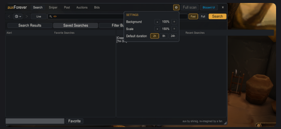

# Player feedback log

Every piece of feedback players give about auxForever is recorded here, one entry per point, so
whoever fixes or builds next (any AI agent or person) can work from it without the original chat.
Started 2026-10-07, on 0.4.1 (the version players have).

## How we read feedback (Tyler, 2026-10-07)

If a player has a problem with auxForever, assume the problem is in the addon, not the player.
Tyler: "If a user downloads our add-on, and they have a problem, it's very likely a problem with
our app and not a problem with them. I'm not going to assume that people are just bad at the
auction house. Our app needs to be so good that they can't help but be good at the auction house
because of the visual clarity we provide, the information we provide, etc."

(Quoted from Tyler's message; it was dictated, and a passage he repeated is given once.)

So:
- "I didn't know you could do X" is a finding about the addon (X is hard to find), not a
  question answered. Record it even when Tyler already explained the feature to the player.
- When a player says they need to get used to something, record what they expected instead.
  That expectation is the design target.
- Never write an entry as "user error". At most, write what the player expected and why the addon
  did not meet it.

One rare exception (Tyler, 2026-10-09, after FB-009): when the player asks for something Forever's
auction house itself does not have, such as Classic stacks, the problem is not the addon's.
auxForever is for intermediate players who know the modern auction house; teaching the auction
house is not its job. Record the entry as usual, set it `wont-fix` with this reason, and give Tyler
a reply he can send the player. The test is narrow: the request must be impossible or meaningless
on Forever's auction house. A screen that is merely confusing still falls under the main rule.

## Credit

When a change comes from a player's feedback, its line in `docs/changelog.md` (which is also the
CurseForge changelog) names the player by in-game name: "(suggested by Darkhorse)" for an idea,
"(reported by Darkhorse)" for a bug. Several players: "(reported by Darkhorse and Hotpocket)". The
entry's "From" field says who to credit. Tyler asked for this on 2026-10-07.

## Rules

For whoever records feedback:

- One entry per distinct point. A message with three complaints becomes three entries that share
  the same source.
- Record what the player said **word for word** under "Said", with spelling as given. Never
  improve, shorten or merge quotes. If Tyler retells it instead of quoting, write "Tyler's
  summary:" before it.
- Keep three things apart and labeled: what the player said, what Tyler added, and what the
  recorder infers (likely cause, code area). An inference is never written as a fact.
- Names: the player's in-game character name (Tyler, 2026-10-07: "In game names are fine they
  are very public"). No real names, Discord account IDs, email addresses or other contact details:
  this repository is public. If a player asks not to be named, replace their name in every entry
  with a label ("Player A") and note the change in the commit message.
- Screenshots (Tyler's choice, 2026-10-07): save one in `docs/feedback/` as `FB-<id>-<n>.png` only
  when the picture itself matters to the fix (a layout problem, an error window). Before saving,
  tell Tyler what is visible in it (chat lines, other players' names, his character, guild, gold)
  and crop out what the fix does not need. Every other screenshot is described in words in the
  entry. BugSack error text goes in the entry in full, in a code block.
- Keep the whole conversation, word for word, as a source file in `docs/feedback/sources/`
  (`<date>-<player>-<channel>.md`), and link it from each entry. Entries quote only the part that
  matters; the source keeps the context.
- Fill in the player under "Players" below the first time they appear.
- No follow-up questions to players (Tyler, 2026-10-07: "We wont get this info we need to work
  without it. I dont want to follow up on feedback."). Record what is not known under "Unknowns"
  and how a fix can work without it. Questions for Tyler are fine ("Ask Tyler").
- IDs are never reused or renumbered. Entries are never deleted; a wrong or duplicate entry gets
  status `duplicate` or `wont-fix` with a reason.
- Add the entry to the index table and commit after every batch, so nothing is lost if a session
  ends.

For whoever fixes or builds from it:

- Read `AGENTS.md` and `docs/status.md` first. An entry's "Proposed" fields are suggestions;
  Tyler decides what goes into which version (`docs/roadmap.md`: a patch version is fixes, speed
  and small things only; new features wait for the next minor version; a bad bug gets a hotfix).
- When you take an entry, set its status to `in-progress` with your branch. When done, set
  `fixed` (or `built`) with the version and commit, and add the in-game check to `TESTING.md`.
  Each bug fix comes with a test that fails without the fix (AGENTS.md).
- Do not wait for more from the player; none will come. Read "Unknowns" and build a fix that
  holds whatever the answer would have been (for example, make every way a post can fail say why,
  instead of finding the one cause), or check it yourself in the code, Blizzard's code, or ask
  Tyler to try it in game. Set `needs-info` only while waiting on Tyler.
- Credit the player in the changelog (see Credit above).

## Fields

| Field | Meaning |
| --- | --- |
| Received | Date Tyler passed it on (and when the player said it, if different). |
| From | Player handle; how many players reported the same thing (update when others repeat it). |
| Where | Discord, in game, CurseForge comment, and so on. |
| Source | Link to the full conversation in `docs/feedback/sources/`. |
| Version | auxForever version the player had, if known. Unknown is written "unknown". |
| Type | `bug` (something works wrong), `request` (something new), `ux` (works, but confusing or awkward), `question`, `praise`. |
| Area | Search, Fast mode, Live, Sniper, Buy bar, Post, Auctions, Bids, Recipe search, Filter Builder, Settings, Window, Performance, Install, Other. |
| Severity | Bugs only. `S1`: spends money wrongly, errors over and over, a tab that does not work, or data lost (hotfix per the roadmap). `S2`: wrong, with a way around it. `S3`: small or cosmetic. |
| Said | The player's words, quoted exactly. |
| Steps / setup | What they did, what they expected, what happened, other addons, error text. Only what was reported. |
| Tyler's notes | Anything Tyler added: whether he can reproduce it, his opinion. |
| Recorder's notes | Inferences, marked as such: likely code area, likely cause, related entries, existing docs that touch it. |
| Unknowns | What the report leaves open, and how a fix can work without it. Players are not asked. |
| Ask Tyler | Open questions for Tyler (what he meant, what he has seen himself). |
| Proposed | Recorder's suggestion: `hotfix`, next patch, next minor (`0.5`), `later`, or `none`. Tyler decides. There will be no 0.4.2 (Tyler, 2026-10-07): fixes and small things wait for 0.5 unless they are bad enough for a hotfix. |
| Status | `new`, `needs-info` (waiting on Tyler), `confirmed` (reproduced), `planned <version>`, `in-progress <branch>`, `fixed <version> <commit>`, `built <version> <commit>`, `wont-fix` (with Tyler's reason), `duplicate of FB-n`. |

## Index

| ID | Received | From | Type | Area | Sev | Summary | Status |
| --- | --- | --- | --- | --- | --- | --- | --- |
| [FB-001](#fb-001-the-other-quantity-box-on-the-buy-bar-does-not-look-like-a-place-to-type) | 2026-10-07 | Darkhorse | ux | Buy bar | n/a | The "Other" quantity box does not look like a place to type | fixed 0.5 6f77958 |
| [FB-002](#fb-002-right-click-an-item-in-the-bags-should-load-it-into-the-post-tab) | 2026-10-07 | Darkhorse | request | Post | n/a | Right-click an item in the bags should load it into the Post tab | built 0.5 140996a |
| [FB-003](#fb-003-clicking-post-sometimes-does-nothing-and-shows-no-error) | 2026-10-07 | Darkhorse | bug | Post | S2 | Clicking Post sometimes does nothing and shows no error | fixed 0.5 7a187c7 |
| [FB-004](#fb-004-the-ui-is-the-biggest-issue-closer-to-the-traditional-auction-house-layout) | 2026-10-07 | Darkhorse | ux | Overall | n/a | The UI is his biggest issue; wants it closer to the traditional auction house | wont-fix (direction; Tyler: follow TSM and aux) |
| [FB-005](#fb-005-praise-the-list-of-sellable-items-on-the-left-of-the-post-tab) | 2026-10-07 | Darkhorse | praise | Post | n/a | Praise: the list of sellable items on the Post tab | new |
| [FB-006](#fb-006-after-resizing-and-changing-the-scale-the-recent-searches-header-sticks-out-of-the-window) | 2026-10-07 | Garsterson | bug | Window | S3 | After resizing and changing the scale, the Recent Searches header sticks out of the window | fixed 0.5 31ac02c |
| [FB-007](#fb-007-crafting-cost-in-the-profession-window-anywhere-in-the-world) | 2026-10-07 | Garsterson | request | Recipe search | n/a | Crafting cost in the profession window, anywhere in the world | built 0.5 5a935e1 |
| [FB-008](#fb-008-chat-command-settings-should-also-be-in-the-settings-menu) | 2026-10-08 | CurseForge player (name not recorded yet) | request | Settings | n/a | Chat command settings should also be in the Settings menu | built 0.6 (released 2026-10-09) |
| [FB-009](#fb-009-post-cloth-in-several-stacks-of-a-chosen-size) | 2026-10-09 | Maggew | request | Post | n/a | Post cloth in several stacks of a chosen size, as in Classic | wont-fix (Forever has no stacks; Tyler: not the addon's job) |
| [FB-010](#fb-010-picking-a-weapon-slot-such-as-daggers-searches-every-weapon-of-that-kind) | 2026-10-11 | GregoryWW | bug | Search | S2 | Picking a weapon slot such as Daggers searches every weapon of that kind | fixed 0.6.1 (released 2026-10-11) |
| [FB-011](#fb-011-clicking-an-items-icon-in-the-post-tabs-list-does-not-select-it) | 2026-10-12 | Gaddor | bug | Post | S3 | Clicking an item's icon in the Post tab's list does not select it | fixed 0.6.1.1 (tested 2026-10-12) |
| [FB-012](#fb-012-a-public-api-so-other-addons-can-read-auxs-prices) | 2026-10-13 | MDHippie | request | Other | n/a | A public API so other addons can read aux's prices | built 0.7 (released 2026-10-13) |
| [FB-013](#fb-013-an-item-level-column-in-the-search-results) | 2026-10-13 | HoaxBox | request | Search | n/a | An item level column in the search results | built 0.7 (released 2026-10-13) |
| [FB-014](#fb-014-a-search-for-tigerstrike-mantle-finds-nothing-auctionator-finds-7) | 2026-10-16 | daland | bug | Search | S2 | A search for Tigerstrike Mantle finds nothing; Auctionator finds 7 | fixed 0.7.1 (released 2026-10-17) |
| [FB-015](#fb-015-the-auctions-tab-does-not-show-all-your-own-auctions) | 2026-10-16 | daland | bug | Auctions | S2 | The Auctions tab does not show all your own auctions | fixed 0.7.1 (released 2026-10-17) |
| [FB-016](#fb-016-cancel-says-cancelled-comes-by-mail-but-the-auction-is-still-listed) | 2026-10-16 | daland | bug | Auctions | S2 | Cancel says "Cancelled, comes by mail" but the auction is still listed | fixed 0.7.1 (released 2026-10-17) |
| [FB-017](#fb-017-the-deposit-aux-shows-is-lower-than-the-1-silver-the-game-charges) | 2026-10-17 | sarrathsilentstrider | bug | Post | S3 | The deposit aux shows is lower than the 1 silver the game charges | not reproduced (aux matched the game in Tyler's test) |
| [FB-018](#fb-018-a-setting-for-whether-the-post-tab-starts-on-match-lowest-or-undercut) | 2026-10-17 | sarrathsilentstrider | request | Settings | n/a | A setting for whether the Post tab starts on Match lowest or Undercut | wont-fix (Tyler: keep as is) |
| [FB-019](#fb-019-praise-everything-is-shte-in-comparison) | 2026-10-17 | sarrathsilentstrider | praise | Overall | n/a | Praise: "everything is SH!TE in comparison" | new |
| [FB-020](#fb-020-find-the-cheapest-way-to-fill-waylaid-crates-and-writs) | 2026-10-17 | Harro22 | request | Search | n/a | Find the cheapest way to fill Waylaid crates and writs | built 0.8 build 2 (crates; writs planned 0.9.1) |
| [FB-021](#fb-021-a-typed-price-below-the-lowest-listing-cannot-be-posted-rough-stone-5c) | 2026-10-18 | sarrathsilentstrider | bug | Post | S2 | A typed price below the lowest listing cannot be posted (Rough Stone, 5c) | fixed 0.7.1.1 (released 2026-10-19) |
| [FB-022](#fb-022-the-player-did-not-know-the-newest-listing-at-a-price-sells-first) | 2026-10-18 | sarrathsilentstrider | ux | Post | n/a | The player did not know the newest listing at a price sells first | new |
| [FB-023](#fb-023-a-shopping-list-for-crafting-n-of-a-recipe) | 2026-10-20 | Kortan | request | Search | n/a | A shopping list for crafting N of a recipe | planned 0.9.1 |
| [FB-024](#fb-024-an-exact-search-for-hillmans-cloak-finds-nothing-a-search-for-hillmans-finds-many) | 2026-11-08 | GregoryWW | bug | Search | S2 | An exact search for Hillman's Cloak finds nothing; a search for Hillman's finds many | fixed 0.8.1 (released 2026-11-09) |
| [FB-025](#fb-025-adding-a-tooltip-word-strength-turns-an-instant-search-into-a-2-minute-one) | 2026-11-08 | RushJet1 | bug | Performance | S2 | Adding a tooltip word (strength) turns an instant search into a 2 minute one | fixed 0.8.2 (released 2026-11-09) |
| [FB-026](#fb-026-show-whether-a-craft-makes-a-profit-or-a-loss) | 2026-11-08 | deep_structure | request | Recipe search | n/a | Show whether a craft makes a profit or a loss | built 0.8.1 (released 2026-11-09) |
| [FB-027](#fb-027-the-full-scan-takes-more-than-5-minutes-since-forever-launched) | 2026-11-08 | user_ayzkr6rhvrlna3ya | bug | Performance | S3 | The full scan takes more than 5 minutes since Forever launched | fixed 0.8.2 (released 2026-11-09) |
| [FB-028](#fb-028-the-sniper-takes-over-30-seconds-from-its-sound-to-the-purchase) | 2026-11-08 | user_ayzkr6rhvrlna3ya | bug | Sniper | S2 | The Sniper takes over 30 seconds from its sound to the purchase | fixed 0.8.2 (released 2026-11-09) |
| [FB-029](#fb-029-price-gear-with-a-random-ending-of-the-eagle-of-the-bear-separately) | 2026-11-08 | user_yt0k9lezehn1ukm993387 | request | Other | n/a | Price gear with a random ending ("of the Eagle", "of the Bear") separately | built 0.8 (released 2026-11-08) |
| [FB-030](#fb-030-how-the--of-historical-value-works-keep-more-price-history) | 2026-11-08 | user_yt0k9lezehn1ukm993387 | question | Other | n/a | How the % of historical value works; keep more price history | new |
| [FB-031](#fb-031-posting-rules-based-on-historical-value-like-tsm) | 2026-11-08 | user_yt0k9lezehn1ukm993387 | request | Post | n/a | Posting rules based on historical value, like TSM | planned 0.9.1 |
| [FB-032](#fb-032-start-a-full-scan-when-the-window-opens-if-the-15-minute-wait-is-over) | 2026-11-08 | Chawitsch | request | Settings | n/a | Start a full scan when the window opens, if the 15 minute wait is over | built 0.9 (released 2026-11-22) |
| [FB-033](#fb-033-tooltip-prices-for-the-whole-stack-not-one-item) | 2026-11-08 | Chawitsch | ux | Other | n/a | Tooltip prices for the whole stack, not one item | wont-fix (Tyler: no Shift instructions in tooltips; Shift already works) |
| [FB-034](#fb-034-opening-aux-moves-blizzards-professions-window-to-the-right) | 2026-11-08 | Chawitsch | bug | Window | S3 | Opening aux moves Blizzard's Professions window to the right | fixed 0.8.1 (released 2026-11-09) |
| [FB-035](#fb-035-a-setting-to-hide-the-usually-price-line-in-tooltips) | 2026-11-09 | deep_structure | request | Settings | n/a | A setting to hide the "usually" price line in tooltips | built 0.8.2 (released 2026-11-09) |
| [FB-036](#fb-036-the-sniper-calls-a-flat-market-a-deal-at-4-of-the-usual-price) | 2026-11-09 | Swiftwren | bug | Sniper | S2 | The Sniper calls a flat market a deal at 4% of the usual price | fixed 0.8.2 (released 2026-11-09) |
| [FB-037](#fb-037-i-cant-scan-today) | 2026-11-09 | deep_structure | bug | Full scan | S2 | "i cant scan today" | fixed 0.8.2 (released 2026-11-09) |
| [FB-038](#fb-038-show-auxs-tooltip-lines-only-while-holding-a-key) | 2026-11-09 | blackmyin | request | Settings | n/a | Show aux's tooltip lines only while holding a key | wont-fix (Tyler: the tooltip line switches cover it) |
| [FB-039](#fb-039-full-scan-not-working-for-a-player-tyler-knows) | 2026-11-09 | a player Tyler knows (name not given) | bug | Full scan | S2 | Full scan "wasnt working" | fixed 0.8.2 (released 2026-11-09) |
| [FB-040](#fb-040-tab-does-not-complete-in-the-search-bar) | 2026-11-11 | Tyler | bug | Search | S3 | Tab does not complete in the search bar | wont-fix (works as built, seen 2026-11-16) |
| [FB-041](#fb-041-a-switch-to-turn-off-the-crate-lines-in-tooltips) | 2026-11-16 | user_tdsvrjvpe8rufw54 | request | Settings | n/a | A switch to turn off the crate lines in tooltips | built 0.8.2.1 (released 2026-11-16) |
| [FB-042](#fb-042-crate-tooltip-full-cost-less-the-quest-reward-favor-and-reputation-per-gold) | 2026-11-16 | user_tdsvrjvpe8rufw54 | request | Other | n/a | Crate tooltip: full cost less the quest reward, favor and reputation per gold | planned 0.9.1 (with FB-059) |
| [FB-043](#fb-043-a-window-listing-every-crate-and-writ-by-favor-and-reputation-per-gold) | 2026-11-16 | user_tdsvrjvpe8rufw54 | request | Other | n/a | A window listing every crate and writ by favor and reputation per gold | new |
| [FB-044](#fb-044-gear-can-be-priced-in-copper-but-aux-rounds-it-to-whole-silver) | 2026-11-16 | sarrathsilentstrider, user_mezgz2zh1g3sbu1v | bug | Post | S2 | Gear can be priced in copper, but aux rounds it to whole silver | fixed 0.8.2.1 (released 2026-11-16) |
| [FB-045](#fb-045-some-gear-endings-of-shadow-protection-of-healing-do-not-show-their-stat-in-search) | 2026-11-16 | karrier_user_slouyac50poxg707 | bug | Search | S3 | Some gear endings (of Shadow Protection, of Healing) do not show their stat in search | fixed 0.8.2.1 (confirmed 2026-11-22) |
| [FB-046](#fb-046-posting-says-the-item-is-on-the-mouse-in-the-mail-or-a-trade-when-it-is-not) | 2026-11-16 | karrier_user_slouyac50poxg707 | bug | Post | S2 | Posting says the item is on the mouse, in the mail or a trade when it is not | fixed 0.8.2.1 (released 2026-11-16) |
| [FB-047](#fb-047-praise-great-addon) | 2026-11-16 | selubangerz | praise | Overall | n/a | Praise: "Great addon" | new |
| [FB-048](#fb-048-players-do-not-like-the-confirm-click-when-buying-trade-goods) | 2026-11-16 | players, through Tyler | ux | Buy bar | n/a | Players do not like the Confirm click when buying trade goods | built 0.8.2.1 (released 2026-11-16) |
| [FB-049](#fb-049-confirm-before-buying-back-as-an-option) | 2026-11-17 | Tremulent | request | Buy bar | n/a | Confirm before buying, back as an option | built 0.8.2.2 (released 2026-11-20) |
| [FB-050](#fb-050-one-click-bought-far-more-than-the-player-needed) | 2026-11-17 | Tremulent | bug | Buy bar | S1 | One click bought far more than the player needed | fixed 0.8.2.2 (released 2026-11-20) |
| [FB-051](#fb-051-sometimes-a-purchase-happens-twice) | 2026-11-17 | Tremulent | bug | Buy bar | S1 | Sometimes a purchase happens twice | fixed 0.8.2.2 (released 2026-11-20) |
| [FB-052](#fb-052-aux-post-bid-on-turns-bid-prices-off) | 2026-11-17 | joker2206 | bug | Settings | S3 | `/aux post bid on` turns bid prices off | fixed 0.8.2.2 (released 2026-11-20) |
| [FB-053](#fb-053-a-controller-button-to-refresh-or-search) | 2026-11-17 | user_q6cn8g517mpcvp2f | request | Other | n/a | A controller button to refresh or search | new |
| [FB-054](#fb-054-bag-searching-cannot-sort-by-bag-slots) | 2026-11-17 | jebbush | request | Post | n/a | Bag searching: cannot sort by bag slots | new |
| [FB-055](#fb-055-too-slow-to-keep-up-with-quickly-changing-prices-and-snipe-undercuts) | 2026-11-17 | khorrs; Tyler | ux | Sniper | n/a | Too slow to keep up with quickly changing prices and snipe undercuts | built 0.8.2.2 + Narrower Sniper 0.9 (released 2026-11-22) |
| [FB-056](#fb-056-many-lua-errors-warning-during-a-dungeon-possibly-on-conjured-water) | 2026-11-20 | user_kc0ds7pqedmptpep | bug | Other | S1 | Many Lua errors warning during a dungeon, possibly when conjured water was created | fixed 0.9 (released 2026-11-22) |
| [FB-057](#fb-057-settings-interface-accessible-outside-the-auction-house-options--addons) | 2026-11-20 | LLanwrst, jebbush | request | Settings | n/a | Settings interface accessible outside the auction house (Options > AddOns) | built 0.9 (released 2026-11-22) |
| [FB-058](#fb-058-toggle-to-show-tooltip-prices-for-the-whole-stack-by-default) | 2026-11-20 | jebbush | request | Settings | n/a | Toggle to show tooltip prices for the whole stack by default (flipping Shift) | built 0.9 (released 2026-11-22) |
| [FB-059](#fb-059-show-how-much-merchants-favor-a-waylaid-crate-offers) | 2026-11-20 | sarrathsilentstrider | request | Other | n/a | Show how much Merchant's Favor a Waylaid Crate offers in its tooltip | planned 0.9.1 (with FB-042; mockup first) |
| [FB-060](#fb-060-show-best-items-to-farm-like-goldscout) | 2026-11-20 | XtreamCoder | request | Other | n/a | Show best items to farm, like GoldScout | wont-fix (not in auxForever; potential separate optional-dependency addon later) |
| [FB-061](#fb-061-toggle-to-hide-the-materials-and-profit-line-in-the-professions-window) | 2026-11-20 | LLanwrst | request | Recipe search | n/a | Toggle to hide the Materials and profit line in the Professions window | built 0.9 (released 2026-11-22) |
| [FB-062](#fb-062-option-for-right-clicking-a-bag-item-to-always-open-the-post-tab) | 2026-11-20 | rokstar8872, deep_structure, bubbledn42 | request | Post | n/a | Option for right-clicking a bag item to always open the Post tab (like default AH) | built 0.9 (released 2026-11-22) |
| [FB-063](#fb-063-keybinds-for-buying-confirming-and-declining) | 2026-11-20 | khorrs | request | Buy bar | n/a | Keybinds for buying, confirming and declining | built 0.9 (released 2026-11-22) |
| [FB-064](#fb-064-tooltip-word-search-ignores-stats-on-generic-green-random-suffix-gear) | 2026-11-22 | RushJet1 | bug | Search | S2 | Tooltip-word search ignores stats on generic green random-suffix gear ("of the Channeler") | fixed 0.9 (released 2026-11-22) |
| [FB-065](#fb-065-sniper-stopped-showing-deals-even-after-changing-thresholds) | 2026-11-22 | marcus4555 | bug | Sniper | S1 | Sniper stopped showing deals even after changing thresholds | new |
| [FB-066](#fb-066-setting-to-pick-default-buy-quantity-1-vs-full-stack) | 2026-11-22 | user_ivpyccljovcjne72 | request | Buy bar | n/a | Setting to pick default buy quantity (1 vs full stack) | built 0.9 (released 2026-11-22) |
| [FB-067](#fb-067-posting-2-gear-items-lists-both-but-aux-reports-posted-1-of-2-and-leaves-1-in-the-post-tab) | 2026-11-23 | Tyler | bug | Post | S2 | Posting 2+ gear items lists all of them but aux reports "Posted (N-1) of N" and leaves 1 in the Post tab | fixed 0.9.0.1 (released 2026-11-23) |

## Players

Who gives feedback, so a reader can weigh it. Add a player the first time they appear.

- **Darkhorse**: was in Tyler's guild. Thousands of hours in all versions of WoW; he and Hotpocket
  "are always the richest people in the game because they know how to use the auction house"
  (Tyler, 2026-10-07). Used to the traditional auction house, Auctionator and the retail auction
  house (his own words). Tyler: "a high value feedback provider". Asked for recipe search before
  0.4. Inference: his expectations are likely shared by many experienced players.
- **Hotpocket**: was in Tyler's guild; one of the two richest players Tyler knows, for the same
  reason (Tyler, 2026-10-07). Knows the retail "search every ingredient" feature
  (`docs/roadmap.md`, 0.4). Asked for recipe search before 0.4. Spelling of the in-game name not
  yet confirmed (Tyler wrote "Hot Pocket").
- **Maggew**: CurseForge commenter (CurseForge name; in-game name unknown). Plays with Classic
  auction house habits (FB-009). Whether they also wrote the
  CurseForge comment behind FB-008 is not known.
- **GregoryWW**: CurseForge commenter (CurseForge name; in-game name unknown). Reported FB-010
  and FB-024.
- **Gaddor**: CurseForge commenter (CurseForge name; in-game name unknown). Reported FB-011.
- **MDHippie**: CurseForge commenter (CurseForge name; in-game name unknown). Asked for FB-012.
  Names `history.latest`, so has read aux's code. Inference: writes addons or scripts of their own.
- **HoaxBox**: CurseForge commenter (CurseForge name; in-game name unknown). Asked for FB-013;
  opened with "awesome addon".
- **daland**: CurseForge commenter (CurseForge name; in-game name unknown). Reported FB-014, FB-015
  and FB-016 in three comments the same day. Also uses Auctionator and compares aux with it.
- **sarrathsilentstrider**: CurseForge commenter (CurseForge name; in-game name unknown).
  Reported FB-017, asked for FB-018, praised in FB-019, reported FB-021, FB-022 and FB-044, asked
  for FB-059. Plays in the Classic theme.
- **Kortan**: told Tyler directly (Tyler's retelling, not his own words). Asked for FB-023. Knows
  TSM well, including its alt inventory data. Spelling of the in-game name not yet confirmed.
- **Harro22**: CurseForge commenter (CurseForge name; in-game name unknown). Asked for FB-020.
- **RushJet1**: CurseForge commenter (CurseForge name; in-game name unknown). Reported FB-025 and
  FB-064. Writes search text by hand (`armor/mail/chest/usable/strength`,
  `armor/miscellaneous/finger/spell`).
- **deep_structure**: CurseForge commenter (CurseForge name; in-game name unknown). Asked for
  FB-026 and FB-035, reported FB-037, seconded FB-062. Uses the Sniper and crafts.
- **blackmyin**: CurseForge commenter (CurseForge name; in-game name unknown). Asked for FB-038.
- **Swiftwren**: CurseForge commenter (CurseForge name; in-game name unknown). Reported FB-036
  (two comments, the second with an example: Invoker's Cord). Uses the Sniper, buys deals and
  relists them (flipping); Full scans daily.
- **user_ayzkr6rhvrlna3ya**: CurseForge commenter (a name CurseForge generated; in-game name
  unknown). Reported FB-027 and FB-028. Used aux for a couple of weeks before Forever launched.
  Uses the Sniper.
- **user_yt0k9lezehn1ukm993387**: CurseForge commenter (a name CurseForge generated; in-game name
  unknown). Asked for FB-029, FB-030 and FB-031. Used aux for the whole beta ("made lots of
  gold") and knows TSM's posting rules.
- **Chawitsch**: CurseForge commenter (CurseForge name; in-game name unknown). Asked for FB-032
  and FB-033, reported FB-034. Agreed to FB-032 as an option, off by default.
- **user_tdsvrjvpe8rufw54**: CurseForge commenter (a name CurseForge generated; in-game name
  unknown). Asked for FB-041, FB-042 and FB-043. Uses Waylaid Crates and writs, and other addons
  made for them.
- **user_mezgz2zh1g3sbu1v**: CurseForge commenter (a name CurseForge generated; in-game name
  unknown). Reported FB-044 with a code suggestion; has read aux's pricing code.
- **karrier_user_slouyac50poxg707**: CurseForge commenter (CurseForge name; in-game name unknown).
  Reported FB-045 and FB-046. Uses Bagnon.
- **selubangerz**: CurseForge commenter (CurseForge name; in-game name unknown). Praise (FB-047).
- **Tremulent**: CurseForge commenter (CurseForge name; in-game name unknown). Reported FB-050
  and FB-051 and asked for FB-049, in one comment on 0.8.2.1. Buys trade goods with the buy bar.
- **joker2206**: CurseForge commenter (CurseForge name; in-game name unknown). Reported FB-052;
  opened with "love the addon". Uses the chat commands.
- **user_q6cn8g517mpcvp2f**: CurseForge commenter (a name CurseForge generated; in-game name
  unknown). Asked for FB-053. Plays with a controller.
- **jebbush**: CurseForge commenter (CurseForge name; in-game name unknown). Asked for FB-054,
  FB-057 and FB-058.
- **khorrs**: CurseForge commenter (CurseForge name; in-game name unknown). Reported FB-055 (a
  reply under Tremulent's comment) and asked for FB-063. Used aux before Forever to snipe undercuts.
- **user_kc0ds7pqedmptpep**: CurseForge commenter (a name CurseForge generated; in-game name
  unknown). Reported FB-056.
- **XtreamCoder**: CurseForge commenter (CurseForge name; in-game name unknown). Asked for FB-060.
  Also uses GoldScout.
- **LLanwrst**: CurseForge commenter (CurseForge name; in-game name unknown). New player to WoW;
  praised tooltip-text logic search, asked for FB-057 and FB-061. Uses other profession addons.
- **rokstar8872**: CurseForge commenter (CurseForge name; in-game name unknown). Asked for FB-062.
- **bubbledn42**: CurseForge commenter (CurseForge name; in-game name unknown). Asked for FB-062
  (specifically from the Auctions tab).
- **marcus4555**: CurseForge commenter (CurseForge name; in-game name unknown). Reported FB-065.
  Heavy Sniper user (326 ignored items).
- **user_ivpyccljovcjne72**: CurseForge commenter (a name CurseForge generated; in-game name
  unknown). Asked for FB-066; closed with "Great addon."
- **Garsterson**: Tyler's brother. Found the gear posting error fixed in 0.1.1 (earlier docs call
  him "Tyler's brother"). His feedback so far reaches the log as Tyler's retelling, not his own
  words.

## Entries

Template (copy for each new entry, newest at the bottom):

```
### FB-001: <one-line summary in plain words>

- Received: 2026-10-07
- From: <handle> (1 report)
- Where: <channel>
- Source: <link to docs/feedback/sources/...>
- Version: <forever-0.4.1 | unknown>
- Type: <bug | request | ux | question | praise>
- Area: <area>
- Severity: <S1 | S2 | S3 | n/a>
- Status: new
- Proposed: <hotfix | 0.5 | later | none>

Said:
> exact words

Steps / setup:

Tyler's notes:

Recorder's notes:

Unknowns:

Ask Tyler:
```

### FB-001: The "Other" quantity box on the buy bar does not look like a place to type

- Received: 2026-10-07
- From: Darkhorse (1 report)
- Where: Discord, direct message to Tyler
- Source: [source](feedback/sources/2026-10-07-darkhorse-discord.md)
- Version: unknown (0.4.1 was released 2026-10-05)
- Type: ux
- Area: Buy bar
- Severity: n/a
- Status: fixed 0.5 6f77958 (mockup option B, approved by Tyler 2026-10-07: the box is labeled QUANTITY and always shows the number being bought). In-game check: TESTING.md, 0.5 build 1, steps 17 to 19
- Proposed: 0.5 (no 0.4.2, Tyler 2026-10-07; a visual change, so mockup first)

Said:
> is there a way to select the number of something you want to buy? or am i locked in to like 1 or
> 5 or 20

> bc now that forever is using some of the retail AH features i don't think you are locked into
> buying stacks anymore

Steps / setup: buying a trade good (a commodity) from the Search tab. He saw the quantity buttons
(1, 5, 20) and did not find a way to type another number.

Tyler's notes: "I knew that Other button sucked", "It's says Other to the right of 20 but it's
not obvious that it's a text field", "Now that I hear you say it I will make that way more
obvious".

Recorder's notes:
- Fact (code): the box exists. For commodities the buy bar shows four quantity buttons sized to
  the item's stack (`quantities` in `auxForever/gui/buy_bar.lua`: 1, the two largest of 5, 10, 20,
  50, 100, 200, 500 below the stack size, and the stack size), then `other_input`: a 56 wide
  numeric edit box whose empty text shows the word "Other" in gray (`other_input.formatter`).
  Typing a number and pressing Enter buys that many (`other_input.enter`).
- Inference: a gray word in a box styled like the buttons next to it reads as a fifth button, not a
  text field. Nothing shows it takes typing until it is clicked.
- Inference: his second sentence is right: Forever sells commodities by unit, so any quantity can
  be bought. Retail's auction house and Auctionator show a plain number box for this, which is what
  he expects.
- Gear is bought one auction at a time; this entry is about commodities only.

Unknowns: which item he was buying, so which four buttons he saw. Does not matter for the fix:
the box looks the same for every item.

Ask Tyler: nothing.

### FB-002: Right-click an item in the bags should load it into the Post tab

- Received: 2026-10-07
- From: Darkhorse (1 report)
- Where: Discord, direct message to Tyler
- Source: [source](feedback/sources/2026-10-07-darkhorse-discord.md)
- Version: unknown
- Type: request (Darkhorse expected it to work; see Tyler's notes on a possible bug)
- Area: Post
- Severity: n/a
- Status: built 0.5 140996a (right-click a bag item follows Blizzard's AuctionHouseFrame:SetPostItem into aux; see docs/clicks.md, Built in 0.5). In-game check: TESTING.md, 0.5 build 1, steps 11 to 13
- Proposed: 0.5 (no 0.4.2, Tyler 2026-10-07)

Said:
> also, being able to right click something in your bags when you're on the sell tab would be
> great since it's something we are all used to

> yea I jsut need to train my eyes to look there instead of my bags

(Tyler asked: "You think it should just be a right click from the bag to populate the post
field?")
> yea since that's how it works normally

(Tyler asked whether right-clicking a bag item on the post screen locked the addon up.)
> i dont remember it doing that. jsut nothing happened

Steps / setup: on the Post tab ("sell tab" in his words), right-clicked an item in his bags.
Expected: the item is loaded for posting, as in Blizzard's auction house and Auctionator.
Got: nothing happened.

Tyler's notes: told him it is Shift-click from the bag on the Post tab. "I want people to easily
be able to do both". Agreed to make right-click work: "I can make that happen", "That's added to
the list". Also: "I think there is a bug in this section though" (see Ask Tyler).

Recorder's notes:
- Fact (code): `auxForever/core/shortcut.lua` hooks `HandleModifiedItemClick` and passes Shift-click
  (only with no chat box open) and Alt-click to the current tab's `USE_ITEM`; the Post tab selects
  the item (`tab.USE_ITEM` in `auxForever/tabs/post/core.lua`). A plain right-click is not handled.
- Fact (code): aux keeps Blizzard's `AuctionHouseFrame` shown but shrunk to 1% and invisible while
  the auction house is open (`set_blizzard_frame_shown` in `auxForever/aux-addon.lua`), because
  hiding it closes the auction house.
- Inference, unverified: in the modern client a right-click on a bag item with the auction house
  open is handled by Blizzard's bag code and goes to Blizzard's own Sell tab. If so, the item may
  have been put into the invisible Blizzard window, which would match "nothing happened" and could
  be the bug Tyler suspects. Check Blizzard's Forever bag code (`ContainerFrame` item button click)
  before building.
- "train my eyes to look there instead of my bags" and Tyler's "I want people to easily be able to
  do both": the bag list on the Post tab is liked (FB-005), and the bags are where his habit
  starts. Both should work.
- Tyler widened this into a review of every click in the addon (2026-10-07): `docs/clicks.md`. Build
  this entry as part of that standard.
- Vocabulary: he calls it the "sell tab" (Blizzard's and Auctionator's name); aux calls it "Post".
  Recorder's reading of Tyler's decision in FB-004 (follow TSM and the original aux): keep "Post".

Unknowns: none that block a fix.

Ask Tyler: what bug do you suspect in this section, and have you seen the addon lock up after a
right-click on a bag item yourself? Steps if so.

Answer (Tyler, 2026-10-07): he does not remember what the bug was. Found while building 0.5: the
right-click went into Blizzard's hidden Sell tab (docs/clicks.md, Built in 0.5); that is the most
likely candidate, not confirmed.

### FB-003: Clicking Post sometimes does nothing and shows no error

- Received: 2026-10-07
- From: Darkhorse (1 report, happened once)
- Where: Discord, direct message to Tyler
- Source: [source](feedback/sources/2026-10-07-darkhorse-discord.md)
- Version: unknown
- Type: bug
- Area: Post
- Severity: S2 (nothing lost; the player is left not knowing why)
- Status: fixed 0.5 7a187c7 (every way a post ends says what happened; a faded Post button says why). In-game check: TESTING.md, 0.5 build 1, steps 5 to 8
- Proposed: 0.5 (no 0.4.2, Tyler 2026-10-07; the silent part: always say why a post did not happen)

Said:
> also one time i tried posting an item and just nothing happened when i clicked post. I forget if
> it was gear that needed to be repaired or something but no error message came up

> i should have investigated more

Steps / setup: clicked Post on the Post tab. Nothing was posted and no message appeared. He does
not remember the item; possibly damaged gear. Happened once.

Tyler's notes: "Okay perfect all of these messages are invaluable and will probably lead to a big
fix. The post tab needs the most work imo". To "i should have investigated more": "It's all good I
think this is more than enough".

Recorder's notes (code facts with locations; the cause in his case is not known):
- `post_auction` in `auxForever/tabs/post/core.lua` can end without a word in three ways: (1)
  `find_item_location` finds no bag slot with the item that is auctionable and not locked, and the
  function returns at once; (2) `C_AuctionHouse.PostItem` or `PostCommodity` returns false and
  only `pending_post` is cleared; (3) the wait loop gives up after 5 seconds (60 with a
  confirmation dialog open) and clears the state.
- Which items are listed: `container_item` in `auxForever/util/info.lua` first requires full
  durability, then, while the auction house is open, replaces that answer with
  `C_AuctionHouse.IsSellItemValid`. So whether damaged gear can appear in the list depends on what
  the game answers; not verified on Forever.
- Inference, unverified: if the game refuses damaged gear, it shows its own red error text at the
  top of the screen; whether Forever does, and whether he would have noticed it, is unknown.
- Whatever the cause, each of the three paths above can tell the player why (for example "This
  item must be repaired first", "Item not found in your bags"). That fix does not need the cause.

Unknowns (no follow-up with the player): the item, whether it was damaged, whether the game showed
red text, and whether an error happened inside the addon (he may not have BugSack). Work without
them: give each of the three silent paths above its own message, and check damaged gear in the
code or ask Tyler to try it (Ask Tyler).

Ask Tyler: can you try posting a damaged piece of gear on Forever and say what happens (listed in
the Post tab or not; what Post does; any red text)?

### FB-004: The UI is the biggest issue; closer to the traditional auction house layout

- Received: 2026-10-07
- From: Darkhorse (1 report)
- Where: Discord, direct message to Tyler
- Source: [source](feedback/sources/2026-10-07-darkhorse-discord.md)
- Version: unknown
- Type: ux
- Area: Overall (every tab)
- Severity: n/a
- Status: wont-fix for the direction he asked for (Tyler, 2026-10-07, see below). That the UI is
  too confusing stands, and is the redesign's job.
- Proposed: 0.5 (Tyler's planned redesign; see Tyler's notes)

Said:
> yea the UI is my biggest issue rn

> but that's bc i'm so used to the traditional UI and auctionator / retail AH

> i will stick with and keep trying for sure

> but yea I think working on the UI so that there is less of a dramatic change from the
> traditional UI is a great move. I know that's a ton of work though

Steps / setup: general impression, not one screen. His references: "the traditional UI",
Auctionator, the retail auction house.

Tyler's notes: "Me and my UI designer buddy are working on a massive .5-.6 update". "Agree" (that
the UI is the biggest issue). "My buddy has like a whole design concept laid out. I'll show you
some prototypes soon." "It's still going to be quite transformative, it's geared toward TSM users"
"But it will be more visually simple" "It's too confusing rn". Also told him: "No hard feelings if
you switch back. Everytime I make a big update I'll let you know".

Recorder's notes:
- He blames his habits ("that's bc i'm so used to..."). Under Tyler's rule (How we read feedback,
  above) this is a finding about the addon: an expert auction house player finds it confusing.
- Darkhorse said he will keep using it; Tyler promised to tell him at each big update.

Decision (Tyler, 2026-10-07), on Darkhorse's request for less change from the traditional UI:
"This one I outright reject. This should much more closely resemble TSM and the original aux like
it already does." So the redesign follows TSM and Simon's aux, not Blizzard's auction house or
Auctionator. What is kept from this entry: the UI is too confusing today (Tyler agreed: "It's too
confusing rn") and should be "more visually simple". Darkhorse's smaller, concrete points are
separate entries and are not rejected: FB-001 (typed quantity), FB-002 (right-click from the bags,
which Tyler agreed to), FB-005 (keep the bag list).

Unknowns: which screens confuse him most. Not asked (no follow-up with players); the redesign
works from Tyler's and the designer's judgment.

Ask Tyler: who is the UI designer (a name or handle for the docs), how their designs will reach
the repository (images, a mockup page, Figma), and whether the redesign is 0.5, 0.6 or spans both.

### FB-005: Praise: the list of sellable items on the left of the Post tab

- Received: 2026-10-07
- From: Darkhorse (1 report)
- Where: Discord, direct message to Tyler
- Source: [source](feedback/sources/2026-10-07-darkhorse-discord.md)
- Version: unknown
- Type: praise
- Area: Post
- Severity: n/a
- Status: new
- Proposed: none (keep it through the redesign)

Said:
> i do love the list of sellable stuff ont he left too though

Tyler's notes: "Yeah that one I don't take credit for it was an original feature that I love" (it
comes from Simon's aux).

Recorder's notes: the redesign (FB-004) should keep a list of sellable bag items on the Post tab,
alongside right-click from the bags (FB-002).

Unknowns: none.

Ask Tyler: nothing.

### FB-006: After resizing and changing the scale, the Recent Searches header sticks out of the window

- Received: 2026-10-07
- From: Garsterson (1 report)
- Where: told to Tyler; Tyler retold it
- Source: [source](feedback/sources/2026-10-07-garsterson-via-tyler.md)
- Version: unknown (the Scale setting exists since 0.2.1)
- Type: bug
- Area: Window (seen on Search, Saved Searches)
- Severity: S3 (looks broken; nothing lost)
- Status: fixed 0.5 31ac02c (tables lay out again when shown and when resized; the last column is anchored to the right edge). In-game check: TESTING.md, 0.5 build 1, steps 9 and 10
- Proposed: 0.5

Said (Tyler's summary):
> He had the issue in the screenshot when he, at 100% scale, made the window large, then raised
> the scale to 140%, I think. Then when he shrunk the window, after doing that, he was able to get
> an element to bleed off of the add-on itself, the window of the add-on itself.

Steps / setup (as told; Tyler is not sure of the exact scale):
1. Settings, Scale at 100%. Make the aux window large with the resize corner.
2. Raise Scale to about 140% (the screenshot shows 150%).
3. Shrink the window with the resize corner.
4. Something sticks out past the window's edge.

Screenshot (cropped, added with Tyler's OK): 

What it shows: Search tab, Saved Searches sub tab, the
settings menu open (Background 100%, Scale 150%, Default duration 2h). The window's right edge is
at the close button, but the gray header bar of the "Recent Searches" list runs on past it, about a
fifth of the window's width further, over the game world. The list's two rows ("[Copp...",
"[Tin O...") are cut off by the settings menu, not by the bug. The "Favorite Searches" list on the
left looks right.

Tyler's notes: none beyond the steps.

Recorder's notes:
- Fact (code): the two lists split the Saved Searches area in half by anchors
  (`frame.saved.favorite`, `frame.saved.recent` in `auxForever/tabs/search/frame.lua`), so the
  panels follow the window. Their column headers do not: `gui/listing.lua` sets each header and
  cell to a fixed width (`col:SetWidth(colInfo.width * width)`, with `width` read from
  `contentFrame:GetRight() - GetLeft()`), recalculated only in `Update`, which runs from the
  table's `OnSizeChanged`.
- Inference, unverified: the header kept a width computed for the larger window. Either
  `OnSizeChanged` did not fire for this table when the window shrank (the Saved Searches sub tab
  may have been hidden at the time, or a scale change does not count as a size change), or
  `GetRight`/`GetLeft` gave values from before the change. Why only the right list is affected is
  not known.
- Other tables built on `gui/listing.lua` may do the same: the Post tab's bid and buyout lists
  (`tabs/post/frame.lua`). The search, Sniper, Auctions and Bids tables use
  `gui/auction_listing.lua`, which resizes differently (`fit_rows`); check them too.
- Related, fixed in 0.4.1: the resize corner made the window jump (`frame.lua`, aux's own sizing).

Unknowns: the exact scale and whether the Saved Searches sub tab was open while resizing. A fix
should hold for any order of resize, scale change and sub tab switch: for example recalculate the
column widths when the table is shown and after the scale changes, or size columns by anchors
instead of fixed widths.

Ask Tyler: nothing; the steps are enough to try.

### FB-007: Crafting cost in the profession window, anywhere in the world

- Received: 2026-10-07
- From: Garsterson (1 report)
- Where: told to Tyler; Tyler retold it
- Source: [source](feedback/sources/2026-10-07-garsterson-via-tyler.md)
- Version: unknown
- Type: request
- Area: Recipe search (profession window)
- Severity: n/a
- Status: built 0.5 5a935e1 (mockup approved by Tyler 2026-10-07). In-game check: TESTING.md, 0.5 build 1, steps 20 to 23
- Proposed: 0.5 (a new feature; the roadmap keeps those out of patch versions)

Said (Tyler's summary):
> He wants there to be a tooltip in a sorry, in the professions menu. If you are out in the world
> and you open up a recipe, you should be able to generate within the profession tab on that recipe
> the price of crafting and the profit based on full scan data. If we're getting all this f- full
> scan data, then we should be using it for things like this.

> So one of his requests is having the total cost of crafting, if you were to purchase it based on
> full scan data anywhere in the world, not necessarily just at the auction house, if that's
> possible.

What is asked: open a recipe in the profession window anywhere (not only at the auction house) and
see what its materials would cost to buy, from prices aux already saved. Garsterson asked for cost
and profit.

Tyler's notes (scope): "Come to think of it, maybe not profit, maybe just cost of crafting based on
the last full scan data. I don't think we need to bloat the user with information when we could
just give them only what they need. We don't want to suffer from feature creep too much." So the
request as Tyler shapes it: **cost only, no profit** (reversed 2026-11-08 by Tyler for FB-026: profit
goes on the line in 0.8.1). Tyler first said "tooltip", then "in the
professions menu"; where exactly it shows is open (see Ask Tyler).

Recorder's notes:
- Fact (git history): Simon's aux had this for Classic: `core/crafting.lua` added "(Total Cost:
  ...)" to Classic's profession window, each material at its vendor price if a vendor sells it
  without limit, else its usual price (`history.value`); "?" when any material had no price. It
  hooked Classic's frames only, did nothing on Forever, and was removed in 0.4.1 (commit 14eda02,
  "recipe search does this job"). This request brings that idea back for Forever's profession
  window. The removed file is the reference: `git show 14eda02^:auxForever/core/crafting.lua`.
- Fact (code): the 0.4 recipe cost line (`recipe_costs` in `auxForever/tabs/search/recipe.lua`)
  works only after a recipe search at the auction house: it prices materials from that search's
  live auctions or the vendor price. Reading a recipe's materials anywhere works the same way
  (`recipe_parts`, `C_TradeSkillUI.GetRecipeSchematic`).
- Fact (code): aux does not keep "the last full scan" as such. Every scan (full scan, searches,
  Sniper) feeds price history (`auxForever/core/history.lua`): per item, today's lowest buyout seen
  (`market_value`) and up to 11 past daily lows, from which the usual price (`value`) is a weighted
  median. History is saved, so it is there away from the auction house. Vendor prices aux has seen
  are saved too (`info.merchant_buy_info`).
- Inference: "based on full scan data" therefore had to mean one of: the usual price (steady, what
  Simon used), today's lowest, or a new store of the last full scan's prices. Tyler chose the usual
  price (Decisions below). How aux stores prices: `docs/price-data.md`.
- Performance (AGENTS.md): compute the cost only when a recipe is selected, not per frame, and use
  the history cache (`value_and_days`), not unpacking per material.

Unknowns: none that block it; Tyler's decisions below settle the open points.

Decisions (Tyler, 2026-10-07, answering the questions this entry asked him):
1. Where: "A line in the detail panel of the recipe" (as Simon's aux did; not a tooltip).
2. Which price: "usual price. We need to make sure we are communicating this in a low-profile and
   clean way."
3. A material with no price: Tyler left it to Claude: "My general philosophy is to convey as much
   info as we can with as little screen space as we can. [...] My gut says I would like to show
   them at least an idea of how much it will cost. If we somehow are able to convey that one of the
   items is missing price data graphically, isnt it implied that the calculation would be missing
   that amount? [...] Nothing is permanent, we can edit later."

Design (Claude's decision on point 3, with the rest filled in; build from this, mockup first):
- One line in the recipe's detail panel, small text in the label color, for example
  `Materials  1g 24s`. It is the cost of one craft: each material at its vendor price if a vendor
  sells it without limit and that is cheaper, else its usual price (`history.value`), times the
  amount the recipe needs.
- Some materials without a price: show the sum of the priced ones followed by a gray `+`
  (`Materials  1g 24s+`). The `+` says "at least this much", which is what Tyler's gut asked for:
  an idea of the cost, with the gap visible but taking no space.
- No material priced: `Materials  no price yet` in gray. All priced: no marker.
- Hovering the line shows a tooltip: one row per material (name, amount, cost, and where the price
  comes from: "vendor" or "usual, N days"), missing ones as "no price yet", and a first line
  "Usual prices from aux's price history". This is where the price basis is explained, so the line
  itself stays clean (Tyler's "low-profile").
- Not done: marking the material's own icon in Blizzard's reagent list. It would show which one is
  missing at a glance, but it means hooking Blizzard's reagent buttons, which change between game
  versions. The tooltip names it instead. Revisit if players miss it.
- Works anywhere the profession window opens; no auction house needed. Computed when a recipe is
  selected, never per frame (AGENTS.md, Performance).
- How good the number is depends on how the usual price is worked out; see `docs/price-data.md`,
  "Is it the best way?" (one cheap auction can set a day's price; the cheapest unit understates the
  cost of buying many).

### FB-008: Chat command settings should also be in the Settings menu

- Received: 2026-10-08
- From: a player commenting on CurseForge (1 report). In-game name not recorded yet.
- Where: CurseForge comment
- Source: not saved; only Tyler's retelling below. The comment's exact words are not in the
  repository.
- Version: unknown (likely forever-0.5, the version on CurseForge)
- Type: request
- Area: Settings
- Severity: n/a
- Status: built 0.6 (released 2026-10-09). Built in 0.6 build 3: a two-column Settings
  menu with switches for the seven `/aux tooltip ...` lines, from a mockup Tyler approved
  (2026-10-08). Tooltip switches tested in game (build 4, pass). A Bid prices choice was added in
  build 3 and removed in build 4 (Tyler, see below). Left as chat only: ignore owner, action
  shortcuts, debug, post bid.
- Proposed: 0.6

Said: not available. Tyler's summary: "a user on CurseForge talked about how some of the chat
commands should be built into the settings."

Tyler's notes: "I pushed back a little bit on that saying like aux debug and like aux price are not
commands I would want in the settings menu, but I'm sure there's some in there that are like
effectively toggles and they could be added in addition to being a CLI command or a chat command,
they could also be in the settings menu. If any of the choices are obvious, then just go ahead and
build those in. And then if any aren't obvious, just ask me." (2026-10-08)

Recorder's notes (the building session):
- Built as obvious: the tooltip lines (Value, Today, Vendor sell price, Vendor buy price,
  Disenchant value, Disenchants into, Coin icons). Plain on/off, per character like the chat
  commands, which keep working.
- Already in Settings before: Background (`/aux opacity`), Scale (`/aux scale`), Default duration
  (`/aux post duration`). Undercut mode is on the Post tab.
- Left out on purpose: `debug`, `debug list`, `memory`, `price` (tools, not settings; Tyler).
- Not obvious, asked: `action shortcuts` (Alt-click buys or cancels at once), `ignore owner`
  (scanning speed against seller names), `post full scan`, `post bid` (three choices), `clear item
  cache`, `clear post` (actions that delete data).

Unknowns: which commands the player had in mind. Built so it holds either way: every plain on/off
the player would meet in tooltips is now in the menu.

Tyler's notes, 2026-10-08 (on build 2): "this picture is not what I envisioned at all for the
settings menu" ... "I envision toggles, not checkboxes" ... "What it seems that you've built is
something only pertaining to tooltips?" On the Alt-click shortcuts: "Isnt this dangerous cause they
could buy a stack of 1000 on accident?" (they buy gear in one click and a stack in two, so they stay
chat only). On the mockup (https://claude.ai/artifact/21FjqFGt2vzbVo9BDG5d6j): "I actually really
like what you made here in the mock-up" ... "I love this layout."

Tyler's notes, build 4 test (2026-10-08): "Tooltip stuff is good. Bid row setting is probably
broken, but im not sure how its supposed to work. With this bid price option, does the stack option
even make any sense?" Recorder: on Forever only items (gear) can have bids, trade goods cannot, and
an item auction holds one item, so "per stack" means the same as "per item" or nothing; Tyler's
screenshots show every Auction Bid as "---". The setting did not earn a place in the menu and was
removed; this was the recorder's own wrong recommendation, not Tyler's or the player's.

Ask Tyler: the player's in-game name (for the changelog credit) and, if he has it, the comment's
exact words.
### FB-009: Post cloth in several stacks of a chosen size

- Received: 2026-10-09 (said about an hour before Tyler's screenshot)
- From: Maggew (1 report)
- Where: CurseForge comment on the auxForever project page
- Source: [source](feedback/sources/2026-10-09-maggew-curseforge.md)
- Version: unknown
- Type: request
- Area: Post
- Severity: n/a
- Status: wont-fix (Tyler, 2026-10-09: Forever's auction house has no stacks, and teaching the
  modern auction house is not the addon's job; see "How we read feedback", the exception)
- Proposed: none

Said:
> Please make it so that I can sell multiple stacks. So for example, I have a hundred linen cloth.
> I want to sell them in stacks of five. Right now, it makes me redo it over and over and over...
> Maybe I'm able to do it, but because I don't have enough money, it wasn't able to show me I could
> do it??

> It just seemed a little odd because sometimes I like to make multiple post-stacks in different
> quantities, like five, four, ten. That way you can totally capitalize and dominate the market

Steps / setup: wants to post 100 Linen Cloth as 20 stacks of 5 in one go, as Classic aux did.

Tyler's notes: replied on CurseForge that Forever has no stacks: the auction house groups all units
of an item into one pile per price, so 122 Linen Cloth at 23c are posted at once by typing 122 in
the Quantity field. Decision (2026-10-09): not built; the addon is for intermediate players who know
the modern auction house. This entry is why the exception to "How we read feedback" exists.

Recorder's notes:
- Inference from the code and `docs/forever-auction-house.md`: cloth is a commodity. The Post tab
  shows one Quantity box for it and posts one listing at a price per unit
  (`tabs/post/core.lua`, `post_auction`). Buyers type how many they want and the game fills it from
  the cheapest price first, so 20 x 5 at a price looks the same to buyers as 100 at that price.
- What the player wants underneath (control how much is on the market and at what price) is
  already possible: post part of the stock (a smaller Quantity), or post batches at different prices.
- "Because I don't have enough money": likely the Post tab's faded Post button with "Not enough
  money for the deposit" (`disabled_reason`). Not confirmed.

Unknowns: the player's in-game name; which message they saw about money. Neither changes the decision.

Ask Tyler: none.

### FB-010: Picking a weapon slot such as Daggers searches every weapon of that kind

- Received: 2026-10-11 (posted about 6 hours before Tyler's screenshot)
- From: GregoryWW (1 report)
- Where: CurseForge comment on the auxForever project page
- Source: [source](feedback/sources/2026-10-11-gregoryww-curseforge.md)
- Version: unknown (likely 0.6.0.2, the version on CurseForge)
- Type: bug
- Area: Search
- Severity: S2 (wrong results and a slow search; a name search still works)
- Status: fixed 0.6.1 (commit cf45949, released 2026-10-11; Tyler's test passed the same day:
  Weapons, One-Handed, Daggers lists only daggers)
- Proposed: next patch (0.6.0.3); Tyler named the version 0.6.1 (2026-10-11), with the audit's fixes

Said:
> Slot selection for weapons (daggers f.e.) doesnt work, it cause full search instead.

Steps / setup: only what is in the quote: a weapon slot (Daggers, for example) picked in the
search, and a search over far more than daggers.

Tyler's notes: did not understand the report at first and asked what it meant; asked for it to be
logged and fixed (2026-10-11).

Recorder's notes:
- Confirmed in the code and with a test (`0.6.1: slots under any category`, fails without the
  fix). On Forever the auction house has three levels under Weapons: Weapons, One-Handed, Daggers
  (Blizzard's `Camelot/Blizzard_AuctionData.lua`, branch `forever` of `Gethe/wow-ui-source`,
  build 70338; Containers, Consumables and Armor's Relic and Miscellaneous have three levels too).
  The Slot menu in "Which items" reads that list, so it offers Daggers, and writes
  `weapons/one-handed/daggers` as the search text.
- When aux read that text back, it accepted a third level only under Armor
  (`util/filter.lua`, the `slot` parser, written for Classic, where only armor had slots). So
  "daggers" became a tooltip text filter: the search went through every one-handed weapon and
  then looked for the word "daggers" in each tooltip (a dagger's tooltip says "Dagger"). That is
  the "full search" the player saw.
- Fix: the slot is now read under any category.
- Inference: Forever loads the Camelot list. The player picking Daggers under a weapon type
  agrees with it; not yet seen in game by an agent.

Unknowns: which weapon slot and which screen (the "Which items" menus or typed text). The fix
covers both, since both go through the same parser.

Ask Tyler: none.

### FB-011: Clicking an item's icon in the Post tab's list does not select it

- Received: 2026-10-12 (posted about 35 minutes before Tyler's screenshot)
- From: Gaddor (1 report)
- Where: CurseForge comment on the auxForever project page
- Source: [source](feedback/sources/2026-10-12-gaddor-curseforge.md)
- Version: unknown (likely 0.6.1, the version on CurseForge)
- Type: bug
- Area: Post
- Severity: S3 (clicking the name works; but the player thought the tab was broken and reloaded
  several times)
- Status: fixed 0.6.1.1 (commit 2a1d144; Tyler's test
  passed 2026-10-12: icon click selects, right-click on the icon searches)
- Proposed: hotfix; Tyler: "We will ship 6.1.1 tonight with an easy fix" (2026-10-12), named
  0.6.1.1 by the numbering rule (a bug fix raises the fourth number)

Said:
> Minor thing, on the Post screen you have to click on the item's text to select it for selling.. I kept clicking the icon to select it and nothing was happening, like an idiot i kept doing it over and over and even reloaded the UI a few times until i realized what was happening..  Is it possible to have clicking either the Icon or the Text on the post screen select the item for posting?    -Thanks

Steps / setup: Post tab, the list of bag items on the left. A click on an item's icon did nothing;
a click on its name selected it.

Tyler's notes: wants it fixed in a bug fix release the same night.

Recorder's notes:
- Confirmed in the code. Each row of the list (`gui/item_listing.lua`) takes clicks on the row
  frame (`OnMouseUp`). The icon is a separate button (`gui.item`, a Blizzard action button) that
  takes the mouse for its item tooltip and is registered for no clicks, so a click on it went
  nowhere. The code dates from Simon's aux. Inference: Classic aux behaved the same.
- Fix: the icon's mouse-up calls the row's click handler, so left-click selects and right-click
  searches, from the icon or the name. Test `lists follow the window size` (item list: a click on
  the icon selects the item), fails without the fix.
- Not a player mistake: the icon is the biggest thing in the row and looks like a button.

Unknowns: none that change the fix.

Ask Tyler: none.

### FB-012: A public API so other addons can read aux's prices

- Received: 2026-10-13 (posted about 9 hours before Tyler's screenshot)
- From: MDHippie (1 report)
- Where: CurseForge comment on the auxForever project page
- Source: [source](feedback/sources/2026-10-13-mdhippie-curseforge.md)
- Version: unknown (likely 0.6.1.1, the version on CurseForge)
- Type: request
- Area: Other (price data)
- Severity: n/a
- Status: built 0.7 (commit a244d2d, released 2026-10-13; Tyler's test passed: the API printed
  Linen Cloth's price in game)
- Proposed: 0.7 (a new feature by the roadmap rule), if Tyler wants it at all

Said:
> Hey, is there a chance you could add a public API for other addons to get AH prices from this addon? history.latest is private atm. Thanks!

Steps / setup: none; a request.

Tyler's notes: wants it (2026-10-13): "Yes!!! MIT License remember man?" Then: "Yeah the API
should be implemented immediately as well" (2026-10-13, built into 0.7 build 1 with FB-013).

Recorder's notes:
- Confirmed in the code: no other addon can call aux's functions. `history.latest` (the market
  price of the latest complete look, shown as Value in tooltips; `core/history.lua`) lives in
  aux's module system (`libs/package.lua`), which writes nothing to `_G`. The only global is
  `aux`, the saved variables table (`aux-addon.lua`).
- Inference: another addon could read the raw prices from that saved table today, but the format
  is internal and has changed before (`history_version` 3 wiped older data,
  `aux-addon.lua`). A real API would be a promise not to break callers.
- What an API would involve (recorder's sketch, not decided): one global table with a version
  number and a few read-only functions, for example the price of an item by link or ID (latest,
  usual price, age in days), for the player's realm and faction (`aux.faction_data.history`,
  keyed by realm and faction). It only answers when called, so it costs nothing per frame. It
  needs a test that guards each function and a page in `docs/` for addon authors.
- Inference: other auction addons offer something like this (TSM's `TSM_API`, Auctionator's
  `Auctionator.API.v1`, from memory, not checked in this session). Copying the shape of one of
  them would make aux easy to adopt for authors who already support those.
- Which price matters: `history.latest` (what the auction house showed last) and `history.value`
  (the multi-day usual price) answer different questions (`docs/price-data.md`). The player named
  `latest`; an API should say which one it returns.

Unknowns: what MDHippie wants to build with it (a tooltip, a crafting addon, a WeakAura). An API
that returns both prices and their age covers all of these.

Ask Tyler:
- Answered 2026-10-13: yes, offer it.
- Answered 2026-10-13: now, in 0.7 build 1.

### FB-013: An item level column in the search results

- Received: 2026-10-13 (posted about 3 hours before Tyler's screenshot)
- From: HoaxBox (1 report)
- Where: CurseForge comment on the auxForever project page
- Source: [source](feedback/sources/2026-10-13-hoaxbox-curseforge.md)
- Version: unknown (likely 0.6.1.1, the version on CurseForge)
- Type: request
- Area: Search
- Severity: n/a
- Status: built 0.7 (commits a244d2d, 38e04e5, 963a6c3; released 2026-10-13; Tyler's test of
  build 4 passed)
- Proposed: 0.7 (a new column is a visual change: mockup first)

Said:
> awesome addon
> just one lil Thing, could you add an Itemlvl column to the search window?

Steps / setup: none; a request.

Tyler's notes (2026-10-13):
- Item level in Forever's tooltips: "I dont think so check out the screenshot". The screenshot
  (sent again later, not kept) shows aux's window and two item tooltips, Tuskwrap Belt and Ritual
  Belt of Arcane Protection: each lists armor, stats, durability, "Requires Level" and sell price,
  and neither shows an item level.
- Idea: put required level and item level in the same column, and color the required level by
  how far it is from the player's level: red when far above, then orange, yellow, green, and blue
  when the player is well above it. Asked whether that is hard.
- After the reply (gray instead of blue, two columns instead of one): "Lets use two columns, I
  trust that you can make it work." Built without a mockup on that basis.

Recorder's notes:
- Confirmed in the code: the search table's first column, "Lvl", is the level required to use the
  item, not the item level (`level_column` in `gui/auction_listing.lua`; red when above your
  level). The same column is in the Auctions and Bids tables.
- Inference: the label "Lvl" is ambiguous. A player who wants item level may read it as item
  level and be misled, or, like HoaxBox (who wrote "Itemlvl"), see it is not and ask for it. By
  the main rule this is the addon's problem either way.
- Item level is available: `GetItemInfo` returns it (`util/info.lua` already reads it into item
  info as `level`), and the browse list's item key carries `itemLevel` (used for the row
  tooltip). Search records do not store it yet.
- Space: the table is already full at the smallest window (Lvl is 3% wide, Item 35%). A new
  column takes width from the others; a mockup should show both looks at the smallest window.
- Built (0.7 build 1): "Lvl" renamed "Req" and colored, "iLvl" added after the item's name (as in
  TSM, and so the two numbers are not side by side), in Search, Sniper, Auctions and Bids. Build 2
  (Tyler, before testing: "I want it to be ilvl / req / Item name / for sale... Need clarity, quick
  visual clarity on how many are for sale"): iLvl first, so For sale is not next to it. Build 4
  (Tyler: "Req first always"): Req, iLvl, Item, For sale. Item
  level only for gear (an equip slot, not bags or quivers).

Unknowns: why HoaxBox wants it (comparing gear, sorting, spotting upgrades), and whether Forever
shows item level in its own tooltips (Classic Era does not by default). A sortable column covers comparing
and sorting; a filter by item level was not asked for.

Ask Tyler:
- Answered 2026-10-13: Tyler thinks tooltips do not show item level (screenshot to resend).
- Answered 2026-10-13: two columns. Gray for "well above" (blue is the color of rare items'
  names in the same row; gray is Blizzard's color for trivial), not objected to.

### FB-014: A search for Tigerstrike Mantle finds nothing; Auctionator finds 7

- Received: 2026-10-16 (posted about 2026-10-15, "1 day ago" in Tyler's screenshot)
- From: daland (1 report)
- Where: CurseForge comment on the auxForever project page
- Source: [source](feedback/sources/2026-10-16-daland-curseforge.md)
- Version: unknown (likely 0.7, released on CurseForge 2026-10-13)
- Type: bug
- Area: Search
- Severity: S2 (items for sale are missed; Blizzard's window or another addon finds them)
- Status: fixed 0.7.1, released 2026-10-17 (commit 3cacc86, first built as 0.7.0.1). Tested by Tyler 2026-10-17:
  "tigerstrike mantle" found 2 in aux (fast mode, 500g and 666g) and 2 in Blizzard's window. The
  miss daland saw did not happen again; the cause stays unknown, and aux now says when it could
  not read an item.
- Proposed: 0.7.1 (Tyler, 2026-10-17: "all these changes are going to just be .7.1")

Said:
> Something wrong wit addon, i'm searching for Tigerstrike Mantle, but addon don't find any, but Auctionator finds 7 of them.

Steps / setup: searched for Tigerstrike Mantle in aux, found none; Auctionator found 7 at the
same time (inference: the same visit to the auction house). Not said: whether the name was typed
in full, picked from aux's suggestions (which add `/exact`), or reached by a right-click on one of
their own auctions (which also searches `name/exact`).

Tyler's notes: none (screenshots only).

Recorder's notes:
- Not reproduced from the code. A plain name search sends the name to the game's own search, as
  Blizzard's window does (`browse_query` in `core/scan.lua`), so it should find the same items.
- Confirmed in the code: a search can miss an item **without saying so**. When the game has not
  loaded an item's details within 3 seconds (`item_key_info` and `wait_item` in `core/scan.lua`),
  or the auction house does not answer, the item is skipped; rows whose item details are missing
  are dropped (`new_record` in `util/info.lua` returns nothing). Fast mode drops items still
  missing after 5 seconds. None of this tells the player.
- Inference: Tigerstrike Mantle is not in aux's Classic item data (no match in the addon), so it
  is likely an item new to Forever or one the player's game had not seen before. An item the game
  has never loaded is exactly the case that can take longer than 3 seconds.
- Not ruled out: an `/exact` search pins the level range to the level the game gives for the item
  (`blizzard_query` in `util/filter.lua`). Blizzard's build of 2026-10-15 (1.60.1, 70425) started
  showing each auction's required level per item key (`GetItemKeyRequiredLevel`) on Forever.
  If the same item can carry different required levels, an exact search would miss the others.
  Unverified; nothing seen in game suggests it yet.

Unknowns: how the player searched, and which realm (the item may not be listed on Tyler's). A fix
that holds either way: an item is never skipped silently. aux waits longer for item details and,
if an item still cannot be read, says so at the end of the search and asks for a second search.

Ask Tyler: if he can, search for an uncommon piece of gear by its full name in aux, and compare
with Blizzard's window (Blizzard UI button), once typed plainly and once with `/exact`.

### FB-015: The Auctions tab does not show all your own auctions

- Received: 2026-10-16 (posted about 2026-10-15)
- From: daland (1 report)
- Where: CurseForge comment on the auxForever project page
- Source: [source](feedback/sources/2026-10-16-daland-curseforge.md)
- Version: unknown (likely 0.7)
- Type: bug
- Area: Auctions
- Severity: S2 (auctions you have up are hidden; Blizzard's window shows them)
- Status: fixed 0.7.1, released 2026-10-17 (commit 3cacc86, first built as 0.7.0.1). Tested by Tyler 2026-10-17: two
  identical Ritual Bands of Spirit (9s, 12h) showed as two rows.
- Proposed: 0.7.1 (Tyler, 2026-10-17: "all these changes are going to just be .7.1")

Said:
> There is also problems with showing all your own auctions.

Steps / setup: none given.

Tyler's notes: none.

Recorder's notes:
- Confirmed in the code and reproduced in the test harness. The Auctions tab uses the search
  results table (`gui/auction_listing.lua`), which folds rows together: identical auctions (same
  item, price, quantity, time left band) become one row, and other prices of the same item hide
  under that row until it is expanded. In the Search tab the For sale column shows the total; the
  Auctions tab's Qty column shows only one auction's quantity. Harness: 5 auctions (3 identical
  Spellbinder Robes, 1 more at another price, 1 Greenweave Robe) showed as 2 rows, the first with
  Qty 1.
- Inference: on Forever, posting several of an item makes one auction each (multisell), so
  identical auctions are the normal case. Classic aux had the same folding, but Classic posted
  stacks, so it showed less.
- Fix: the Auctions tab shows one row per auction, as Blizzard's own list does
  (`GetNumOwnedAuctions`, one line each). No new column, same layout.

Unknowns: none that change the fix.

Ask Tyler: none.

### FB-016: Cancel says "Cancelled, comes by mail" but the auction is still listed

- Received: 2026-10-16 (posted about 2026-10-15)
- From: daland (1 report)
- Where: CurseForge comment on the auxForever project page
- Source: [source](feedback/sources/2026-10-16-daland-curseforge.md)
- Version: unknown (likely 0.7)
- Type: bug
- Area: Auctions
- Severity: S2 (the addon says something happened that did not; Blizzard's window shows the truth)
- Status: fixed 0.7.1, released 2026-10-17 (commit 3cacc86, first built as 0.7.0.1). Tested by Tyler 2026-10-17: both
  auctions cancelled ("Auction canceled." twice in chat) and left the list ("No auctions").
- Proposed: 0.7.1 (Tyler, 2026-10-17: "all these changes are going to just be .7.1")

Said:
> And now problem with auction cancellation, it shows action cancelled, comes by mail, but it's not actually cancelled. It's still showing in Auctionator.

Steps / setup: cancelled an auction on the Auctions tab; the row said "Cancelled, comes by mail"
(the player quotes aux's status text), but Auctionator still listed it.

Tyler's notes: none.

Recorder's notes:
- Confirmed in the code: aux marks an auction "Cancelled, comes by mail" the moment the cancel is
  sent (`cancel_auction` in `tabs/auctions/core.lua`), before the auction house answers. If the
  server refuses or never answers, the row keeps saying cancelled.
- Likely link to FB-015 (inference): a row that folds several identical auctions stands for all
  of them, but Cancel cancels only one. The row says "Cancelled" while the others are still up,
  and after the list refreshes the row is back. To the player that looks exactly like "not
  actually cancelled". Fixing FB-015 removes this case.
- Fix: the row says "Cancelling..." until the auction house confirms (`AUCTION_CANCELED` for that
  auction, or the auction leaves your list). With no answer in 10 seconds, the row goes back to
  its status and a chat line says the cancel was not confirmed.
- Blizzard's code (branch `forever`, build 70450): `CancelAuction` needs a click
  (`HasRestrictions`); aux calls it from a button click, as Blizzard's dialog does.

Unknowns: whether the player had several identical auctions (FB-015's case) or a cancel the
server refused. The fix covers both.

Ask Tyler: none.

### FB-017: The deposit aux shows is lower than the 1 silver the game charges

- Received: 2026-10-17 (posted about 2026-10-14, "3 days ago")
- From: sarrathsilentstrider (1 report)
- Where: CurseForge comment on the auxForever project page
- Source: [source](feedback/sources/2026-10-17-curseforge-comments.md)
- Version: unknown (likely 0.6.1.1 or 0.7)
- Type: bug
- Area: Post
- Severity: S3 (a wrong cost on the receipt; posting itself works)
- Status: not reproduced (Tyler's test, 2026-10-17). aux showed the same deposit as Blizzard's
  window and as the money taken, for a trade good and for gear. Nothing changed in 0.7.1.
- Proposed: none; a reply to the player

Said (the full text, from Tyler's second screenshot, 2026-10-17):
> I don't know if you can adjust this, but the deposit amount AUX shows is not correct, at least for low level crafting mats and consumables.  EVERYHTING is 1 silver to deposit...stack of 20 copper ore or a single Protection Scroll (Tier1)...its a silver to put up on the AH.  Aux shows, what I believe to be, the accurate CLASSIC/Anniversary deposit amounts.  I'm mor curious if anyone know if this is a bug or something from retail.

Steps / setup: posting cheap trade goods and consumables (20 Copper Ore, one Protection Scroll
(Tier1)). The game takes 1 silver each time; aux's receipt shows a different, smaller amount
(inference from "not correct"; the number aux showed is in the hidden part).

Tyler's notes: none yet.

Recorder's notes:
- Confirmed in Blizzard's code (branch `forever`, build 70450,
  `Shared/Blizzard_AuctionHouseSellFrame.lua`, `UpdateDeposit`): Blizzard's sell window asks the
  game for the deposit (`CalculateCommodityDeposit` / `CalculateItemDeposit`, the same calls aux
  makes) and, when `C_AuctionHouse.SupportsCopperValues()` is false, rounds it **up** to the next
  whole silver. aux shows the game's number without that rounding (`deposit_amount` in
  `tabs/post/core.lua`). A deposit of a few copper would then show as a few copper in aux and
  1 silver in Blizzard's window, which fits "EVERYTHING is 1 silver".
- Checked (2026-10-17, Tyler asked whether the rounding is only for gear): no difference between
  gear and trade goods in Blizzard's code. The item and the trade goods sell windows
  (`AuctionHouseItemSellFrameMixin`, `AuctionHouseCommoditiesSellFrameMixin`) both inherit
  `UpdateDeposit` from `AuctionHouseSellFrameMixin`; each only supplies its own question to the
  game (`CalculateItemDeposit` or `CalculateCommodityDeposit`). `SupportsCopperValues()` takes no
  argument: one answer for the whole auction house. A difference could still exist on the server
  (how each deposit is worked out, or a minimum), which no interface code shows. Inference: both
  of the player's examples (Copper Ore, a scroll) are likely trade goods, so the 1 silver they
  saw was on trade goods, not gear.
- Not known: what `SupportsCopperValues()` returns on Forever. Tyler saw trade goods listed at
  copper prices (88c), which suggests true; if so, the rounding above does not explain it and
  the server may charge a minimum of 1 silver that the API does not report.

Unknowns: the number aux showed the player, and their version. The rounding built in 0.7.1 build
2 for the case `SupportsCopperValues()` is false was taken out in build 3: Forever says true.

Ask Tyler: answered 2026-10-17 (test page `0-7-1-build-2`, screenshots):
- `SupportsCopperValues()` prints **true**, so Blizzard's window does not round the deposit and
  the rounding added in 0.7.1 build 2 never applied on Forever. It was taken out in build 3.
- 20 Linen Cloth, 8 hours: aux 1s, Blizzard 1s (21, 2 hours), money 12g 23s 44c to 12g 22s 44c:
  1s taken. One Ritual Bands of Spirit, 8 hours: aux 1s, money 12g 12s 44c to 12g 11s 44c: 1s.
  Blizzard's window: 1s at 2 and 8 hours, 1s 20c at 24 hours.
- Conclusion: aux shows the game's own deposit (it has asked the game since 2026-10-04) and it
  matched what was taken. The 1 silver is the game's floor (`docs/forever-auction-house.md`).
  Why the player saw Classic amounts is not known: possibly an old version or another addon.

Reply for the player (Tyler posts it if he wants): "Thanks! We checked this in game: Forever's
auction house charges at least 1 silver deposit, and auxForever shows the deposit the game itself
reports, so on the current version it should read 1s for those items too. If you still see a
smaller number after updating, a screenshot of the Post tab would help."

### FB-018: A setting for whether the Post tab starts on Match lowest or Undercut

- Received: 2026-10-17 (posted about 39 minutes before Tyler's screenshot)
- From: sarrathsilentstrider (1 request)
- Where: CurseForge comment on the auxForever project page
- Source: [source](feedback/sources/2026-10-17-curseforge-comments.md)
- Version: unknown (plays in the Classic theme, so 0.6 or later)
- Type: request
- Area: Settings, Post
- Severity: n/a
- Status: wont-fix (Tyler, 2026-10-17: "I don't want to build it in yet. Let's just keep it how
  it is"). Built in 0.7.1 build 2 and taken out in build 3.
- Proposed: none

Said:
> Could we have "Match lowest" or Undercut" be options in settings, that is defaulting to one or the other like we can set our default Duration.  if it is there I am just not seeing it in the Classic Theme.

Steps / setup: none; a request. The player looked for it in Settings and did not find it (it
does not exist).

Tyler's notes: none yet.

Recorder's notes:
- Confirmed: undercut mode starts off every time the auction house opens (`aux-addon.lua`,
  `post.set_undercut_mode(false)` on open). That was Tyler's rule ("never remembered",
  `docs/status.md`). The default duration is already a setting (Settings, Posting).
- Inference: a chosen default in Settings is different from silently remembering the last
  state, which is likely what the rule guarded against: the player picks it on purpose, once.
  It would sit next to the default duration and also need a chat command if one is added
  (AGENTS.md: a setting with a chat command behaves the same from both).

Unknowns: none that change the answer; the decision is Tyler's.

Ask Tyler: answered 2026-10-17. The recorder first read "all these changes are going to just be
.7.1" as a yes and built it; Tyler then said no: keep Match lowest at every visit. His rule, in
his words: "If they set it to undercut, I want it to stay at undercut until they close the
auction house." That is how it works (only a click changes it; it resets when the auction house
opens), now guarded by a test (`undercut mode stays on through other tabs`).

Reply for the player: "Undercut stays on for every item you post until you close the auction
house, so you only need to click it once per visit. We are keeping Match lowest as the start of
every visit for now."

### FB-019: Praise: "everything is SH!TE in comparison"

- Received: 2026-10-17
- From: sarrathsilentstrider
- Where: CurseForge comment on the auxForever project page
- Source: [source](feedback/sources/2026-10-17-curseforge-comments.md)
- Version: unknown
- Type: praise
- Area: Overall
- Severity: n/a
- Status: new
- Proposed: none

Said:
> Thanks again for bring this back...everything is is SH!TE in comparison ;)

Recorder's notes: the player uses the Classic theme (FB-018), so the 0.5 look kept as an option
has users.

### FB-020: Find the cheapest way to fill Waylaid crates and writs

- Received: 2026-10-17 (posted about 12 hours before Tyler's screenshot)
- From: Harro22 (1 request)
- Where: CurseForge comment on the auxForever project page
- Source: [source](feedback/sources/2026-10-17-curseforge-comments.md)
- Version: unknown
- Type: request
- Area: Search (new)
- Severity: n/a
- Status: built 0.8 build 2 (crates, 2026-10-20: tooltip option A and Alt-click search C of the mockup, chosen by Tyler); writs planned 0.9.1 (moved from 0.9 by Tyler, 2026-11-22)
- Proposed: 0.8

Said:
> Any chance of waylaid crate and writs integration to scan for the most cost effective option?

Steps / setup: none; a request.

Tyler's notes: none yet.

Recorder's notes:
- Inference, not checked: "Waylaid" crates are likely the Waylaid Supplies of Season of
  Discovery (crates filled with crafted items or materials and turned in for reputation). What
  "writs" means on Forever is not known to the recorder. Whether Forever has either was not
  checked.
- If it is what it looks like, the shape is close to recipe search (FB-007): a list of what each
  crate or writ needs, priced from aux's price history, cheapest first. The hard part is the
  list of crates and what each needs, which would be written by hand and kept up to date.

Unknowns: which crates and writs exist on Forever and what each needs.

Ask Tyler: answered 2026-10-17: "Forever does have waylaid crates... We could plan that for
0.8." Still open: what writs are, and what each crate asks for (a crate's tooltip; Tyler asked
whether he needs to buy one: not yet, only when 0.8 is planned in detail).

Tyler, 2026-10-20: "most cost effective" means the cheapest way to fill one crate (not the best
crate per gold). Writs: "I dont know you will need to look it up."

Found 2026-10-20 (web guides written during Forever's beta; **Outside**, not seen in game):
- A Waylaid Crate (for example "Waylaid Crate: Apprentice Herbs") lists several bundles; any one
  of them fills it, and parts of two bundles cannot be mixed. Examples from guides: Apprentice
  Herbs, 20 Peacebloom or 20 Silverleaf or 10 Earthroot or 10 Mageroyal or 10 Briarthorn;
  Apprentice Ingots, 20 Copper Bar or 20 Tin Bar or 10 Bronze Bar; Artisan Textiles, 40
  Runecloth or 20 Thick Leather or 20 Rugged Leather. Guides disagree on some lists. Filled
  crates go to the Azeroth Commerce Authority (Three Corners, Redridge) or Durotar Supply and
  Logistics (west of the Crossroads) for Merchant's Favor, a currency for recipes. Crates drop in
  the world and are sold on the auction house. Sources: wowforeverbuilds.com/merchants-favor,
  endgametools.com (items 248698, 248711), theforeverera.com/en/merchants-favor.
- So "cheapest way to fill one" means: price each bundle and point to the cheapest.
- Craftsman's Writs are something else: a Sealed Writ drops in the world and opens into a random
  order to deliver one crafted item (for example a Frost Protection Potion or a Craftsman's
  Monocle) for reputation with the two factions (75 or 125 each, per Wowhead's Forever quest
  pages, quests 94256, 94282, 94221). "Cheapest" for a writ is buying the item versus crafting
  it, which is the shopping list's question (FB-023, 0.9).
- Tyler, 2026-10-20: "writs in 0.9 with the shopping list". 0.8 builds crates only.

Seen in game (Tyler's screenshots, 2026-10-20, aux's Search tab, search `waylaid crate`):
- A crate's tooltip lists its bundles in its Use line **[Seen]**: "Waylaid Crate: Journeyman
  Textiles. Use: Fill the crate with any bundle from the following list: - 20 Wool Cloth - 40
  Silk Cloth - 20 Medium Leather. Requires Level 10." Journeyman Fabrics: "- 6 Bolt of Woolen
  Cloth - 10 Bolt of Silk Cloth - 2 Cured Medium Hide".
- Crates are sold on the auction house, many kinds at once **[Seen]**: Apprentice, Journeyman and
  Expert Textiles, Fabrics, Herbs, Ore, Ingots, Parts and Curiosities, plus Earthly Artisan Herbs
  and Flowering Expert Herbs (Req 10, 20 or 35). Journeyman Textiles listed around 60s, Journeyman
  Fabrics around 2g.
- Inference: since the list is in the tooltip text, aux can likely read it (each line "- <count>
  <item name>") with no hand-written list. Not yet checked from code (the `/run` line in the chat
  was not run).
- Still to see in game: how a crate shows its bundles (tooltip or quest text), and whether aux
  can read them or needs a hand-written list.

### FB-021: A typed price below the lowest listing cannot be posted (Rough Stone, 5c)

- Received: 2026-10-18 (two comments, the second a reply to Tyler's question)
- From: sarrathsilentstrider (1 report)
- Where: CurseForge comments on the auxForever project page
- Source: [source](feedback/sources/2026-10-18-sarrathsilentstrider-curseforge.md)
- Version: unknown (0.6 or later: Classic theme, Match lowest / Undercut switch)
- Type: bug
- Area: Post
- Severity: S2 (Blizzard's window was the way around it)
- Status: fixed 0.7.1.1 (released 2026-10-19); tested in game by Tyler on 2026-10-19, build 2:
  Light Feather listed at 7c, 4c typed and posted, and 5c with Undercut on

Reply for the player (Tyler's earlier reply named the wrong cause; Tyler posted it 2026-10-19): "You were right, it was aux.
For trade goods, aux kept a hidden starting bid at the automatic price, and typing a buyout below
it turned the Post button off. Undercut set both to 6c, which is why 6c worked and 5c did not. It
is fixed in 0.7.1.1, along with a few other things we found while looking into it."
- Proposed: hotfix (0.7.1.1)

Said:
> And why can't we undercut by more than a copper on commodities?  I mean, if i want to sell my stuff for less, why can't I?

> I had to go into the Blizz UI to actually push it past one copper.  it would be really nice if you would remove this limitation since A LOT of Classic minded people are going to be playing this game.

> Rough Stone is on the AH for 7c and I am trying to post it for 5c and AUX will not let me.  6c is fine, but I cannot do 5c.  if I open BlizzUI I can post it for 5c no problem.

Steps / setup: Rough Stone (a trade good) listed at 7c; the player typed 5c in the Post tab and
could not post it; 6c worked; Blizzard's window posted 5c.

Tyler's notes: Tyler did not know of any such limit and asked whether the price box could be
edited (his reply in the source). Before the cause was found, he posted a reply saying a typed
price could be replaced when typed before the listings load, from Claude's first reading of the
code; that was a real bug but not the cause of this report (below).

Recorder's notes (2026-10-18, confirmed with tests, not yet in game):
- Cause: trade goods have no starting bid, and its box is hidden for them, but aux still kept one,
  set to the automatic price along with the buyout (7c, or 6c in Undercut mode). Typing a buyout
  below it (5c) made the Post button fade with "The starting bid is above the buyout.", a box the
  player cannot see. Undercut set both to 6c, so 6c worked; any typed price below the automatic
  one did not. Fix: that check is for gear only (`disabled_reason`, `tabs/post/core.lua`).
- Found on the way, with the new slow auction house in the tests (`tests/slow_server.lua`): a
  price typed while the listings were still loading was replaced by the automatic price when they
  arrived (fixed: `keep_player_price`), and Post could be clicked before the listings arrived,
  posting at the price remembered from the last visit, possibly days old (fixed: Post waits with
  "Reading the listings..." unless the player typed a price).
- Tests: `tests/timing_test.lua`, each checked to fail without its fix.

Unknowns: none that change the fix.

### FB-022: The player did not know the newest listing at a price sells first

- Received: 2026-10-18
- From: sarrathsilentstrider
- Where: CurseForge comments on the auxForever project page
- Source: [source](feedback/sources/2026-10-18-sarrathsilentstrider-curseforge.md)
- Version: unknown
- Type: ux
- Area: Post
- Severity: n/a
- Status: new
- Proposed: later

Said:
> Ya, I did not know about the LIFO thing.  In Classic undercutting was the nature of the beast.  But I still see people doing it.

Steps / setup: none. The player learned it from Tyler's reply, not from the addon.

Tyler's notes: "I am learning quickly that a lot of players dont actually understand how the new
auction house works, and are trying to use logic from Classic AH in Forever AH." (his reply in
the source)

Recorder's notes:
- Inference: the Post tab starts on Match lowest because the newest listing at a price sells
  first (AGENTS.md, Code gotchas), but the tab does not say why, so a player from Classic reads
  Match lowest as a missing undercut. Under the main rule this is the addon's to explain; the
  narrow exception (teaching the auction house) may apply, which is Tyler's call.

Ask Tyler: should the Post tab say why it matches (a line or a hint on the switch), or is this the
"teaching the auction house" exception?

### FB-023: A shopping list for crafting N of a recipe

- Received: 2026-10-20
- From: Kortan (1 request)
- Where: told to Tyler; Tyler retold it
- Source: [source](feedback/sources/2026-10-20-kortan-via-tyler.md)
- Version: unknown
- Type: request
- Area: Search (recipe search)
- Severity: n/a
- Status: planned 0.9.1 (moved from 0.9 by Tyler, 2026-11-22; originally planned 0.9 on 2026-10-20)
- Proposed: 0.9

Said (Tyler's retelling):
> I want a feature that used to be in TSM (Trade Skill Master), where the user could put in a
> number for how many of something they wanted to craft. There was a way to automatically buy the
> materials for the amount you want to craft for a recipe. [...] it would tell you the best place
> to get everything (or it would tell you to get it from a vendor if that's the best place to get
> it).

What is asked: pick a recipe, type how many to craft, and get a list of the materials still
needed, each with where it is cheaper (auction house or vendor) and its price, then buy the
auction house ones from the list.

Tyler's notes: it feels like it goes in the Search tab. One recipe at a time for now. Counting
what alts hold (Kortan: TSM could, with an addon called Syndicator) may be saved for 0.9.

Recorder's notes:
- Fact (code): aux already reads any recipe's materials (`recipe_parts` in
  `auxForever/tabs/search/recipe.lua`, `C_TradeSkillUI.GetRecipeSchematic`), picks vendor or
  auction house per material (`info.merchant_buy_info`, only for vendors the player has opened),
  and buys through the buy bar, which never spends more than the price shown.
- Inference: every purchase needs its own click (aux's purchase code runs from click handlers);
  "automatic" therefore means one click per material line, with aux moving to the next line, as
  in TSM. Not checked on Forever beyond aux's own buying.
- Related: FB-007 (recipe cost line, built 0.5) and FB-020 (Waylaid crates, planned 0.8). A crate
  is also "N of these items, cheapest source", so one shopping list could serve both.

Unknowns: whether materials the player crafts (a Bolt of Silk Cloth) should be compared with
crafting them (Claude's suggestion: not in the first version); which price the list shows.

Ask Tyler: open as of 2026-10-20: materials crafted from other materials, and the price shown
(Claude suggests today's auction house prices from a quick search when the list opens). Then a
mockup before anything is built.

### FB-024: An exact search for Hillman's Cloak finds nothing; a search for Hillman's finds many

- Received: 2026-11-08 (posted about 5 hours before Tyler's screenshot)
- From: GregoryWW (1 report)
- Where: CurseForge comment on the auxForever project page
- Source: [source](feedback/sources/2026-11-08-curseforge-comments.md)
- Version: before 0.8 (Tyler); likely 0.7.1.1, the release on CurseForge then (inference)
- Type: bug
- Area: Search
- Severity: S2 (no results for an item that is for sale; searching without `/exact` works)
- Status: fixed 0.8.1 (built in 0.8.0.1 build 1, commit 0d27989; tested by Tyler 2026-11-08: `hillman's cloak/exact` lists Hillman's Cloak, 415 for sale; released 2026-11-09, PR #39)
- Proposed: next patch (0.8.0.1)

Said:
> got some weird bug. if i search for hillman's cloak/exact it shows nothing, but if i look just for hillman's there is many

Steps / setup: typed `hillman's cloak/exact`: no results. Typed `hillman's`: many results.

Tyler's notes: none yet.

Recorder's notes (from the code, not reproduced in game):
- An exact search narrows the request with the item's own category, required level and quality
  (`blizzard_query` in `auxForever/util/filter.lua`). Two likely ways it goes wrong for a cloak:
  1. If aux knows the item's name, it asks for Armor > Cloth at exactly the cloak's required level.
     Forever's auction house files cloaks under Armor > Miscellaneous > Cloak
     (`tests/forever_categories.lua`, made from Blizzard's code). The slot is never matched: the
     item's slot is the game's code name (`INVTYPE_CLOAK`), and aux compares it with the category
     names ("Cloak"). Whether the server returns cloaks for Armor > Cloth is Unknown: the Cloth
     category's filter list has a plain "cloth armor" filter, but cloaks also appear separately
     under Miscellaneous, which suggests the plain one does not include them.
  2. If aux does not know the name yet (not in its item cache), it sends the typed name with
     Blizzard's exact-match filter, in lower case. How the server compares case and the
     apostrophe in an exact match is Unknown.
- Either way the cause is aux's request, not the item: the same item appears in a plain search.
- Related: FB-010 (GregoryWW too: a weapon slot read wrongly, fixed 0.6.1).

Unknowns: which of the two paths the player hit. Path 2 is unlikely for this item: aux learns
every item numbered below 30000 at login (`fetch_item_data` in `core/cache.lua`), and Hillman's
Cloak is a Classic item (inference: its number is in that range).

Fix (0.8.0.1, 2026-11-08): the slot is found by equip location in Forever's category list
(`info.inventory_slot`), looking in the item's own type first and then in its whole category when
only one slot there fits. A cloak is now asked for under Armor > Miscellaneous > Cloak.
**Code** (Blizzard's `Camelot/Blizzard_AuctionData.lua`, branch `forever`, build 70862): Armor >
Cloth gets one filter per armor slot, none for cloaks, and cloaks are added under Miscellaneous.
Test: `0.8.0.1: an exact search finds the item's own slot`, checked to fail without the fix.

Ask Tyler: the in-game check is steps 1 and 2 of 0.8.0.1 build 1 (`TESTING.md`).

### FB-025: Adding a tooltip word (strength) turns an instant search into a 2 minute one

- Received: 2026-11-08 (posted about 18 hours before Tyler's screenshot)
- From: RushJet1 (1 report)
- Where: CurseForge comment on the auxForever project page
- Source: [source](feedback/sources/2026-11-08-curseforge-comments.md)
- Version: before 0.8 (Tyler); likely 0.7.1.1 (inference)
- Type: bug
- Area: Performance (Search)
- Severity: S2 (works, but takes minutes; leaving the word out and reading tooltips by hand is the
  way around)
- Status: fixed 0.8.2 (released 2026-11-09, PR #40; tested by Tyler in build 7: "That was LIGHTNING fast"; build 5 failed in game with gear with endings read one by one; build 6, commit 82c546c: their tooltips come from the item key, no request; not yet seen in game)
- Proposed: 0.8.1 (speed)

Said:
> Searching for things that don't search through the text is still instant, such as armor/mail/chest/usable but if I put armor/mail/chest/usable/strength it will take 2 minutes instead.  Shouldn't it just be doing the same search but then searching locally through the results?

Steps / setup: `armor/mail/chest/usable` is instant; `armor/mail/chest/usable/strength` takes
about 2 minutes.

Tyler's notes: none yet.

Recorder's notes (from the code):
- "strength" is not a category or a filter name, so aux reads it as tooltip text
  (`util/filter.lua`, the `tooltip` filter). A tooltip condition switches the search from fast
  mode (one list of items with their lowest price, one request per 500 items) to reading every
  auction of every item, one request per item (`fast_choice` in `tabs/search/results.lua`). With
  many mail chest pieces and the auction house's limit on requests, that is minutes.
- The player's idea fits most items. Inference: an item's tooltip text ("+5 Strength") is the
  same for every auction of it, so aux could check the text from the item itself after the fast
  list and open only the items that match. The exception is gear with a random ending ("of
  Strength"), whose stats come from the ending; on Forever versions of one name have the same
  stats (`docs/forever-auction-house.md`, section 4), so the ending's name can stand for them. Not
  checked: whether the game gives an item's tooltip text without the item being cached.

Unknowns: none that change the fix. `/aux debug` prints where a search's time goes, if Tyler
wants numbers before and after.

### FB-026: Show whether a craft makes a profit or a loss

- Received: 2026-11-08 (posted about 2 days before Tyler's screenshot)
- From: deep_structure (1 request)
- Where: CurseForge comment on the auxForever project page
- Source: [source](feedback/sources/2026-11-08-curseforge-comments.md)
- Version: before 0.8 (Tyler); likely 0.7.1.1 (inference)
- Type: request (a finding: the feature partly exists and was not found)
- Area: Recipe search
- Severity: n/a
- Status: built 0.8.1 (0.8.1 build 1, commit 639b425; tested by Tyler 2026-11-08: Woolen Bag "Materials 12s 97c  Loss 8s 22c" with the hover's sum; released 2026-11-09, PR #39)
- Proposed: 0.8.1 (a small change to an existing line)

Said:
> Is it possible to add the feature in crafting where it tells you if a craft is a profit or a loss? Thanks,

Steps / setup: none; a request.

Tyler's notes: none yet.

Recorder's notes (from the code):
- aux already says it, in one place: after a recipe search (the button on the profession window,
  or Alt-click on a recipe) the bottom bar reads "materials 6s 10c   sells 42s 75c after cut
  profit 36s 65c", or "loss" in red (`recipe_summary` in `tabs/search/recipe.lua`, since 0.5).
- The line that is always visible, "Materials" under the profession window's reagents (0.5),
  shows the cost only. The player looked there, or never ran a recipe search; either way, under
  the main rule, the addon did not show them.
- Inference: the Materials line could add the made item's latest price after the cut and the
  difference ("sells 42s, profit 36s"), from saved prices with no request. Same price source as
  the cost (`history.latest`), so it costs almost nothing.

Unknowns: none that change the fix.

Found after logging: when the Materials line was built (FB-007, 2026-10-07), Tyler chose
"cost only, no profit" for it. Adding profit there reopens his decision.

Tyler, 2026-11-08 (decided): profit goes on the Materials line, reversing FB-007's "cost only, no
profit": "Yeah reverse my decision, because if it was enough for someone to leave a comment on the
addon we should make it easier to see." Planned 0.8.1; a mockup of the line comes first (AGENTS.md:
visual changes are shown before they are built). Mockup (2026-11-08):
https://claude.ai/artifact/6VxaaXKXe3f9uJEjK7Gtoy. Option A (cost and profit on one line, the
selling price in the hover), B (cost, selling price and profit on one line), C (two lines; does not
fit the 20-pixel gap above Blizzard's optional reagents). Claude recommends A. Tyler,
2026-11-08: "go with A". Built in 0.8.1 build 1 (`recipe_sale`, `recipe_cost_text` and the hover in `tabs/search/recipe.lua`; test
`0.8.1: profit or loss on the Materials line`, checked to fail without the change).

### FB-027: The full scan takes more than 5 minutes since Forever launched

- Received: 2026-11-08 (posted about 2 days before Tyler's screenshot)
- From: user_ayzkr6rhvrlna3ya (1 report)
- Where: CurseForge comment on the auxForever project page
- Source: [source](feedback/sources/2026-11-08-curseforge-comments.md)
- Version: before 0.8 (Tyler); likely 0.7.1.1 (inference)
- Type: bug
- Area: Performance (Full scan)
- Severity: S3 (it finishes; it is slow)
- Status: fixed 0.8.2 (released 2026-11-09, PR #40; Tyler's build 7 test: 215090 auctions in 50.5s, 2.0s to send the list; commit 19921b1: the Full scan prints how long the answer and the list took; the cause, the server, is not aux's to fix; the numbers come from Tyler's test). 0.8.2.1 (not released yet, outside review R-07 to R-09): aux's own part, reading the list, no longer runs at 100 auctions per frame; the wait for the server is unchanged. Tyler's build 4 test, 2026-11-11: 220,508 auctions in 48.5s, of which 30.3s was the auction house answering, 2.0s the list and 16.2s the reading, so the total is about what it was and the reading is a third of it (an earlier note here took the reading for about 48s; that was a wrong inference from a partly hidden chat line)
- Proposed: 0.8.1 (speed), after measuring

Said:
> With the Forever launch, it seems to be slower - perhaps just so much more data.  In particular, the full scan now takes more than 5 minutes to get data before processing.

Steps / setup: a full scan on the released game; more than 5 minutes before aux starts
processing. The player used aux for a couple of weeks before launch.

Tyler's notes: "Ive noticed it as well :( I am investigating currently. Trying to get to a high
enough level in game that I can actually do lots of..." (his reply, cut off by CurseForge).

Recorder's notes (from the code):
- A full scan asks the server for the whole auction house once (`C_AuctionHouse.ReplicateItems`,
  `replicate` in `core/scan.lua`), waits up to 2 minutes for the first part, waits until the list
  stops growing for 2 seconds, then reads every entry (waiting up to 30 seconds more for items the
  game had not loaded).
- Inference: "to get data before processing" sounds like the part before aux reads anything,
  which is the server sending the list. More players at launch means more auctions. How much of
  the 5 minutes is the server and how much is aux is not known.

Unknowns: how many auctions, and which part is slow. With `/aux debug` on, a full scan prints its
total time, but not split into parts (code: `replicate` records no parts), so it cannot say yet
which part is slow. The scan's own status bar shows "Full scan: waiting for the auction house..."
while the server has not answered.

Ask Tyler: how long does a full scan take for you now, and how much of it is the status bar
saying "waiting for the auction house"?

### FB-028: The Sniper takes over 30 seconds from its sound to the purchase

- Received: 2026-11-08 (posted about 2 days before Tyler's screenshot)
- From: user_ayzkr6rhvrlna3ya (1 report)
- Where: CurseForge comment on the auxForever project page
- Source: [source](feedback/sources/2026-11-08-curseforge-comments.md)
- Version: before 0.8 (Tyler); likely 0.7.1.1 (inference)
- Type: bug
- Area: Sniper (Performance)
- Severity: S2 (the Sniper finds deals but is too slow to get them)
- Status: fixed 0.8.2 (released 2026-11-09, PR #40; commit 8a4aa64: a deal read in the last 15 seconds goes straight to the buy bar; not yet seen in game)
- Proposed: 0.8.1 (speed)

Said:
> And the sniper function takes over 30 seconds from sounding off to attempting the purchase.  That speed is really not enough to get an actual snipe in.

Steps / setup: the Sniper running on the released game; over 30 seconds between the sound and
"attempting the purchase".

Tyler's notes: same reply as FB-027 ("Ive noticed it as well").

Recorder's notes (from the code):
- The sound plays once aux has read the deal's auctions (`check_item` and `alert` in
  `tabs/sniper/core.lua`). A click on the deal stops the round and reads the item again
  (`refresh_deal`), then shows the buy bar; Buy asks the server for a price quote, then the
  confirm click buys. That is two or three server requests after the sound.
- Inference: on a busy launch server each request can wait on the request limit, and the read
  after the click repeats the one made just before the sound. Reusing that read when it is a few
  seconds old would save one request; buying must still never spend more than shown (AGENTS.md).

Unknowns: what "attempting the purchase" means (clicking Buy, or the purchase going through),
and whether the player clicked at once. A timing of each step in the Sniper would settle where
the 30 seconds go; `/aux debug` prints nothing for the Sniper today (its reads are quiet).

### FB-029: Price gear with a random ending ("of the Eagle", "of the Bear") separately

- Received: 2026-11-08 (posted about 18 days before Tyler's screenshot, about 2026-10-21)
- From: user_yt0k9lezehn1ukm993387 (1 request)
- Where: CurseForge comment on the auxForever project page
- Source: [source](feedback/sources/2026-11-08-curseforge-comments.md)
- Version: before 0.8 (Tyler); likely 0.7.1.1 (inference)
- Type: request
- Area: Other (price history, Post)
- Severity: n/a
- Status: built 0.8 (released 2026-11-08, tag `v0.8`, commit 0028685)
- Proposed: 0.8

Said:
> One more request. It would be AMAZING if the addon could track prices differently depending on the suffixes like "of the Eagle" having a different historical value and being posted in a different way than "of the Bear" for example. They are currently all merged together. Thank you so much.

Steps / setup: none; a request.

Tyler's notes: replied the same day: "This an issue I was working on last night and boy is it a
hard one to solve. .8 will address these kinds of items in a permanent way."

Recorder's notes: 0.8 keeps prices per ending (`info.price_key`, "gear versions" in
`docs/roadmap.md` and `docs/changelog.md`), and the Post tab compares a piece with listings of
the same ending. The work was already under way when the comment came (Tyler's reply), so the
request confirms it rather than started it.

Ask Tyler: credit the player in the 0.8 changelog ("also suggested by ...")? The 0.8 notes are
already published on GitHub and CurseForge, so it would show only in the repository's file unless
the release text is edited.

### FB-030: How the % of historical value works; keep more price history

- Received: 2026-11-08 (posted about 18 days before Tyler's screenshot, about 2026-10-21)
- From: user_yt0k9lezehn1ukm993387
- Where: CurseForge comment on the auxForever project page
- Source: [source](feedback/sources/2026-11-08-curseforge-comments.md)
- Version: before 0.8 (Tyler); likely 0.7.1.1 (inference). Used aux "for the entire beta".
- Type: question (and a request)
- Area: Other (price history)
- Severity: n/a
- Status: new
- Proposed: later (the answer first; any change after Tyler decides)

Said:
> 1. How does % historical value work? It seems to be updating very often and not storing a lot of historical data, so items often change what 100% historical value is to the current lowest value. I would love if the addon could store more historical data to get more accurate values, it would be amazing.

Steps / setup: none. What the player saw: 100% of the historical value often moves to the
current lowest price.

Tyler's notes: "Great feedback here. I will use this feedback to shape future updates. Stay tuned
and I may reach out with questions." (his reply, covering FB-030 and FB-031)

Recorder's notes (from the code and `docs/price-data.md`):
- The % columns, the Post tab's % badge and the Sniper compare with the usual price
  (`history.value` in `core/history.lua`): the weighted middle of up to 14 past days' prices,
  each day's weight halving every 7 days. A day's price is the average of the cheapest 20% of the
  units seen in a complete look that day, or that day's lowest. Today does not count until the day
  ends. With no past days yet, today's price is used.
- Inference: that last rule explains what the player saw. Early on (the beta, a new item, or a
  realm where aux has scanned only a few days) the usual price is today's price, so 100% is the
  current lowest. It steadies as days are added, and only days on which the player scans count.
- Inference: the tooltip's Value line is the latest price (today's market price), with "usually"
  only when the two differ; a player reading Value as the historical value would also see it
  follow the current price.
- Nothing on screen says how many days a usual price rests on, outside the Sniper's notice. That
  is the addon's part of this question.

Unknowns: how many days of scans the player had. A change can work without it: show the number of
days behind the % (for example in the tooltip: "usually 12s, 9 days").

Ask Tyler: should aux show how many days a usual price rests on, and is 14 days the right amount
to keep? (Keeping more days costs memory per item; aux keeps one short line of text per item.)

### FB-031: Posting rules based on historical value, like TSM

- Received: 2026-11-08 (posted about 18 days before Tyler's screenshot, about 2026-10-21)
- From: user_yt0k9lezehn1ukm993387
- Where: CurseForge comment on the auxForever project page
- Source: [source](feedback/sources/2026-11-08-curseforge-comments.md)
- Version: before 0.8 (Tyler); likely 0.7.1.1 (inference)
- Type: request
- Area: Post
- Severity: n/a
- Status: planned 0.9.1 (moved from 0.9 by Tyler, 2026-11-22; mockup first)
- Proposed: a later minor version (0.9 or after), mockup first

Said:
> 2. Would it be possible to get a feature where you can always decide what you want to sell items for, in relation to historical values? Like, what if I want to post all my items at [150%] historical value? Would be amazing with a setting that just automatically posts all items at a set value like that. This could also be something like "always undercut by [1c]" if people would want to post their items like that. Or something more advanced like "if [150%] historical value is lowest, post, but if [150%] historical value is higher than the lowest auction, undercut, but if lowest auction is under [80%] historical value, don't post at all", like how TradeSkillMaster would be able to do.

What is asked, three levels:
1. Post at a set share of the usual price (150%).
2. A fixed undercut ("always undercut by 1c").
3. Rules, as in TSM's posting settings: post at 150% of usual if that is below the lowest listing;
   otherwise undercut the lowest; skip the item when the lowest is under 80% of usual.
Also implied: posting "all items" with one setting, not one item at a time.

Tyler's notes: same reply as FB-030.

Recorder's notes:
- Today (code): the Post tab's price is the lowest listing (Match lowest) or one step below
  (Undercut), or the usual price when nothing is listed; the % of usual badge shows how the price
  compares. There are no saved rules and no posting of several items at once.
- The player's own rules fit the rule that aux informs and does not decide (AGENTS.md): the player
  sets them. A floor ("don't post below 80%") would be the player's own limit, not aux refusing.
- Level 2 overlaps FB-018 (a default for Undercut; wont-fix, Tyler: keep as is) and E6 (whether the
  newest listing at a price sells first, Unknown). Inference: a fixed undercut setting reopens
  that decision.
- Inference: this is the largest request in the batch: rule settings, a place for them, and a way
  to apply them to every item in the bag list. Close to TSM's posting operations, which matches the
  direction (AGENTS.md: resemble TSM and the original aux).

Unknowns: whether rules are per item, per group or one for everything (the player says "all my
items"). A first version could be one rule for everything, with the Post tab showing what the rule
picked and why.

Ask Tyler: which version, if any; and whether level 2 (always undercut by N) is still a no after
FB-018.

### FB-032: Start a full scan when the window opens, if the 15 minute wait is over

- Received: 2026-11-08 (posted about 17 days before Tyler's screenshot, about 2026-10-22)
- From: Chawitsch (1 request)
- Where: CurseForge comment on the auxForever project page
- Source: [source](feedback/sources/2026-11-08-curseforge-comments.md)
- Version: before 0.8 (Tyler); likely 0.7.1.1 (inference)
- Type: request
- Area: Settings (Full scan)
- Severity: n/a
- Status: built 0.9 (build 2, gemini/0.9, 2026-11-21)
- Proposed: 0.9 (a new setting is a feature)

Said:
> 1) Starting a full scan of the AH automatically when the AuxForever window opens, in case the 15 minute cooldown period is over.

> 1) It would absolutely be fine as an option and off by default....

Steps / setup: none; a request.

Tyler's notes: "I will make it an option in the settings, turning that on by default I feels goes
against Simon's vision." (his reply)

Recorder's notes (from the code):
- aux saves when the last full scan was asked for (`account_data.replicate_time`) and knows the
  15-minute wait (`REPLICATE_COOLDOWN` in `core/scan.lua`), so it can tell when one is allowed.
- Inference: a full scan blocks other searches while it runs (one scan at a time), so an automatic
  one would delay the player's first search; the setting's text should say so.
- The saved time is account-wide; whether the server's 15 minutes count per character or per
  account is Unknown (`docs/forever-auction-house.md` has the wait, not who it applies to). With
  per-character waits, aux would skip a scan it could have made.

Unknowns: as above.

### FB-033: Tooltip prices for the whole stack, not one item

- Received: 2026-11-08 (posted about 17 days before Tyler's screenshot, about 2026-10-22)
- From: Chawitsch
- Where: CurseForge comment on the auxForever project page
- Source: [source](feedback/sources/2026-11-08-curseforge-comments.md)
- Version: before 0.8 (Tyler); likely 0.7.1.1 (inference)
- Type: ux (the feature exists; the player did not find it)
- Area: Other (tooltips)
- Severity: n/a
- Status: wont-fix (0.8.2 build 1 added "Shift for 20" on the Value line; Tyler, 2026-11-09, after testing: "I dont want to put shift instructions in the tooltip", removed in build 6. Holding Shift already shows a stack's prices; Chawitsch can be told so)
- Proposed: next patch (a hint line), if Tyler wants one

Said:
> 2) Calculating the AH price in item tooltips for the current stack, instead of a single item.

Steps / setup: none; a request.

Tyler's notes: "Does this not currently work when holding shift and hovering the stack? I will
answer that question myself eventually, and if that's not how it works now, it will." (his reply)

Recorder's notes (from the code): Tyler is right. Since 0.5, holding Shift while hovering a stack
turns aux's tooltip prices into prices for the whole stack, and the lines say so ("for 20")
(`core/tooltip.lua`; `docs/changelog.md`, 0.5). Not found in the test history as a step Tyler
checked in game. Nothing in the tooltip tells a player about Shift, so under the main rule this is
the addon's to fix: for example a gray "Shift: whole stack" line on stacks of more than one.

Reply for the player (once Tyler has seen it work in game): "It does: hold Shift while hovering a
stack and aux's prices change to the whole stack (the lines say 'for 20'). We will add a hint to
the tooltip so it is easier to find."

Ask Tyler: check Shift on a stack in game before sending the reply; and should the hint line be
added?

### FB-034: Opening aux moves Blizzard's Professions window to the right

- Received: 2026-11-08 (posted about 17 days before Tyler's screenshot, about 2026-10-22)
- From: Chawitsch (1 report)
- Where: CurseForge comment on the auxForever project page
- Source: [source](feedback/sources/2026-11-08-curseforge-comments.md)
- Version: before 0.8 (Tyler); likely 0.7.1.1 (inference)
- Type: bug
- Area: Window
- Severity: S3 (cosmetic)
- Status: fixed 0.8.1 (0.8.0.1 build 1 commit 0d27989, changed in 0.8.1 build 2 commit bc47ef5; tested by Tyler 2026-11-08 with his window at his own spot; released 2026-11-09, PR #39)
- Proposed: next patch, if the fix does not touch Blizzard's code in a risky way

Said:
> I also noticed a very minor bug. When the AuxForever window opens, the default Professions window is moved slightly to the right.

Steps / setup: the Professions window open, then aux's window opens (at the auction house); the
Professions window moves a little to the right.

Tyler's notes: "I'll try to fix the professions menu bug." (his reply)

Recorder's notes:
- Fact (code): aux's window is not one of Blizzard's managed panels; it is only listed so Escape
  closes it (`UISpecialFrames`, `frame.lua`). Blizzard's auction house window stays open but
  invisible under aux (AGENTS.md, Code gotchas).
- Inference: Blizzard's panel manager places side-by-side windows next to each other, so the open,
  invisible auction house window pushes the Professions window over, as it would with Blizzard's
  own window. Not checked in Blizzard's code (the panel layout in `UIParent`, branch `forever` of
  `Gethe/wow-ui-source`).
- Any fix must not taint Blizzard's windows (see the gamepad gotcha in AGENTS.md); moving the
  Professions window back after Blizzard moves it is likely safer than changing the panel manager.

Confirmed in Blizzard's code (**Code**, `Blizzard_UIParentPanelManager/Shared/
UIParentPanelManager.lua`, branch `forever`, build 70862): the auction house window is
"doublewide" (`UIPanelWindows["AuctionHouseFrame"]`, xoffset 20). A side window shown with it goes
to the right place, which starts after the doublewide window's width times its scale, plus 20,
plus a 32 gap. aux keeps that window at 1% scale, so its width counts as a few pixels: the side
window lands about 60 pixels right of where it stands alone. That is the "slightly".

Fix (0.8.0.1, 2026-11-08): after each layout by the game (a `hooksecurefunc` on the global
`UpdateUIPanelPositions`, which runs after the game's own code), and when aux hides Blizzard's
window, aux moves the right-hand side window back to the left place at the game's own offsets.
Only while Blizzard's window is hidden; never a protected window in combat; aux does not change
the game's layout tables. Not covered: a few layout passes the game starts from inside its
window manager (it calls itself directly there), so a side window could still shift in a rare
case. Test: `0.8.0.1: a side window stays put while aux is open`, checked to fail without the fix.

Seen in game (Tyler, 2026-11-08, 0.8.1 build 1): Tyler keeps his Professions window at a spot he
set himself. With aux open, the fix pulled it to the far left place, behind aux's window, and on
reopening it "starts on the left then teleports to its custom position set by me". Inference:
whatever keeps his window there re-places it after the game's layout (as window addons such as
BlizzMove do by hooking the same function, **Outside**), and aux's hook ran after it. Build 2:
aux moves the side window only when it stands exactly where the game's right place puts it (at
the hidden window's 1% width, or at full width when the layout ran before aux shrank it); any
other position is the player's and stays. Test extended (`a window placed by the player is never
moved`, checked to fail on build 1).

Unknowns: which addon (or game setting) keeps Tyler's window position; the fix does not depend on
it.

Ask Tyler: the in-game check is step 3 of 0.8.0.1 build 1 (`TESTING.md`).

### FB-035: A setting to hide the "usually" price line in tooltips

- Received: 2026-11-09 (posted about 6 hours before Tyler's screenshot)
- From: deep_structure (1 request)
- Where: CurseForge comment on the auxForever project page, a reply to their own FB-026 comment
- Source: [source](feedback/sources/2026-11-09-deep_structure-curseforge.md)
- Version: 0.8 or earlier (posted before 0.8.1 was released; the line exists since 0.5)
- Type: request
- Area: Settings (tooltips)
- Severity: n/a
- Status: built 0.8.2 (released 2026-11-09, PR #40; tested by Tyler in build 5: the % of usual switch turns the percent off; commit 153132a: Usually switch; build 4: the usual price is a percent on the Value line, switch "% of usual"; not yet seen in game)
- Proposed: 0.8.2 (a small thing: one switch)

Said:
> also is it possible to remove the 'usually' price as an option?

Steps / setup: none; a request.

Tyler's notes: none yet.

Recorder's notes (from the code):
- Under Value, the item tooltip adds a gray line "usually 12s" (the multi-day usual price) when it
  differs from Value by 30% or more (`core/tooltip.lua`, `history.usually_differs`,
  `USUALLY_SHARE = .3`, since 0.5 build 3). It belongs to the Value line: the only way to hide it
  today is to hide Value too ("Value" switch in Settings, Tooltip lines, or `/aux tooltip value`).
- A fix fits the existing switches: a "Usually" row in Settings, Tooltip lines (kept per character,
  like the others), and the same as a chat command (AGENTS.md: a setting with a chat command
  behaves the same from both). Default on, so nothing changes for other players.
- Inference: the reason is not given. It may be clutter, or two prices on one tooltip being
  confusing (FB-030 asked how the % of the historical value works). Under the main rule, if the
  line confuses, its wording is the addon's to fix too; the switch is what was asked.

Unknowns: why the player wants it off. The switch works whatever the reason.

Ask Tyler: is a switch the right answer, and does adding one row to Settings need a mockup (it
copies the rows already there)?

Second comment (deep_structure, 2026-11-09, before 0.8.2 was out,
[source](feedback/sources/2026-11-09-blackmyin-deep_structure-curseforge.md)):
> is it possible to have the 'usually' price on tooltip as an option? rather than by default

Tyler, 2026-11-09: "I think just adding the option to toggle it solves both issues" (this and
FB-038). Then, from a screenshot (Value 2s, "usually 3"), he chose a cleaner form: the usual price
as a percent on the Value line, like the Search tab's % Hist. Value column: "Value: 2s (67%)  seen
today". Built in 0.8.2 build 4: no extra line, the switch is "% of usual" (`/aux tooltip percent`),
on, shown whenever a usual price exists.

### FB-036: The Sniper calls a flat market a deal at 4% of the usual price

- Received: 2026-11-09 (posted about 5 hours before Tyler's screenshot)
- From: Swiftwren (1 report; deep_structure answered "nah", meaning no luck with the Sniper either)
- Where: CurseForge comment on the auxForever project page
- Source: [source](feedback/sources/2026-11-09-swiftwren-deep_structure-curseforge.md)
- Version: 0.8 or 0.8.1 (posted a few hours after 0.8.1 came out)
- Type: bug
- Area: Sniper
- Severity: S2 (the player loses money buying "deals" that are the normal price; the Sniper can be
  ignored)
- Status: fixed 0.8.2 (released 2026-11-09, PR #40; Tyler's build 5 test showed "% of market" deals; commits bde3033 and 4090883: deals judged against the lower of the usual price and today's market; build 2: the list check also uses today's Full scan and other versions of the name; build 3: Gemini's review H-008, eight findings fixed; not yet seen in game)
- Proposed: 0.8.2

Said:
> Is anyone having luck with the Sniper? I'm finding it's offering me deals that are at 4% of the usual price and it's saying there are only  2 left. Then, when you look at the actual listings for that, there's hundreds (if not thousands) of entries within 1s of the price.

> The result is that you buy a great deal, you go to relist the item, and there are 45 copies only 2c dearer than what you paid for it.

Steps / setup: the Sniper running on the released game. A trade good (inference: "45 copies only
2c dearer" is a commodity listing) shows as a deal at 4% of the usual price, with 2 for sale. The
auction house has hundreds or thousands within 1s of that price. Bought and relisted: 45 listed
just 2c above the price paid.

Tyler's notes: none yet.

Recorder's notes (from the code; the cause is an inference, not seen):
- What a deal is (`judge` in `tabs/sniper/core.lua`): a price at or below the player's percent
  of the usual price, the usual price resting on at least 3 days of complete looks. The usual price
  is `history.value`: the weighted middle of up to 14 past days' prices, each day's weight halving
  every 7 days, today not counted until the day ends (`core/history.lua`, `docs/price-data.md`).
- Likely cause: prices fell after Forever launched, and the usual price follows them slowly. A
  material that sold for 25 times more in the first days keeps a high usual price for a week or
  more, so today's ordinary price is "4% of the usual". Every listing of it is then a "deal", and
  the Sniper offers the cheapest. Nothing in the rule asks whether today's market agrees.
- The "2 left": the Sniper's table shows how many are for sale at the cheapest price only (`count`
  of the cheapest checked auction, `tabs/sniper/frame.lua`). The hundreds just above it are not
  shown, so the row reads as a rare chance. The buy bar does offer only the units that are deals,
  but on a flat market they all are.
- aux already keeps today's market price (`history.latest`, Value in tooltips: the average of the
  cheapest 20% of units in the latest complete look). Inference: judging against the lower of the
  usual price and the latest price, or requiring the deal to be well below what is listed right
  after it on the same item (the Sniper reads all of an item's auctions before calling a deal, so
  that costs no extra request), would stop this. Which rule fits best is a decision for Tyler,
  with numbers from the game.
- Related: FB-030 (the usual price moving and how it works), FB-028 (Sniper speed).

Unknowns: which item and the player's percent setting; how many days of history they had. A fix
can work without them: the check against today's market applies whatever they were.

Ask Tyler: can you find one such "deal" in your Sniper? A screenshot of the deal row and of a
search for the same item (Full) shows whether the usual price is far above today's market.

Second comment (Swiftwren, 2026-11-09, [source](feedback/sources/2026-11-09-swiftwren-curseforge-2.md)),
on 0.8.1 or earlier:
> Looking at my issue, Sniper is currently recommending I pick up Invoker's Cord. 1 for sale. Current price 12s. Usual price 32s.

> But, when I search for Invokers Cord I see 1 for sale at 12s and 78 for 13s.  The  "Usual Price" might be a function of the ever changing market at the moment, but there needs to be something that factors in what's actually available. Otherwise it's a lot of manual effort.

> For reference, Sniper currently thinks there are 1,792 possible deals.

Recorder's notes on it:
- This is the case 0.8.2 build 1 was built for: today's market from the other listings is 13s, so
  12s is 92% of it and no deal. One gap (inference, not checked for this item): on Forever one gear
  name can be listed under several versions (`docs/forever-auction-house.md`, gear versions). If the
  12s Cord and the 78 at 13s are different versions, build 1 reads only the 12s version and still
  calls it a deal. Build 2 counts the other versions' lowest prices from the item list as well.
- "1,792 possible deals" is the round's count of items to open: judged on the item list against the
  usual price alone, each costs a request before it is rejected. Build 2 also uses the price from
  today's complete look (a Full scan today: the player says they scan) on the item list, so a flat
  market is not opened at all. Tested by a player who Full scans daily, this should cut that count
  to the real candidates.

### FB-037: "i cant scan today"

- Received: 2026-11-09 (posted about 5 hours before Tyler's screenshot)
- From: deep_structure (1 report)
- Where: CurseForge comment, a reply to Swiftwren's (FB-036)
- Source: [source](feedback/sources/2026-11-09-swiftwren-deep_structure-curseforge.md)
- Version: 0.8 or 0.8.1
- Type: bug
- Area: Full scan (or Search; not said)
- Severity: S2 (provisional: a scan that does not work at all would be S1 for that player)
- Status: fixed 0.8.2 (released 2026-11-09, PR #40; commit 19921b1: the Full scan waits up to 10 minutes and is no longer stopped by the Sniper or the Auctions tab; whether this was the player's problem is not known)
- Proposed: 0.8.2, once Tyler can say whether it happens to him

Said:
> nah and i cant scan today either

Steps / setup: none given. "Scan" most likely means the Full scan (players call it that; the
button says "Full scan"), but it could be a search.

Tyler's notes: none yet.

Recorder's notes (from the code):
- A Full scan asks the server for the whole auction house, and the game allows it once every 15
  minutes. If the server does not answer within 2 minutes, aux prints "full scan: the auction house
  did not respond. It can only be used once every 15 minutes." (`replicate` in `core/scan.lua`).
  aux records the time of the request before the answer comes (`account_data.replicate_time`), so
  a scan that got no answer still starts the 15 minutes in aux's own count. Inference, not checked:
  if the server is slow or busy (FB-027: a full scan already took 5+ minutes for another player),
  a player can get the "did not respond" message, then wait, and see it again.
- Inference: "today" may point at the server rather than aux (launch traffic, maintenance). That
  cannot be told from the comment.

Swiftwren, the same day ([source](feedback/sources/2026-11-09-swiftwren-curseforge-2.md)):
> @tyehampton I've been able to scan today. Sometimes, the auction house is very slow. i've found that affects ALL addons so I don't think it's yours.

Recorder's note: a player's report (**Outside**) that the slowness is the server's, matching
FB-027. Not a reason to drop the fixes: the 2-minute limit and the Sniper and Auctions tab
stopping a waiting Full scan were aux's.

Unknowns: which scan, what happened (a message, nothing, an error), and whether it worked before.
A fix can work without them: make every way a scan can fail say why and what to do next, and check
the 2-minute limit against how long Forever takes now.

Ask Tyler: does your Full scan work today? If not, what does the chat or the status bar say?

### FB-038: Show aux's tooltip lines only while holding a key

- Received: 2026-11-09 (posted about 2 hours before Tyler's screenshot)
- From: blackmyin (1 request)
- Where: CurseForge comment on the auxForever project page
- Source: [source](feedback/sources/2026-11-09-blackmyin-deep_structure-curseforge.md)
- Version: 0.8.1 or earlier
- Type: request
- Area: Settings (tooltips)
- Severity: n/a
- Status: wont-fix (Tyler, 2026-11-09: "I think just adding the option to toggle it solves both
  issues"; the tooltip line switches in Settings, with Usually added in 0.8.2, turn lines off)
- Proposed: none

Said:
> Is it possible you could add an option to have all the tooltip text only show while holding a key like SHIFT or something?

Steps / setup: none; a request.

Tyler's notes: decided the toggles answer it, together with FB-035 (quote in Status).

Recorder's notes:
- What the switches do not give: a player who turns the lines off cannot call them up on demand.
  Recorded so it can be revisited if more players ask.
- If it is built later: Shift cannot be the key, since Shift already shows a stack's prices
  (FB-033; and Blizzard compares items on Shift in some places). Alt or Ctrl would. **Code**
  (`Gethe/wow-ui-source`, branch `forever`, `Blizzard_GameTooltip/Mainline/GameTooltip.lua`): the
  tooltip redraws only when its owner has `UpdateTooltip` (bag buttons do) or a data update asks;
  Blizzard notes that reading or rebuilding the tooltip from an addon can taint it, so aux would
  not force a redraw. Pressing the key while already hovering might then not show the lines
  everywhere. Not seen in game.

Unknowns: none for the decision.

### FB-039: Full scan not working for a player Tyler knows

- Received: 2026-11-09
- From: a player Tyler knows (name not given), through Tyler
- Where: Tyler's general note on the 0.8.2 build 8 test page
- Source: [source](feedback/sources/2026-11-09-tyler-test-page-full-scan.md)
- Version: not said; players have 0.8.1 (the CurseForge release) unless Tyler gave them a test build
- Type: bug
- Area: Full scan
- Severity: S2 (provisional, as FB-037)
- Status: fixed 0.8.2 (released 2026-11-09, PR #40; likely the same as FB-037, fixed by commit 19921b1)
- Proposed: release 0.8.2

Tyler's summary:
> A friend close to me also reported his full scan wasnt working. Did we push some sort of update that may have corrupted the data?

Steps / setup: none given.

Recorder's notes (from the code and git):
- Released code: 0.8.1 (2026-11-09) changed no Full scan or price history code (`git diff v0.8
  v0.8.1`: `aux-addon.lua`, `recipe.lua`, `filter.lua`, `info.lua`, the TOC). 0.8 (2026-11-08)
  changed how gear prices are keyed (per ending) but not how the Full scan asks the server or waits.
  A scan that does not finish writes no prices. So nothing found points at an update corrupting
  data; that is an inference from the code, not seen on the player's computer.
- In 0.8 and 0.8.1 the Full scan gave up after 2 minutes, and a Sniper round or the Auctions tab's
  price check could stop it without a word (FB-037). The server was answering slowly that day
  (FB-027; Swiftwren under FB-037: "Sometimes, the auction house is very slow"). Tyler's own Full
  scan on 0.8.2 build 7 the same evening recorded 215090 auctions in 50.5s.

Unknowns: the version, what he saw (a chat message, a gray button, an error), and whether the
Sniper was running. The fix works without them: 0.8.2 waits up to 10 minutes, nothing but the
player's own search stops a Full scan, and every way it ends says why in the chat.

### FB-040: Tab does not complete in the search bar

- Received: 2026-11-11
- From: Tyler (testing 0.8.2.1 build 4)
- Where: Tyler's note on a step of the 0.8.2.1 build 4 test page
- Source: [source](feedback/sources/2026-11-11-tyler-test-page-tab-complete.md)
- Version: 0.8.2.1 build 4
- Type: bug or ux (not known which until Tyler says what Tab did)
- Area: Search bar (autocompletion)
- Severity: S3 (provisional: searching works without it)
- Status: wont-fix: works as built (Tyler, 2026-11-16, build 7 step 5: "it filled in the vanished part when I pressed tab"; the bar read "linen bag/exact" with the cursor at the end)
- Proposed: 0.8.2.x if it is a bug (Tab does nothing), else the next minor version

Said:
> Why dont we have tab completes working here? Is this something you can log as feedback and provide opus the correct way to do it?

Steps / setup: Search tab, click the search bar, type `line` slowly. The bar fills in
"linen cloth/exact" with the added part highlighted. Then, presumably, Tab.

Tyler's notes: none beyond the quote. He marked the step itself (typing is smooth, the name is
filled in) as Pass.

Recorder's notes (from the code; nothing here was seen in game):
- What exists: while typing, `completion.complete_filter` (`util/completion.lua`) writes the first
  matching item name or filter word into the bar and highlights the added part. Tab is handled in
  `tabs/search/frame.lua`: `OnTabPressed` calls `self:HighlightText(0, 0)`, which is meant to
  accept the suggestion by taking the highlight away. The same line carries a TODO from the
  original aux ("more edit features"). The CurseForge page promises it: "Tab accepts an
  autocompletion." (`docs/curseforge-description.md`).
- So by the code Tab should accept. Why it did not for Tyler is not known. Possible causes, each an
  inference to check, none confirmed: (a) the handler runs but leaves the cursor where it was
  instead of at the end, so the next key does not continue the name; (b) Tab never reaches the
  bar on Forever's client (a key binding or the window takes it first); (c) it works as built,
  but only removes a highlight, which looks like nothing happened, and nothing on screen says
  that Tab accepts or shows what else matches.
- By the feedback rules this is a finding about the addon whichever it is: the owner of the
  project could not tell that Tab accepts a completion.

Proposed way to build it (for the primary engineer):
1. Find out first. Ask Tyler what Tab did (the question below). If the handler's part is in doubt,
   add one line to the `/aux debug` log in the handler ("Tab in the search bar") and ask for one
   press, as was done for R-05.
2. Accept means three things, in this order, in one function used by Tab (and, if wanted, the
   Right arrow at the end of the text): keep the whole text, take the highlight away, and put the
   cursor at the end (`self:SetCursorPosition(strlen(self:GetText()))`), so the next key adds to
   the name instead of replacing the highlighted part. Then run the bar's `change` so the Filter
   Builder stays in sync (`loading` and `syncing` in `tabs/search/filter.lua`).
3. If Tab does not reach the bar: do not rebind keys globally. Look at how Blizzard's own edit
   boxes on Forever take Tab (`Gethe/wow-ui-source`, branch `forever`, chat edit box and the
   auction house search box) before guessing, and never touch the gamepad's bindings
   (`docs/gamepad.md`).
4. Make it visible. A short gray hint at the right end of the bar while a suggestion is
   highlighted ("Tab to accept") costs one label and answers "I did not know". Visual change:
   mockup for Tyler first, as the project rules ask.
5. Not part of this entry unless Tyler asks: stepping through several matches with repeated Tab
   presses, or a list of matches under the bar. Both are features (next minor version), and a
   list is a new widget that needs a mockup. Today only the first match is offered (shortest name
   first).
6. Tests: the harness does not fire `OnTabPressed` by itself and `SetText` does not fire
   `OnTextChanged`. Call the bar's `OnTabPressed` script directly after `char`, and check the
   text, that the highlight was cleared, and that the cursor was set to the end (record
   `HighlightText` and `SetCursorPosition` calls on the stub). One check that fails without the
   cursor line. In game: one step for Tyler, "type `line`, press Tab, type `/`": the bar reads
   "linen cloth/exact/".

Unknowns:
- What happened when Tyler pressed Tab: nothing visible, the filled-in text went away, or the
  cursor left the bar? Asked on 2026-11-11.
- What he expects Tab to do: accept the filled-in name, or step through several names.

### FB-041: A switch to turn off the crate lines in tooltips

- Received: 2026-11-16 (posted about 6 hours before Tyler's screenshot)
- From: user_tdsvrjvpe8rufw54 (1 request)
- Where: CurseForge comment on the auxForever project page
- Source: [source](feedback/sources/2026-11-16-user_tdsvrjvpe8rufw54-curseforge.md)
- Version: unknown (0.8 or later: crate lines came in 0.8)
- Type: request
- Area: Settings (tooltips)
- Severity: n/a
- Status: built 0.8.2.1 (released 2026-11-16; the switch seen working by Tyler; heading renamed "Cheapest fill price")
- Proposed: next patch (0.8.2.x): a switch, like the Usually switch of FB-035

Said:
> About the favor and writ tooltips... Could you make them toggleable, or improve the information in the tooltip? It's not very usable now, compared to other addons specifically for those.

> But a toggle command would be best as with other tooltip info.

Steps / setup: none; a request.

Tyler's notes: none yet.

Recorder's notes (from the code):
- The lines are aux's: "Cheapest way to fill it" and "Latest prices, less what is in your bags"
  under a Waylaid Crate (`add_crate_lines` in `tabs/search/crate.lua`, called from
  `core/tooltip.lua`). Every other aux tooltip line has a switch in Settings (Value, Today,
  Usually, vendor and disenchant lines, FB-035); the crate lines have none and always show.
- Inference: "favor and writ tooltips" means aux's crate lines (aux adds nothing to writs; the
  quoted text "latest prices, less what is in your bags" is aux's). "Favor" is not a word aux
  uses; the player may mean what a crate is turned in for. Not known.
- "toggle command": a chat command as well as the switch (AGENTS.md: a setting that has a chat
  command behaves the same from both).

Unknowns: none for the switch.

### FB-042: Crate tooltip: full cost less the quest reward, favor and reputation per gold

- Received: 2026-11-16
- From: user_tdsvrjvpe8rufw54 (1 request, same comment as FB-041)
- Where: CurseForge comment on the auxForever project page
- Source: [source](feedback/sources/2026-11-16-user_tdsvrjvpe8rufw54-curseforge.md)
- Version: unknown (0.8 or later)
- Type: request
- Area: Other (crate tooltip)
- Severity: n/a
- Status: new (one part built in 0.8.2.1 build 7: the line "Latest prices, less what is in your bags" is gone; the rest planned with writs, 0.9)
- Proposed: 0.9, with Craftsman's Writs (`docs/roadmap.md`); the text change alone could go with
  FB-041

Said:
> Key info would be total cost (Crate or writ and fill, regardless whether items are in my bags or not!) minus the quest reward X silver, and the calculated favor/cost and rep/cost. Also you could remove the unnecessary text: "latest prices, less what is in your bags".

Steps / setup: none; a request.

Tyler's notes: none yet.

Recorder's notes:
- What the tooltip shows today (`add_crate_lines`): each bundle with its cost at the latest price
  aux has seen, less what the bags already hold ("12 in bags", "in your bags"), the cheapest bundle
  in gold. The player wants instead: (a) the cost of the crate itself plus its fill, not reduced by
  the bags; (b) less the silver the quest pays; (c) "favor" and reputation gained per gold spent.
- (a) is a change of what is counted; the bags part was a choice in option A of the mockup
  (Tyler, 2026-10-20). Inference: a player deciding which crate to do wants the market cost, a
  player filling one now wants what is left to buy. Both could show.
- "Crate ... and fill": inference, the crate is bought too (Waylaid Crates may be sold on the
  auction house). Not known on Forever.
- (b) and (c) need what each crate pays (silver, reputation, "favor"), which aux does not know.
  The crate's own tooltip lists its bundles; whether it lists its reward is not known. Earlier
  findings (FB-020, **Outside**, beta guides): crates are turned in at the Azeroth Commerce
  Authority or Durotar Supply and Logistics for reputation.
- "compared to other addons specifically for those": other addons exist for crates and writs on
  Forever. Not looked at.

- Checked 2026-11-16 (**Outside**, search summaries of several guide sites; the pages themselves
  could not be loaded from the session): crates pay Merchant's Favor and a little silver, no
  reputation (for example Apprentice Textiles 5 Favor and 2.5 silver, Journeyman Fabrics 20 Favor
  and 10 silver; beta-era numbers, partly read from the client by a fan site). Craftsman's Writs
  pay reputation (75, 125 or 200 by tier, once a day each) and a small coin pouch, no Favor. So
  "favor/cost" is for crates and "rep/cost" for writs.
  Sources: [mobalytics](https://mobalytics.gg/wow-forever/profile/stoyven-enbj16/guides/merchant-s-favor),
  [wow-professions](https://www.wow-professions.com/forever/merchants-favor-durotar-supply-azeroth-commerce),
  [forevermastery](https://forevermastery.com/en/guides/wow-forever-merchants-favor).

Unknowns: what a crate pays and whether the game says it in a form aux can read; what "favor" is
on Forever. A first version can work without them: show the full cost (crate and fill) next to
what is left to buy, and add rewards once their source is known.

Ask Tyler: what does a Waylaid Crate's quest reward show in game (silver, reputation, anything
called favor)? A screenshot of the turn-in window would do.

### FB-043: A window listing every crate and writ by favor and reputation per gold

- Received: 2026-11-16
- From: user_tdsvrjvpe8rufw54 (1 request, same comment as FB-041)
- Where: CurseForge comment on the auxForever project page
- Source: [source](feedback/sources/2026-11-16-user_tdsvrjvpe8rufw54-curseforge.md)
- Version: unknown
- Type: request
- Area: Other (new window)
- Severity: n/a
- Status: new
- Proposed: later (0.9 or after; a new screen needs a mockup first)

Said:
> And if you ever want to compete with the dedicated crate/writ addons, there could be a new window in aux where you could list every crate or writ sorted by favor/cost and rep/cost.

Steps / setup: none; a request.

Tyler's notes: none yet.

Recorder's notes: needs the list of every crate and writ, what each asks for and what each pays.
aux reads a crate's bundles from the crate's own tooltip, so it only knows crates the player has
looked at. A full list would be written by hand and kept up to date (FB-020 named that as the hard
part). Related: FB-020, FB-042, the 0.9 writs plan.

Unknowns: as FB-042.

### FB-044: Gear can be priced in copper, but aux rounds it to whole silver

- Received: 2026-11-16 (sarrathsilentstrider's first comment about 3 days earlier, the other two
  within the last day)
- From: sarrathsilentstrider (2 comments), user_mezgz2zh1g3sbu1v (1): 2 players
- Where: CurseForge comments on the auxForever project page
- Source: [source](feedback/sources/2026-11-16-user_mezgz2zh1g3sbu1v-sarrathsilentstrider-curseforge.md),
  [source](feedback/sources/2026-11-16-karrier-selubangerz-sarrathsilentstrider-curseforge.md)
- Version: unknown (the whole-silver rule is in every version since 0.4)
- Type: bug (aux refuses a price Blizzard's own window allows: AGENTS.md, "the addon informs, it
  does not decide")
- Area: Post
- Severity: S2 (the item can be posted at the price wanted only through Blizzard's window)
- Status: fixed 0.8.2.1 (released 2026-11-16; seen in game: gear posted at 5s 69c)
- Proposed: next patch (0.8.2.1 or 0.8.2.2) once Tyler has seen it in game (experiment E8)

Said (sarrathsilentstrider, about 3 days before):
> we can sell items by the copper now. Can you update this in Aux.  I was not able to sell a level 3 white axe on the AH for 1s 89c because of this limitation, but went into the default Blizz AH and posted it w/o issue.

Said (user_mezgz2zh1g3sbu1v; the full comment, with its code idea, is in the source):
> However not all Non-commodities are restricted by Blizzard to be sold as whole silver rounded. An example is Small Red Pouch which the auxForever restricts to only whole silver price, but Blizzard actually allows it to be sold in copper too.

> Instead of auxForevers blanket restriction on non-commodities, a better way to handle such this would be to disable the a whole-silver restriction IF the addon finds other current listings of the item at non-whole silver prices.

Said (sarrathsilentstrider, a reply to user_mezgz2zh1g3sbu1v):
> @user_mezgz2zh1g3sbu1v Thanks for this.  I hope it gets implemented somehow, as I prefer not having to swap to the Blizz UI to sell things

Steps / setup: post a common (white) level 3 axe for 1s 89c in aux; aux allows only whole silver.
The same price posted in Blizzard's window.

Tyler's notes: none yet.

Recorder's notes:
- The code: `price_step` in `tabs/post/core.lua` returns 1 copper only for trade goods, 100 for
  everything else; `round_price` rounds typed and automatic prices down to whole silver, and
  undercut mode steps 1 silver ("Gear is priced in whole silver"). user_mezgz2zh1g3sbu1v describes
  that rule correctly (they read aux's code).
- Why the rule exists (`docs/forever-auction-house.md`, section 2): every gear listing seen in 0.4
  was whole silver **[Seen]**, and Tyler's 10s 50c post in Blizzard's window on 2026-10-19 did not
  go through **[Seen]**, with no error text. The players' reports are **[Outside]** until Tyler sees
  it; "now" suggests Blizzard changed it since. Experiment E8 is written for it.
- On the proposed detection (allow copper only when a current listing has copper): inference, it
  would still refuse copper on an item nobody has listed in copper yet, which Blizzard's window
  allows; the rule says aux never refuses what Blizzard's window allows. If E8 shows copper works,
  the smaller and fuller fix is to price every item in copper, as trade goods are. The detection
  idea is useful the other way: if some items refuse copper, a listing with copper proves that
  item takes it.
- What else would change with it: undercut mode's step for gear (1 copper or 1 silver; a choice for
  Tyler), the "Gear is priced in whole silver" note, the R-14 and timing tests that expect silver.
  Gear rows group by buyout price (`price_group`), so copper prices only split rows that differ.

- Checked 2026-11-16: Blizzard's Sell window shows a copper box for gear and does not round it
  **[Code]**; no Blizzard note about the change was found (`docs/forever-auction-house.md`,
  section 2). So copper on gear follows "aux never refuses what Blizzard's window allows"; if the
  server refused it, aux's post would say so.

Unknowns: whether every item takes copper or only some (Small Red Pouch is a bag, the axe common
gear); what happened in Tyler's test of 2026-10-19. E8 answers both enough to build.

Ask Tyler: run E8 (one cheap item, about a minute).

### FB-045: Some gear endings (of Shadow Protection, of Healing) do not show their stat in search

- Received: 2026-11-16 (posted about 1 day before)
- From: karrier_user_slouyac50poxg707 (1 report)
- Where: CurseForge comment on the auxForever project page
- Source: [source](feedback/sources/2026-11-16-karrier-selubangerz-sarrathsilentstrider-curseforge.md)
- Version: unknown
- Type: bug
- Area: Search
- Severity: S3 (provisional: the item can still be found and bought; the player may not see what
  the ending gives)
- Status: fixed 0.8.2.1 (provisional; released 2026-11-16): the healing line shows in Fast and Full (seen); whether it was missing for these items before is not known, "of shadow protection" not tried
- Proposed: next patch once it is known where the stat is missing

Said:
> i found that some items like "of shadow protection", or "of healing" do not show that "green random stat" on search - many others do, but some dont. thanks!

Steps / setup: a search that lists gear with random endings; for most endings the "green random
stat" shows, for "of Shadow Protection" and "of Healing" it does not.

Tyler's notes: none yet.

Recorder's notes (from the code; nothing here was seen in game):
- aux adds no stat text to result rows. The stat shows in the tooltip when the mouse points at a
  row. On Forever an auction's link has an empty suffix field, so a tooltip built from the link
  lacks the ending's stats; fast rows build theirs from the auction house item key instead
  (`SetItemKey`, 0.8.2 build 6, FB-025; `tooltip` in `util/info.lua`). Inference: the row hover may
  take the link for full rows and the item key for fast rows, so whether the stat shows could
  depend on Fast or Full. Not checked.
- Inference: the two endings named give a resistance and a healing bonus, not a primary stat. If
  the game builds those lines differently (an "Equip:" line instead of a "+5 Stamina" line), the
  item key may still be read correctly while the line looks different. Not known.
- "green random stat": inference, the stat line the ending adds, which the game colors green, or
  the ending in the green item name. Either way it is what the ending gives.

- Checked 2026-11-16 (**Code**): aux's row hover (`OnIconEnter` in `gui/auction_listing.lua`)
  uses the auction house item key only for Fast rows; Full rows use the auction's link. Blizzard's
  own item display, given an item key, asks `C_AuctionHouse.GetItemKeySampleLink(itemKey)` first
  and falls back to `SetItemKey` (`Blizzard_AuctionHouseSharedTemplates.lua`, branch `forever`).
  Doing the same for Full rows (`record.item_search_key`) is the likely fix; still an inference
  that the link is what lacks the stat.

Unknowns: Fast or Full search; tooltip or row; which items. A fix can work without them: make
every row's hover use the item key, as fast rows do, and check both endings in game.

Ask Tyler: search `of healing` (Fast, then Full) and point the mouse at a row: is the healing line
in the tooltip? The same with `of shadow protection`.

### FB-046: Posting says the item is on the mouse, in the mail or a trade when it is not

- Received: 2026-11-16 (posted about 1 day before)
- From: karrier_user_slouyac50poxg707 (1 report, same comment as FB-045)
- Where: CurseForge comment on the auxForever project page
- Source: [source](feedback/sources/2026-11-16-karrier-selubangerz-sarrathsilentstrider-curseforge.md)
- Version: unknown ("suddenly" suggests after an update; which is not known)
- Type: bug
- Area: Post
- Severity: S2 (provisional: the item cannot be posted from aux while it happens)
- Status: fixed 0.8.2.1 (released 2026-11-16; not seen in game: the case needs Bagnon or a locked item)
- Proposed: next patch (0.8.2.x)

Said:
> also another bug im getting is "item not posted, its on mouse, mail or trade" (when it is not)- happens a lot suddenly - using Bagnon btw

Steps / setup: posting from the Post tab with Bagnon (a bag addon) installed. aux says the item is
on the mouse, in the mail or a trade; the player says it is not. Often, and it started recently.

Tyler's notes: none yet.

Recorder's notes (from the code; nothing here was seen in game):
- The message is aux's: "Not posted: the item is on your mouse pointer, or in a trade or the
  mail." (`NOT_POSTED.locked` in `tabs/post/core.lua`). It shows when Post finds no unlocked bag
  slot with the item and at least one locked one (`find_item_location`, `missing_item_reason`).
  The game locks a slot for more reasons than those three. Inferences, none confirmed:
  (a) Blizzard's own Sell tab holds the item: aux keeps Blizzard's window open but invisible, and
  an item put in its Sell tab stays locked. aux empties it after a bag right-click
  (`on_post_item` in `core/shortcut.lua`), but only when the game reports a right mouse button; a
  bag addon that hands the item over another way (Bagnon) would leave it locked there.
  (b) A post still waiting for the server's answer keeps its slot locked; posting again before it
  comes back finds only locked copies.
  (c) Something changed recently on Blizzard's side or in Bagnon ("suddenly").
- Checked 2026-11-16: nothing found about Bagnon and this. One unofficial guide says a failed
  listing on Forever can leave the bag slot locked "in transit" while the item still shows in the
  bag ([izoate](https://www.izoate.com/blog/6-ways-to-fix-wow-forever-internal-auction-error/),
  **Outside**, no source given), which would also give this message.
- Either way the message names three causes, none of which may apply. The message should cover
  what aux can tell (Blizzard's Sell tab, a post still on its way) and aux could release
  Blizzard's Sell tab itself before posting.

Unknowns: how the item reached the Post tab (bag click, right-click in Bagnon, the bag list);
whether a post had just been sent; the version. The fix in Recorder's notes works without them.

Ask Tyler: do you have Bagnon? If so: auction house open, aux open, right-click an item in
Bagnon's bag, then Post. Does the message come?

### FB-047: Praise: "Great addon"

- Received: 2026-11-16 (posted about 3 days before)
- From: selubangerz
- Where: CurseForge comment on the auxForever project page
- Source: [source](feedback/sources/2026-11-16-karrier-selubangerz-sarrathsilentstrider-curseforge.md)
- Version: unknown
- Type: praise
- Area: Overall
- Severity: n/a
- Status: new
- Proposed: none

Said:
> Great addon

Recorder's notes: the same batch also opens with praise from karrier_user_slouyac50poxg707
("hello, awesome addon!") and user_tdsvrjvpe8rufw54 ("Thank you for keeping aux alive, the new
additions are great!" and "your work is amazing regardless!"); kept in their sources.

### FB-048: Players do not like the Confirm click when buying trade goods

- Received: 2026-11-16
- From: players, through Tyler ("a lot of people")
- Where: Tyler, in the session
- Source: Tyler's message in the session (quoted below)
- Version: 0.8.2 and earlier
- Type: ux
- Area: Buy bar
- Severity: n/a
- Status: built 0.8.2.1 (released 2026-11-16; seen in game: one click bought 1 Linen Cloth for 18c)
- Proposed: 0.8.2.1 (Tyler's decision)

Tyler's summary:
> When people are buying things, uh, a lot of people don't like the confirm option. I think we should just straight up remove the confirm option, and I want your thoughts. I know you built the confirm option for a reason, but what I want to know is, can we remove the confirm option cleanly and still keep the safety aspect of buying things?

Steps / setup: buying a trade good: Buy asked the server for the price, then a second click on
Confirm bought. Gear was already one click.

Tyler's notes: the quote above; he decided to put it in build 7 once the safety question was
answered.

Recorder's notes:
- Why Confirm was there: Blizzard's own window buys a trade good in two steps (ask for the price,
  then confirm), and aux copied the shape so the player saw the server's price before paying.
  The real protection was already automatic: aux cancels any server price above the price on the
  button before a confirm can happen (`COMMODITY_PRICE_UPDATED` in `gui/buy_bar.lua`), and
  Blizzard's window is looser (it accepts up to 5% more, **Code**). The second click could only
  ever confirm a price at or below what the player had already agreed to by clicking Buy.
- Whether it can go: asking for the price needs a click and confirming does not
  (`docs/forever-auction-house.md`, section 6: **Code** and **Outside**). Built: the confirm is
  sent when the price arrives, only if it is at or below the button's price and the player can pay
  it. What is lost: a last look at a lower server price, and a chance to change one's mind after
  Buy; both judged not worth a click (Tyler).
- Not seen in game yet: that Forever accepts the confirm from the price event (build 7 test).

Unknowns: none for the decision.

### FB-049: Confirm before buying, back as an option

- Received: 2026-11-17 (posted about 6 hours before)
- From: Tremulent
- Where: CurseForge comment on the auxForever project page
- Source: [source](feedback/sources/2026-11-17-tremulent-joker2206-user_q6cn8g517mpcvp2f-jebbush-curseforge.md)
- Version: 0.8.2.1 (inference: "Something changed on the addon now" and the Confirm click went in 0.8.2.1)
- Type: request
- Area: Buy bar
- Severity: n/a
- Status: built 0.8.2.2 (released 2026-11-20; tested in game by Tyler, build 1 passed)
- Proposed: 0.8.2.2 (Tyler's decision)

Said:
> Something changed on the addon now. Buyouts no longer ask for confirm.

(The same comment holds FB-050 and FB-051.)

Tyler's notes: "We need to add the confirm button back, but as an option, is that possible? Whats
the cost of doing that." Then: "Cover gear too, default off, no mockup, build it".

Recorder's notes:
- FB-048 took the Confirm click away in 0.8.2.1 because many players disliked it. This entry asks
  for it back; Tyler chose an option, off by default, so the players of FB-048 keep one click.
- "Buyouts" may mean gear too (gear never had a Confirm in aux). Tyler chose to cover gear.
- Built: Settings, Buying, "Confirm before buying" (`account_data.buy_confirm`), and
  `/aux buy confirm` (on, off, or no word to switch it). On: a trade good's server price waits on
  a Confirm button (the 0.8.2 flow, with Cancel and the quote running out); gear shows Confirm
  and the price before it is bought. A higher server price is still cancelled at once. The Bids
  tab's Buyout button is not covered (it buys out an auction the player already bid on).

Unknowns: none for the decision.

### FB-050: One click bought far more than the player needed

- Received: 2026-11-17 (posted about 6 hours before)
- From: Tremulent
- Where: CurseForge comment on the auxForever project page
- Source: [source](feedback/sources/2026-11-17-tremulent-joker2206-user_q6cn8g517mpcvp2f-jebbush-curseforge.md)
- Version: 0.8.2.1 (inference, as FB-049)
- Type: bug
- Area: Buy bar
- Severity: S1 (spends money the player did not mean to spend)
- Status: fixed 0.8.2.2 (released 2026-11-20; tested in game by Tyler, build 1 passed)
- Proposed: 0.8.2.2 (Tyler's decision)

Said:
> Bought A LOT more than I needed.

Tyler's notes: "Since we have the addon default to no confirm button currently, we should not set
the default selection to twenty. Default selection should keep it safe for people who
accidentally buy."

Recorder's notes:
- Cause (Code): the buy bar started at a full stack, or everything for sale if less
  (`show_commodity` in `gui/buy_bar.lua`). With one click buying since 0.8.2.1 (FB-048), one
  click bought the whole stack.
- Fixed: the bar starts at 1 on the Search tab. The Sniper still starts at a deal's own units (up
  to a stack): its bar offers only the deal's price, and those units are what the deal is. Tyler
  can change that if he wants 1 there too.

Unknowns: which item and how many; the fix does not depend on it.

### FB-051: Sometimes a purchase happens twice

- Received: 2026-11-17 (posted about 6 hours before)
- From: Tremulent
- Where: CurseForge comment on the auxForever project page
- Source: [source](feedback/sources/2026-11-17-tremulent-joker2206-user_q6cn8g517mpcvp2f-jebbush-curseforge.md)
- Version: 0.8.2.1 (inference, as FB-049)
- Type: bug
- Area: Buy bar
- Severity: S1 (spends money the player did not mean to spend)
- Status: fixed 0.8.2.2 (released 2026-11-20; quarter-second rest tested in game by Tyler, build 4 passed)
- Proposed: 0.8.2.2 (Tyler's decision)

Said:
> Also sometimes getting double buys... Please FIX!

Recorder's notes:
- Likely cause (inference from the code, not seen in game): the habit of Buy, then Confirm (and
  Enter, then Enter in the quantity box). Since 0.8.2.1 the first click buys; once that purchase
  is done, Buy is lit again at the same quantity, so the second click buys again. On a quick
  auction house the purchase is done in under a second. With gear, the next auction at the same
  price is selected after a purchase and Buy stays lit for it.
- No sign of the addon sending one purchase twice: the price event is acted on once
  (`state` in `gui/buy_bar.lua`), and the random player of `tests/fuzz_test.lua` compares every
  purchase with the button.
- Fixed: after any purchase from the buy bar Buy rests for one second (`HOLD_SECONDS`) and the bar
  says what was bought; the message stays when the next auction of the same gear is selected.
  This does not refuse anything Blizzard's window allows; it only absorbs a click within a second
  of a purchase (Tyler approved it with the build).

Unknowns: whether it was trade goods or gear, mouse or Enter. The pause covers all of them.

### FB-052: `/aux post bid on` turns bid prices off

- Received: 2026-11-17 (posted about 10 hours before)
- From: joker2206
- Where: CurseForge comment on the auxForever project page
- Source: [source](feedback/sources/2026-11-17-tremulent-joker2206-user_q6cn8g517mpcvp2f-jebbush-curseforge.md)
- Version: unknown
- Type: bug
- Area: Settings
- Severity: S3
- Status: fixed 0.8.2.2 (released 2026-11-20; tested in game by Tyler, build 1 passed)
- Proposed: 0.8.2.2

Said:
> love the addon, thank you for bringing this to wow forever. I'm having trouble enabling auction bid using the /aux post bid on    every attempt just shows "<auxForever> post bid off" in my chat window. Am I doing something wrong or is this a defect? Thanks for your help!

Recorder's notes:
- Cause (Code): `/aux post bid` knew only `unit` and `stack`; any other word, `on` included, set
  it off. The help list (`/aux`) printed "post bid [off]", which reads like an on and off switch.
- Fixed: `on` means per unit (gear is one item per auction on Forever, so unit and stack come to
  the same there), `off` turns it off, and an unknown word changes nothing and lists the choices.
- A reply for Tyler to send until the update: "Not you, our help text. Type /aux post bid unit and
  it turns on. The next update makes /aux post bid on work too."

Unknowns: none.

### FB-053: A controller button to refresh or search

- Received: 2026-11-17 (posted about 15 hours before)
- From: user_q6cn8g517mpcvp2f
- Where: CurseForge comment on the auxForever project page
- Source: [source](feedback/sources/2026-11-17-tremulent-joker2206-user_q6cn8g517mpcvp2f-jebbush-curseforge.md)
- Version: unknown
- Type: request
- Area: Other (gamepad)
- Severity: n/a
- Status: new
- Proposed: 0.9 (a new feature, not a patch)

Said:
> great addon! any chance you could add a controller button to refresh/search? :) <3

Recorder's notes:
- Today (Code, `docs/gamepad.md`): Y is Buy on the Search tab; searching takes the D-pad to the
  Search button, then A. aux does not use the triggers (LT, RT).
- Unknown: whether Forever's gamepad mode lets an addon bind the triggers (or what they do there
  now). An experiment for Tyler before building.

Unknowns: whether "refresh" means searching again on the Search tab or a new Sniper round; a
button that searches again on Search and starts or stops on the Sniper covers both.

### FB-054: Bag searching: cannot sort by bag slots

- Received: 2026-11-17 (posted about 15 hours before)
- From: jebbush
- Where: CurseForge comment on the auxForever project page
- Source: [source](feedback/sources/2026-11-17-tremulent-joker2206-user_q6cn8g517mpcvp2f-jebbush-curseforge.md)
- Version: unknown
- Type: request
- Area: Post
- Severity: n/a
- Status: new
- Proposed: not yet (unclear what is asked)

Said:
> Bag searching could use an update, cannot sort by bag slots

Recorder's notes:
- Inference: "bag searching" is likely the Post tab's list of bag items, which is sorted by item
  name (Code, `tabs/post/core.lua`), not by where items sit in the bags. It could also mean
  searching from a bag item (right-click), which has no sorting.
- Ask Tyler: whether he knows what the player meant. Players are not asked (rules above).

Unknowns: which screen; what order they expect (bag 1 slot 1 first is the likely reading).

### FB-055: Too slow to keep up with quickly changing prices and snipe undercuts

- Received: 2026-11-17 (posted minutes before)
- From: khorrs; Tyler says the same of the Sniper
- Where: CurseForge comment (a reply under Tremulent's, FB-049 to FB-051)
- Source: [source](feedback/sources/2026-11-17-tremulent-joker2206-user_q6cn8g517mpcvp2f-jebbush-curseforge.md)
- Version: 0.8.2.1 (inference: posted under a comment on it)
- Type: ux
- Area: Sniper (and Live on the Search tab: "snipe undercuts" can mean either)
- Severity: n/a
- Status: built 0.8.2.2 (released 2026-11-20; Sniper skips grays, 1 s pause, Live every 2 s passed in build 2) + Narrower Sniper built 0.9 (build 4, commit 79e40dc, tested and passed in game by Tyler 2026-11-22: Trade Goods 491 items in 0.1s to 0.2s, clean Watch bar & More... Categories + Search Favorites)
- Proposed: 0.8.2.2 (Tyler: "Do 1, 2 and 3, half second rest")

Said:
> @Tremulent Not only this, but the UI seems to be slower and cant keep up with rapidlly changing market prices. This makes it very hard to snipe undercuts, its disapointing because Aux previously was a great tool to enable that.

Tyler's notes: "Investigate this while I test. As it stands now sniper is quite slow."

Recorder's notes (Claude, 2026-11-17):
- Measured in the test harness (a fake house of 8,000 items, answers after 0.5 s): aux's own work
  per Sniper round is 20 to 50 ms of CPU; the rest of the round is waiting for the auction house.
  So the round time is set by requests, not by aux's code.
- A round (Code, `tabs/sniper/core.lua`): the item list of the whole house, 500 items per request,
  then one request per possible deal (more for gear with several versions), then a 2.5 s pause
  (`ROUND_PAUSE`, Tyler's compromise in 0.4.1 between speed and memory garbage). The game allows
  about one request every half second (Seen: 7,718 items in 8.5 s over 16 requests, 2026-10-04;
  17.8 s of a 24 s Full search was the request limit, 2026-11-11). So a round costs about 0.5 s per
  500 items listed, plus about 0.5 s per possible deal, plus 2.5 s.
- Likely reasons it feels slower now (inference, not measured): the house has more items than the
  7,718 of October (Forever launched since, and since 0.8 every gear version is its own entry);
  after a Full scan and on a new day every item is judged again (0.8.2.1, R-03), so that round
  opens many possible deals.
- Each round also downloads every gray item, though grays are never a Sniper deal (Tyler, 0.6).
  Asking without grays (the rarity filter, as the Search tab does) shortens every round by the
  grays' share of the list (unknown on Forever).
- Live on the Search tab waits 5 s between rounds (`LIVE_INTERVAL`, since 0.3); a round of one
  exact item is about 2 requests. That pause, not the requests, sets how fast Live follows an item.
- Classic aux watched the last page of a search for new auctions (Outside, from memory of Classic
  aux; not checked here). Forever's auction house has no pages, so there is no cheap "only what is
  new" request.
- The 0.8.2.2 pause after a purchase (FB-051) adds 1 s between purchases, which a player buying
  several undercuts in a row will feel.

The FB-051 rest: 1 s in build 1, half a second in build 2 ("It still feels too long", Tyler), a
quarter second in build 3 (2026-11-19).

Built in 0.8.2.2 build 2 (Tyler chose all three, and half a second for the FB-051 pause):
- The Sniper's item list asks for common quality and up (`quality = 1`, the game's rarity filters),
  so grays are not sent at all.
- `ROUND_PAUSE` 2.5 -> 1 second; `LIVE_INTERVAL` 5 -> 2 seconds; `HOLD_SECONDS` 1 -> 0.5.
- In the test harness (8,000 items, one in ten gray, answers after 0.5 s): 17.8 s from one look to
  the next became 15.2 s. Game numbers come from Tyler's test (build 2, steps 1 and 5).
- Noticed while testing: a click on a deal in the same frame as the round opens that item puts a
  new record in its place; the selection follows it, so the player sees nothing wrong. With a gear
  deal, a click more than a moment after the round now usually reads the auction again first
  (one request; review H-008, finding 6), since the next round has searched other items.

Tyler's test of build 2 (2026-11-17), Seen:
- `/aux debug list`: 25,706 items in 37.7 s, 52 requests (October: 7,718 in 8.5 s, 16 requests).
  The house is 3.3 times larger and each request slower (0.73 s against 0.53).
- Sniper round 1 without grays: 25,187 items in 153.8 s, so grays are 519 (2%): leaving them out
  saves about one request a round. The rest of round 1 was opening possible deals (70 gear deals
  at 18 to 30% of usual were listed).
- Live every 2 s passed; deals still show and offer Buy (passed); the half second rest "still
  feels too long" (Tyler).
- Conclusion: a whole-house round has a floor of about 38 s on Forever now, whatever aux does. Real
  speed needs a narrower Sniper (a category, trade goods only, a saved search; proposed for Tyler,
  a new feature) or Live on one item.

Unknowns: how long rounds after the first take now; whether the 70 gear deals are real or come
from out-of-date usual prices for gear endings (Tyler asked).

### FB-056: Many Lua errors warning during a dungeon, possibly on conjured water

- Received: 2026-11-20 (posted 3 minutes before Tyler's screenshot)
- From: user_kc0ds7pqedmptpep (1 report)
- Where: CurseForge comment on the auxForever project page
- Source: [source](feedback/sources/2026-11-20-curseforge-comments.md)
- Version: unknown (0.8.2.2 was released earlier the same day; likely 0.8.2.1 or 0.8.2.2)
- Type: bug
- Area: Other (tooltips / outside auction house)
- Severity: S1 (repeated Lua errors during normal dungeon play; player had to disable aux)
- Status: fixed 0.9 (build 1, gemini/0.9, 2026-11-21)
- Proposed: hotfix / next patch (0.8.2.3); Tyler chose 0.9

Said:
> I got a warning during a dungeon that addons cause many lua errors, I turned off Aux and the warning disappeared. Someone created some magic water or smth like that, maybe that caused it. But it was really annoying.

Steps / setup: in a dungeon; Blizzard showed the "addons are experiencing a large number of errors"
warning. Someone created conjured water ("magic water"). Disabling auxForever made the warning go
away. No BugSack error text was given.

Tyler's notes (2026-11-20): "build this into .9".

Recorder's notes (code facts and inferences, none seen in game):
- Fact (code): outside the auction house, the main aux code that runs during a dungeon is the item
  tooltip post-call (`core/tooltip.lua`, `TooltipDataProcessor.AddTooltipPostCall`), the hidden
  tooltip check (`util/info.lua`, `M.tooltip` and `M.auctionable`), and `GET_ITEM_INFO_RECEIVED`
  (`core/cache.lua`, `process_item`, only for item IDs aux has never seen).
- Fact (code, `Gethe/wow-ui-source`, branch `forever`):
  1. `Blizzard_SharedXMLGame/Tooltip/TooltipUtil.lua` (`TooltipUtil.GetDisplayedItem`, called by
     `tooltip:GetItem()` at `core/tooltip.lua:57`) reads `tooltipData.guid` and calls
     `C_Item.GetItemLinkByGUID` and `C_Item.GetItemInfo` with no `issecretvalue` check. In a
     dungeon or combat, if `tooltipData` holds a secret value, `tooltip:GetItem()` can error before
     aux's `issecretvalue(link)` check on line 59 ever runs.
  2. `Blizzard_SharedXMLGame/Tooltip/TooltipDataHandler.lua:300` already calls `self:Show()` right
     after `ProcessTooltipPostCalls`. `core/tooltip.lua:183` calls `tooltip:Show()` again from
     insecure addon code inside the post-call. `Blizzard_GameTooltip/Mainline/GameTooltip.lua`
     notes that addon taint on `GameTooltip` can fail repeatedly in `OnUpdate` when dungeon/combat
     data is secret.
  3. `core/tooltip.lua:41` (`tooltip_quantity`) checks `quantity > 0` without checking
     `issecretvalue(quantity)`.
  4. `core/tooltip.lua:165,167` (`settings.daily`, off by default) computes `market_value / value`
     without checking that `value` is non-nil and positive.
  5. `util/info.lua:488` (`auctionable`): `not tooltip_match(ITEM_CONJURED, tooltip) or
     tooltip_find(ITEM_MIN_LEVEL, tooltip) > 1`. The right-hand side (`tooltip_find(ITEM_MIN_LEVEL,
     tooltip)`) runs ONLY on conjured items (such as conjured water). Neither `ITEM_CONJURED` nor
     `ITEM_MIN_LEVEL` is nil-checked before `strupper`/`strfind`, and `util/info.lua:511` reads
     `_G['AuxTooltipText' .. side .. i]:GetText()` with no nil check and no `issecretvalue` check.
- Inference: because `GameTooltip` refreshes every 0.2 s while hovering an item (and its `OnUpdate`
  runs every frame), any error or taint triggered on an item tooltip in a dungeon will fire rapidly
  enough to trigger Blizzard's "many Lua errors" warning.
- Proposed fix (works without knowing which exact line threw): harden all five spots above
  (`pcall` / `issecretvalue` around reading tooltip data and quantity, remove redundant
  `tooltip:Show()` in `extend_tooltip`, guard `settings.daily` against missing `value`, nil-check
  and secret-check `AuxTooltip` font strings and `ITEM_CONJURED`/`ITEM_MIN_LEVEL` in `info.lua`),
  with unit tests for each case.

Unknowns: the exact Lua error text, whether the player was in combat, whether they hovered the
conjured water or opened a trade, and what other addons were installed. Hardening every dungeon /
tooltip / conjured-item path works without knowing the exact stack trace.

Ask Tyler: if you run a dungeon or hover conjured water with BugSack installed, watch for any error
in `auxForever` so we know whether anything else fires there.

### FB-057: Settings interface accessible outside the auction house (Options > AddOns)

- Received: 2026-11-20 (LLanwrst posted 1 day before; jebbush 2 hours before)
- From: LLanwrst, jebbush (2 players)
- Where: CurseForge comments on the auxForever project page
- Source: [source](feedback/sources/2026-11-20-curseforge-comments.md)
- Version: unknown
- Type: request (also ux: jebbush did not know the Settings gear inside the auction house exists)
- Area: Settings
- Severity: n/a
- Status: built 0.9 (build 3, gemini/0.9, 2026-11-22; tested and passed in game by Tyler 2026-11-22)
- Proposed: 0.9 (visual panel, mockup first)

Said (jebbush):
> Feature request, an actual interface for the addon to choose settings instead of only using chatbox

Said (LLanwrst):
> Also is there a way to access the settings without being in the AH? Ive seen other addons to be present in the Options > AddOns tab.

Steps / setup: both players wanted to change settings through a menu, including away from the
auction house.

Tyler's notes: replied to LLanwrst that aux is in beta and QoL will come later, and pointed to
`/aux help` for tooltips. Decision (2026-11-20): "Build into .9".

Recorder's notes:
- Fact (code): aux has had a Settings menu since 0.6 (FB-008), behind the small gear button in the
  top bar of aux's auction house window (`frame.lua:377`). It cannot be opened when the auction
  house is closed, aux is not registered in Blizzard's Options > AddOns list, and `/aux` only
  prints chat commands without mentioning the Settings menu.
- Under the main rule, a player thinking settings are chat-only is a discoverability finding about
  the addon.
- Fact (**Seen** 2026-11-22 in 0.9 build 3; **Code**, `Gethe/wow-ui-source`, branch `forever`,
  `Blizzard_Settings_Shared/Blizzard_Settings.lua`): Forever has the modern Settings API:
  `Settings.RegisterCanvasLayoutCategory(frame, name)`, `Settings.RegisterAddOnCategory(category)`,
  and `Settings.OpenToCategory(categoryID)`. Confirmed working in game (both Escape > Options >
  AddOns > auxForever and `/aux settings`).
- Built fix: registered an `auxForever` panel in Blizzard's Options > AddOns sharing the same
  saved settings and `refresh_settings()` sync as the auction house gear popup, added `/aux settings`
  (aliases `config`, `options`) with combat guard, added Clear post prices and Clear item cache
  buttons with confirmation prompts, and listed `/aux settings` at the top of `/aux` help.

Unknowns: none.

Ask Tyler: decided (0.9, mockup first).

### FB-058: Toggle to show tooltip prices for the whole stack by default

- Received: 2026-11-20 (posted 2 hours before Tyler's screenshot)
- From: jebbush (1 request for a toggle; related to FB-033 from Chawitsch)
- Where: CurseForge comment on the auxForever project page (same comment as FB-057)
- Source: [source](feedback/sources/2026-11-20-curseforge-comments.md)
- Version: unknown
- Type: request
- Area: Settings (tooltips)
- Severity: n/a
- Status: built 0.9 (build 2, gemini/0.9, 2026-11-21)
- Proposed: next patch (0.8.2.3) or 0.9; Tyler chose 0.9

Said:
> and a toggle to make it show ah value for the whole stack, rather than being forced to hold shift. If there is 17 of an item I would like to see ah price for all 17, rather than how it is flipped now.

Steps / setup: hovering a stack of 17 items in the bags; wants the tooltip to show the total value
for all 17 by default without holding Shift (and holding Shift to flip to 1 item).

Tyler's notes: (On FB-033, Tyler declined putting Shift instructions in tooltips, noting Shift
already works; this is a new request for a setting to flip the default.) Decision (2026-11-20):
"Build into .9". Updated (2026-11-21): "the vendor and value should always represent the full stack
amount, and to see the vendor and value of just 1 is when they hold shift."

Recorder's notes:
- Fact (code, `core/tooltip.lua:93`): `quantity = IsShiftKeyDown() and quantity or 1`. The tooltip
  already labels multi-item prices with `for 17` (`per` on line 96), so a stack price is never
  mistaken for a unit price.
- Plan for 0.9: flip the default so Vendor, Vendor Buy, Value and Today show the full stack amount
  by default and holding Shift shows 1 item; keep the `stack_default` toggle in Settings > Tooltip
  lines (`/aux tooltip stack`), starting **on** by default so players who want 1-item default can
  still switch it off.

Unknowns: none.

Ask Tyler: decided (0.9: full stack by default, Shift for 1).

### FB-059: Show how much Merchant's Favor a Waylaid Crate offers

- Received: 2026-11-20 (posted 4 hours before Tyler's screenshot)
- From: sarrathsilentstrider (second player asking for crate reward info; see FB-042)
- Where: CurseForge comment on the auxForever project page
- Source: [source](feedback/sources/2026-11-20-curseforge-comments.md)
- Version: unknown
- Type: request
- Area: Other (crate tooltip)
- Severity: n/a
- Status: planned 0.9.1 (with FB-042; mockup first; moved from 0.9 by Tyler, 2026-11-22)
- Proposed: 0.9, together with FB-042 and Craftsman's Writs

Said:
> @tyehampton One thing I noticed, the other addon did that Aux doesn't is show the amount of merchant favor the waylaid crates will offer. Adding this will definitely help make a decision based on the values provided by Aux.  Sorry to tack on one more request :(

Tyler's notes (his reply on CurseForge):
> @sarrathsilentstrider Its a great idea, dont be sorry! Will look into adding this in .9

Decision (2026-11-20): "Build into .9".

Recorder's notes:
- Related: FB-042 (`user_tdsvrjvpe8rufw54`) asked for crate full cost less silver reward and
  favor/gold. This is a second player asking for the Merchant's Favor reward in the crate tooltip.
- Fact (code, `tabs/search/crate.lua`): aux reads a crate's bundles from its tooltip text, and does
  not know what Merchant's Favor or silver a crate pays.
- Unknown: whether Forever exposes a crate's Merchant's Favor reward through any game API (or in
  its tooltip text), or whether it requires a lookup table per crate item ID (**Outside**, guides
  list fixed Favor and silver per crate tier, see FB-042).
- Proposed fix: once confirmed in game how Favor is determined (API vs lookup table), show the
  crate's Favor reward (and optional cost per Favor, FB-042) in `add_crate_lines`, mockup first
  for 0.9.

Unknowns: how Forever defines each crate's Merchant's Favor reward (still needs the in-game crate
turn-in screenshot asked in FB-042).

Ask Tyler: still need a screenshot of a Waylaid Crate's turn-in reward in game before building.

### FB-060: Show best items to farm, like GoldScout

- Received: 2026-11-20 (posted 10 hours before Tyler's screenshot)
- From: XtreamCoder (1 request)
- Where: CurseForge comment on the auxForever project page
- Source: [source](feedback/sources/2026-11-20-curseforge-comments.md)
- Version: unknown
- Type: request
- Area: Other (new feature)
- Severity: n/a
- Status: wont-fix in auxForever (Tyler, 2026-11-20: "Do not build, but remember for potiential in the future, perhaps a seperate add-on we make that is an optional dependency")
- Proposed: none in auxForever; future separate addon idea using `AuxForeverAPI`

Said:
> hey man can you maybe make so that aux can look for best items to farm like GoldScout does so ppl dont need to have 2 seprate addons ?

Tyler's notes (his reply on CurseForge):
> @XtreamCoder Great idea! I will work on seamless way to implement this. Look out for it in a future update.

Decision (2026-11-20): "Do not build, but remember for potiential in the future, perhaps a seperate
add-on we make that is an optional dependency".

Recorder's notes:
- Checked what GoldScout does (**Outside**, CurseForge and WoW Forever forums, November 2026):
  GoldScout is a dedicated farming addon for WoW Forever built around a crowdsourced mob drop-rate
  database (20,000+ player kills collected through a desktop companion app and website), plus a
  Farm tab (mobs, cloth, herbs, ore, leather ranked by gold per hour for the character's level and
  professions), a Craft tab (known recipes ranked by profit), and a Hunt mode (map waypoints,
  nameplate markers, kill/loot tracker).
- Pushback on full parity: rebuilding a crowdsourced mob drop-rate database, companion app,
  waypoints and nameplate markers inside an auction house addon would be massive scope creep and
  heavy ongoing maintenance outside aux's purpose.
- Future direction (Tyler, 2026-11-20): keep auxForever focused on the auction house, and remember
  this as a potential separate companion addon we could make later with `auxForever` as an optional
  dependency (reading scanned prices via `AuxForeverAPI`, `docs/api.md`).

Unknowns: none for this decision.

Ask Tyler: nothing (decided).

### FB-061: Toggle to hide the Materials and profit line in the Professions window

- Received: 2026-11-20 (posted 1 day before Tyler's screenshot)
- From: LLanwrst (1 request; same comment also praises tooltip-text logic search and asks FB-057)
- Where: CurseForge comment on the auxForever project page
- Source: [source](feedback/sources/2026-11-20-curseforge-comments.md)
- Version: unknown (0.8.1 or later: mentions profit/prices in professions)
- Type: request (also ux: turning off all tooltips did not hide it)
- Area: Recipe search (profession window) / Settings
- Severity: n/a
- Status: built 0.9 (build 2, gemini/0.9, 2026-11-21)
- Proposed: next patch (0.8.2.3) or 0.9; Tyler chose 0.9

Said:
> Now a thing that I havent i figured out yet - when opening my professions it seems this addon adds some info about the profit/prices of the materials, which kinda overlaps with some other addons that im using - so my question - is there any way to turn this off? Ive tried turing off all tooltips but still its there. Not a huge downside, as I can turn the addon.

Steps / setup: opens the Professions window while running another profession addon; aux's
`Materials ... Profit ...` line overlaps the other addon's text. Tried turning off all tooltip
options and the line stayed.

Tyler's notes: replied that aux is in beta and QoL will come later, and mentioned `/aux help` for
tooltips. Decision (2026-11-20): "Build into .9".

Recorder's notes:
- Fact (code, `tabs/search/recipe.lua:363-377`): `update_line` always shows the `Materials ...
  Profit ...` line under the reagents list whenever a recipe has reagents. There is currently no
  setting or chat command to turn it off (unlike the tooltip switches in `core/tooltip.lua`).
- Proposed fix: add a toggle (default on) in Settings and a matching chat command (e.g.
  `/aux crafting cost` or `/aux tooltip crafting`) that hides the line immediately when turned off
  and refreshes it when turned back on. Keep the "Search in aux" button separate since it only
  appears at the auction house.

Unknowns: which other profession addon overlaps it; a toggle solves it for any overlapping addon.

Ask Tyler: decided (0.9).

### FB-062: Option for right-clicking a bag item to always open the Post tab

- Received: 2026-11-20 (rokstar8872, deep_structure); 2026-11-22 (bubbledn42)
- From: rokstar8872, deep_structure, bubbledn42 (3 players)
- Where: CurseForge comments on the auxForever project page
- Source: [2026-11-20](feedback/sources/2026-11-20-curseforge-comments.md), [2026-11-22](feedback/sources/2026-11-22-curseforge-comments.md)
- Version: unknown
- Type: request
- Area: Post / Settings
- Severity: n/a
- Status: built 0.9 (build 2, gemini/0.9, 2026-11-21; default flipped to on in build 3 per Tyler)
- Proposed: next patch (0.8.2.3) or 0.9; Tyler chose 0.9

Said (rokstar8872):
> is it possible to have an option like with default ah, when u press right click it goes into selling window? thank you.

Said (deep_structure, reply):
> @rokstar8872 awesome suggestion!

Said (bubbledn42, 2026-11-22):
> in the auctions tab, right clicking an item in my bag should not search for the item it should list the item

Tyler's notes (his reply on CurseForge):
> @rokstar8872 Currently it depends on which menu you have open when you right click an item in your bag. If you are in search tab it searches the item on right click, and on post page it add its to the window to be sold.

Decision (2026-11-20): "Love it, build into .9".

Recorder's notes:
- Fact (code, `core/shortcut.lua:18-28,68-88`): `on_post_item` intercepts bag right-clicks (via
  `AuctionHouseFrame:SetPostItem`) and calls `use_item`, which uses the current tab if it handles
  items (Search searches it, Post loads it; other tabs switch to Search). In Blizzard's default
  auction house, right-clicking a bag item from any tab switches straight to the Sell tab.
- Proposed fix: add an opt-in setting under Settings > Posting (e.g. "Right-click bag item to sell",
  default off so existing behavior is unchanged) and a matching chat command. When on,
  `on_post_item` switches to the Post tab and loads the item there; Shift-click and Alt-click keep
  their current tab-aware behavior (`docs/clicks.md`).

Unknowns: none.

Ask Tyler: decided (0.9).

### FB-063: Keybinds for buying, confirming and declining

- Received: 2026-11-20 (posted 2 days before Tyler's screenshot)
- From: khorrs (1 request)
- Where: CurseForge comment on the auxForever project page
- Source: [source](feedback/sources/2026-11-20-curseforge-comments.md)
- Version: unknown
- Type: request
- Area: Buy bar / Settings
- Severity: n/a
- Status: built 0.9 (build 2, gemini/0.9, 2026-11-21)
- Proposed: 0.9 (new feature; fits with Sniper / fast-buying work)

Said:
> Also is it possible to set keybinds for buying, confirming and declineing?

Tyler's notes (his reply on CurseForge):
> @khorrs I believe there is a way, ill get that added in the future.

Decision (2026-11-20): "Build into .9".

Recorder's notes:
- Fact (code / Forever API): `C_AuctionHouse.StartCommoditiesPurchase` and `C_AuctionHouse.PlaceBid`
  require a hardware event (**Code** / **Seen**). Standard WoW keybindings defined in `Bindings.xml`
  (bound by the player under WoW's Options > Keybindings > AddOns > auxForever, including mouse
  wheel up/down) fire from hardware input, just like `gamepad.lua`'s override bindings do.
- Proposed fix: add a `Bindings.xml` file (requires a full game restart on first install) with
  three bindings that act on whichever buy bar (Search or Sniper) is active while aux is open:
  1. **Buy** (clicks Buy when the bar is in Buy state, so mashing it cannot accidentally Confirm
     when Confirm before buying is on),
  2. **Confirm** (clicks Confirm when a quote or gear confirmation is waiting),
  3. **Cancel / Decline** (clicks Cancel on a pending quote or confirmation).
  Using Blizzard's built-in Keybindings menu avoids building a custom keybind UI, automatically
  respects edit-box focus, and stays clear of `gamepad.lua` override bindings and combat lockdown.
  Verify `Bindings.xml` registration on Forever in game when building.

Unknowns: whether khorrs also wants a single combined Buy/Confirm keybind (for mouse-wheel spam)
or separate ones; offering separate Buy, Confirm and Cancel plus optionally a combined Buy/Confirm
covers both.

Ask Tyler: decided (0.9).

### FB-064: Tooltip-word search ignores stats on generic green random-suffix gear

- Received: 2026-11-22 (posted 11 hours before Tyler's screenshot)
- From: RushJet1 (1 report)
- Where: CurseForge comment on the auxForever project page
- Source: [source](feedback/sources/2026-11-22-curseforge-comments.md)
- Version: likely 0.8.2.2 (released 2026-11-20)
- Type: bug
- Area: Search
- Severity: S2 (fast tooltip-word search silently misses matching random-suffix gear; switching to
  Full mode works around it at the cost of speed)
- Status: fixed 0.9 (build 4, commit 79e40dc; tested and passed in game by Tyler 2026-11-22:
  Fast mode returned 30+ generic green rings with `Equip:` spell stats including `"of the
  Channeler"` and `"of the Prophet"`, and `GetItemKeySampleLink` returned `true` on browse)
- Proposed: 0.9 (high-value bug fix once `GetItemKeySampleLink` behavior is verified in game)

Said:
> Aux seems to ignore text in items that are generic greens, like if i type armor/miscellaneous/finger/spell it will ignore "of the channeler" despite that having +2 to spells

Steps / setup: Search `armor/miscellaneous/finger/spell` in Fast mode when generic green rings with
"of the Channeler" (+2 spell damage/healing) are listed on the auction house.

Tyler's notes: approved for 0.9 build 4 (2026-11-22); tested and passed in game 2026-11-22.

Recorder's notes:
- Fact (code, `util/info.lua:509-515` and `gui/auction_listing.lua:570-577`): in 0.8.2.1 (`FB-045`,
  where hovering "of Shadow Protection" and "of Healing" missed their stat lines under
  `SetItemKey`), `gui/auction_listing.lua` was updated to try
  `C_AuctionHouse.GetItemKeySampleLink(key)` (`SetHyperlink(sample)`) first before `SetItemKey`
  (matching Blizzard's `Blizzard_AuctionHouseSharedTemplates.lua:119-124`, **Code**). However,
  `util/info.lua`'s `info.tooltip('item_key', ...)` (used by fast tooltip-word searches, `FB-025`)
  was NOT updated and still calls only `AuxTooltip:SetItemKey(...)`.
- Fact (code, `core/scan.lua:760`): fast tooltip-word search only falls back to reading individual
  auctions (`read_full`) when `has_ending(record) and #record.tooltip <= 1`.
- Inference (strong): on Forever, `SetItemKey` on random-suffix gear with `Equip:` stats ("of the
  Channeler", "of Healing", "of Shadow Protection", "of Fire Wrath") renders 4+ lines (name, slot,
  required level, possibly `<Random enchantment>`) without the `Equip:` stat line. Because
  `#record.tooltip > 1`, `scan.lua:760` never falls back to `read_full` and silently drops the item.
  `armor/mail/chest/usable/strength` (`FB-025` build 7 test) still matched "of Strength" only
  because the word "strength" appears in the item name itself, whereas "spell" does not appear in
  "of the Channeler".
- Secondary code edge (`util/info.lua:304,314-315` and `core/scan.lua:640`): if
  `C_AuctionHouse.GetItemKeyInfo(key)` is not cached yet when `browse_record` runs, `record.name`
  falls back to the base name, making `has_ending(record)` false even when `key.itemSuffix ~= 0`.
- Built fix (0.9 build 4, `79e40dc`): `info.tooltip('item_key', ...)` tries
  `C_AuctionHouse.GetItemKeySampleLink` first (`SetHyperlink`) before `SetItemKey`;
  `needs_suffix_tooltip(record)` in `core/scan.lua` falls back to `read_full` when a suffixed item
  (`suffix_id ~= 0 or has_ending`) has `<= 1` lines, shows `<Random enchantment>`, or lacks both `+`
  and `ITEM_SPELL_TRIGGER_ONEQUIP` (`Equip:`) on lines `2..N` and has not already matched
  `validator`.

Unknowns: none (settled **[Seen]** 2026-11-22: `FB64: Marble Ring of Fire Protection true` confirmed
`C_AuctionHouse.GetItemKeySampleLink` returns a real sample link during browse on Forever, so Fast
searches match with 0 extra requests while keeping `needs_suffix_tooltip` as a safety fallback).

Ask Tyler: none (passed in game).

### FB-065: Sniper stopped showing deals even after changing thresholds

- Received: 2026-11-22 (posted 19 hours before Tyler's screenshot)
- From: marcus4555 (1 report)
- Where: CurseForge comment on the auxForever project page
- Source: [source](feedback/sources/2026-11-22-curseforge-comments.md)
- Version: likely 0.8.2.2 (released 2026-11-20; "as of today")
- Type: bug
- Area: Sniper
- Severity: S1 (Sniper shows zero deals for this player)
- Status: new (needs diagnostic details from player)
- Proposed: investigate once player answers; check against 0.9 Build 1 throttle-timeout fix

Said:
> Recently, as of today, the "Sniper" functionality has broke for me. I have ignore 326 items, but that shouldnt prevent all items to show as deals with different parameters / threshold for "at most" and "profit of at least".

Steps / setup: Sniper running with 326 ignored items; changing "at most" and "profit at least"
still produces no deals.

Tyler's notes: none yet.

Recorder's notes:
- Fact (code, `v0.8.2.1..v0.8.2.2` diff): the only Sniper browsing changes in 0.8.2.2 were
  `queries = {{blizzard_query = {quality = 1}}}` (skipping gray items; tested in game by Tyler in
  0.8.2.2 build 2, returning 25,187 items and 70 deals) and `ROUND_PAUSE = 1`.
- Fact (code, `tabs/sniper/core.lua:507-516`): ignored entries are matched by exact version key or
  exact `price_key` (`itemID:ending`), so 326 entries cannot block unrelated items.
- Fact (code, `core/scan.lua` in 0.8.2.2 vs 0.9 Build 1): in 0.8.2.2, `wait_throttle()` had no
  timeout when Forever's `IsThrottledMessageSystemReady()` froze (**Seen** by Tyler on 2026-11-20/21),
  which left Sniper silently stuck on "first round, reading the item list..." forever with 0 deals
  even when thresholds were edited. Fixed in 0.9 Build 1 (10-second `THROTTLE_TIMEOUT`).
- Other possible causes on 0.8.2.2 (inference, unconfirmed without player details): fewer than 3
  days of Full scans on the current realm/faction (`MIN_DAYS = 3`, though that shows a notice under
  Start), a Lua error aborting the round, or `AUCTION_HOUSE_BROWSE_FAILURE` / empty browse result.

Unknowns: what Sniper's status line next to Start/Stop says while running, whether any Full-scan
notice shows under Start, and whether any Lua error appears.

Ask Tyler: reply asking those three quick diagnostic questions and note 0.9 already fixes the AH
throttle freeze.

### FB-066: Setting to pick default buy quantity (1 vs full stack)

- Received: 2026-11-22 (posted 22 hours before Tyler's screenshot)
- From: user_ivpyccljovcjne72 (1 request)
- Where: CurseForge comment on the auxForever project page
- Source: [source](feedback/sources/2026-11-22-curseforge-comments.md)
- Version: 0.8.2.2 ("The latest update changed the default stack size when buying items to 1")
- Type: request (also praise: "Great addon.")
- Area: Buy bar / Settings
- Severity: n/a
- Status: built 0.9 (build 4, commit 79e40dc; tested and passed in game by Tyler 2026-11-22:
  Default quantity 1 / Stack choice under Settings > Buying synced across AH gear popup and
  Blizzard Options > AddOns > auxForever, plus `/aux buy quantity 1|stack`)
- Proposed: 0.9 (small Setting under Buying + `/aux buy quantity 1|stack`)

Said:
> Hello! The latest update changed the default stack size when buying items to 1, which is quite annoying. Is it possible to change it back to the maximum stack size? Thank you! Great addon.

Steps / setup: Select a trade good on the Search tab; the Buy bar now starts at Quantity 1 (changed
in 0.8.2.2 for FB-050 so one-click buying does not accidentally buy a full stack).

Tyler's notes (2026-11-22): "People should be able to customize aux to work how they want with
settings." Approved for 0.9 build 4 (2026-11-22); tested and passed in game 2026-11-22.

Recorder's notes:
- Fact (code, `gui/buy_bar.lua:524`): `show_commodity` starts at `1` unless `params.whole_deal`
  (used by Sniper) is true.
- Built fix (0.9 build 4, `79e40dc`): added a `Default quantity` choice (`1` / `Stack`, default `1`)
  under **Settings > Buying** (automatically synced across both the AH Settings gear popup and
  Blizzard Options > AddOns > auxForever via `build_settings_body` in `frame.lua`), plus
  `/aux buy quantity 1|stack`. When set to `stack`, `show_commodity` starts at
  `min(max_stack, available())` just as before 0.8.2.2. Fits Tyler's rule that players choose how
  aux behaves without forcing one default.

Unknowns: none.

Ask Tyler: none (passed in game).

### FB-067: Posting 2 gear items lists both but aux reports Posted 1 of 2 and leaves 1 in the Post tab

- Received: 2026-11-23
- From: Tyler (1 report, 3 consecutive reproductions in one session)
- Where: chat with Gemini Neon (with 2 screenshots)
- Source: [source](feedback/sources/2026-11-23-tyler-post-multisell.md)
- Version: 0.9 (bug introduced in 0.9 commit `4c4d3a9`)
- Type: bug
- Area: Post
- Severity: S2 (every auction posts at the right price and no money is lost, but 100% of multi-item gear posts of N items report "Posted (N-1) of N" and leave a ghost item in the Post tab whose next Post click fails)
- Status: fixed 0.9.0.1 (released 2026-11-23; build 1 `f851108`, tested and passed in game by
  Tyler 2026-11-23)
- Proposed: 0.9.0.1 hotfix (approved by Tyler 2026-11-23: "Just build the bug fix into version .9.0.1 that will ship asap.")

Said:
> log this bug I found. Aux sold both my bracers I was selling (2) but acted like it only sold one

> it just did it again

> I was posting 8 auctions and it got through most, but on the last few it did this.

Steps / setup (from Tyler's two screenshots, `[Seen]` 2026-11-23):
1. Posting 2 Runed Copper Bracers at 3s 17c (2h): chat printed 2 `Auction created.` lines, then `<auxForever> Posted 1 of 2 × Runed Copper Bracers`. Market table showed `2` own auctions in green at 3s 17c, while Post tab kept `[Runed Copper Bracers]` (`1 in your bags`, Deposit `0c`, `Post 1 item`). Clicking `Post 1 item` printed `<auxForever> Not posted: the item is no longer in your bags.` and still left the ghost row in the bag list.
2. Posting 8 Runed Copper Gauntlets: chat printed 8 `Auction created.` lines, then `<auxForever> Posted 7 of 8 × Runed Copper Gauntlets`.
3. Posting 3 Rough Bronze Boots at 3s (2h): chat printed 3 `Auction created.` lines, then `<auxForever> Posted 2 of 3 × Rough Bronze Boots`. Market table showed `3` own auctions in green at 3s 00c, open bag window showed 0 Rough Bronze Boots left in bags, while Post tab showed `[Rough Bronze Boots]` (`1 in your bags`, Deposit `0c`, `Post 1 item`, gold line `Posted 2 of 3 × Rough Bronze Boots`). The previous stale `[Runed Copper Gauntlets]` row disappeared only after posting the boots forced another `update_inventory_records()`.

Tyler's notes (2026-11-23): reproduced 3 for 3 (2, 8, and 3 items); confirmed the 8-auction message referred to the second screenshot and asked to build the fix into `0.9.0.1` to ship asap.

Recorder's notes:
- Fact (`[Code]`, `auxForever/tabs/post/core.lua:111-133`, introduced in 0.9 commit `4c4d3a9`): on `AUCTION_MULTISELL_UPDATE(count, total)`, when `count == total`, aux checked `bag_count(post_state.item_key) < post_state.bags_before`. For any multi-item post (`wanted >= 2`), that was already true as soon as item 1 left the bags, before the Nth item's `BAG_UPDATE` arrived. The `'single'` `BAG_UPDATE` handler used the same `< bags_before` check.
- Fact (`[Code]`, `auxForever/tabs/post/core.lua:121-133, 531, 581`): `post_state.updated_at` was never refreshed on `AUCTION_MULTISELL_START`, intermediate `AUCTION_MULTISELL_UPDATE` (`count < total`), or `AUCTION_HOUSE_AUCTION_CREATED`, capping an entire multi-item batch at 5 seconds total instead of 5 seconds of silence.
- Fact (`[Code]`, `auxForever/tabs/post/core.lua:173, 551, 912`): `update_inventory_records()` never ran on `BAG_UPDATE_DELAYED` while the Post tab was open or when `post_auction()` hit `'gone'`, leaving stale ghost items stuck in the Post tab.
- Built fix (`0.9.0.1` build 1 on `gemini/0.9.0.1`):
  1. Track `expected_bags = max(0, bags_before - wanted)` and `last_bags` on `post_state`; finish on `AUCTION_MULTISELL_UPDATE(count == total)` or `'single'` `BAG_UPDATE`/`BAG_UPDATE_DELAYED` only once `bag_count <= expected_bags` (also fixing multi-slot commodity posts).
  2. Reset `post_state.updated_at` on `AUCTION_MULTISELL_START`, every `AUCTION_MULTISELL_UPDATE`, `AUCTION_HOUSE_AUCTION_CREATED`, and each bag-count drop so 8+ item batches do not hit the 5-second timeout mid-batch.
  3. Sync `inventory_records` (and clamp or advance `selected_item`) on `BAG_UPDATE_DELAYED` while the Post tab is open and idle (zero bag scans while closed), and refresh `inventory_records` if `post_auction()` hits `'gone'`.
  4. Added 25 unit and slow-server checks (verified to fail without the fix) and upgraded `tests/slow_server.lua` to simulate realistic staggered multi-item `PostItem` events with `needsConfirmation = false`.

Unknowns: none.

Ask Tyler: none (passed in game and released in 0.9.0.1).

## Before this log

Feedback before 2026-10-07 was recorded in other files, not here:

- Two guild testers (Darkhorse, Hotpocket) asked for recipe search, built in 0.4
  (`docs/roadmap.md`, 0.4, "Recipe search"); their concern about memory use led to `/aux memory`
  (0.3.1).
- Tyler's own in-game test results, build by build: `docs/status.md` and `docs/testing-history.md`.
- Tyler's notes for the Sniper rework and the Auctions tab: `docs/roadmap.md`, 0.5.
- Tyler's brother (Garsterson) found the gear posting error fixed in 0.1.1 (`docs/status.md`, Fixed in 0.1.1).
