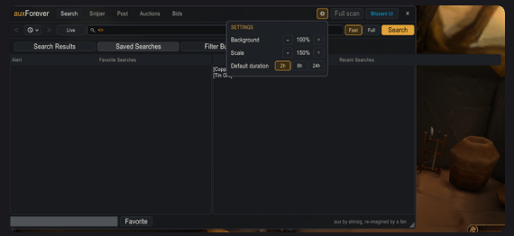

# Player feedback log

Every piece of feedback players give about auxForever is recorded here, one entry per point, so
whoever fixes or builds next (any AI agent or person) can work from it without the original chat.
Started 2026-10-07, on 0.4.1 (the version players have).

## How we read feedback (Tyler, 2026-10-07)

If a player has a problem with auxForever, assume the problem is in the addon, not the player.
Tyler: "If a user downloads our add-on, and they have a problem, it's very likely a problem with
our app and not a problem with them. I'm not going to assume that people are just bad at the
auction house. Our app needs to be so good that they can't help but be good at the auction house
because of the visual clarity we provide, the information we provide, etc."

(Quoted from Tyler's message; it was dictated, and a passage he repeated is given once.)

So:
- "I didn't know you could do X" is a finding about the addon (X is hard to find), not a
  question answered. Record it even when Tyler already explained the feature to the player.
- When a player says they need to get used to something, record what they expected instead.
  That expectation is the design target.
- Never write an entry as "user error". At most, write what the player expected and why the addon
  did not meet it.

One rare exception (Tyler, 2026-10-09, after FB-009): when the player asks for something Forever's
auction house itself does not have, such as Classic stacks, the problem is not the addon's.
auxForever is for intermediate players who know the modern auction house; teaching the auction
house is not its job. Record the entry as usual, set it `wont-fix` with this reason, and give Tyler
a reply he can send the player. The test is narrow: the request must be impossible or meaningless
on Forever's auction house. A screen that is merely confusing still falls under the main rule.

## Credit

When a change comes from a player's feedback, its line in `docs/changelog.md` (which is also the
CurseForge changelog) names the player by in-game name: "(suggested by Darkhorse)" for an idea,
"(reported by Darkhorse)" for a bug. Several players: "(reported by Darkhorse and Hotpocket)". The
entry's "From" field says who to credit. Tyler asked for this on 2026-10-07.

## Rules

For whoever records feedback:

- One entry per distinct point. A message with three complaints becomes three entries that share
  the same source.
- Record what the player said **word for word** under "Said", with spelling as given. Never
  improve, shorten or merge quotes. If Tyler retells it instead of quoting, write "Tyler's
  summary:" before it.
- Keep three things apart and labeled: what the player said, what Tyler added, and what the
  recorder infers (likely cause, code area). An inference is never written as a fact.
- Names: the player's in-game character name (Tyler, 2026-10-07: "In game names are fine they
  are very public"). No real names, Discord account IDs, email addresses or other contact details:
  this repository is public. If a player asks not to be named, replace their name in every entry
  with a label ("Player A") and note the change in the commit message.
- Screenshots (Tyler's choice, 2026-10-07): save one in `docs/feedback/` as `FB-<id>-<n>.png` only
  when the picture itself matters to the fix (a layout problem, an error window). Before saving,
  tell Tyler what is visible in it (chat lines, other players' names, his character, guild, gold)
  and crop out what the fix does not need. Every other screenshot is described in words in the
  entry. BugSack error text goes in the entry in full, in a code block.
- Keep the whole conversation, word for word, as a source file in `docs/feedback/sources/`
  (`<date>-<player>-<channel>.md`), and link it from each entry. Entries quote only the part that
  matters; the source keeps the context.
- Fill in the player under "Players" below the first time they appear.
- No follow-up questions to players (Tyler, 2026-10-07: "We wont get this info we need to work
  without it. I dont want to follow up on feedback."). Record what is not known under "Unknowns"
  and how a fix can work without it. Questions for Tyler are fine ("Ask Tyler").
- IDs are never reused or renumbered. Entries are never deleted; a wrong or duplicate entry gets
  status `duplicate` or `wont-fix` with a reason.
- Add the entry to the index table and commit after every batch, so nothing is lost if a session
  ends.

For whoever fixes or builds from it:

- Read `AGENTS.md` and `docs/status.md` first. An entry's "Proposed" fields are suggestions;
  Tyler decides what goes into which version (`docs/roadmap.md`: a patch version is fixes, speed
  and small things only; new features wait for the next minor version; a bad bug gets a hotfix).
- When you take an entry, set its status to `in-progress` with your branch. When done, set
  `fixed` (or `built`) with the version and commit, and add the in-game check to `TESTING.md`.
  Each bug fix comes with a test that fails without the fix (AGENTS.md).
- Do not wait for more from the player; none will come. Read "Unknowns" and build a fix that
  holds whatever the answer would have been (for example, make every way a post can fail say why,
  instead of finding the one cause), or check it yourself in the code, Blizzard's code, or ask
  Tyler to try it in game. Set `needs-info` only while waiting on Tyler.
- Credit the player in the changelog (see Credit above).

## Fields

| Field | Meaning |
| --- | --- |
| Received | Date Tyler passed it on (and when the player said it, if different). |
| From | Player handle; how many players reported the same thing (update when others repeat it). |
| Where | Discord, in game, CurseForge comment, and so on. |
| Source | Link to the full conversation in `docs/feedback/sources/`. |
| Version | auxForever version the player had, if known. Unknown is written "unknown". |
| Type | `bug` (something works wrong), `request` (something new), `ux` (works, but confusing or awkward), `question`, `praise`. |
| Area | Search, Fast mode, Live, Sniper, Buy bar, Post, Auctions, Bids, Recipe search, Filter Builder, Settings, Window, Performance, Install, Other. |
| Severity | Bugs only. `S1`: spends money wrongly, errors over and over, a tab that does not work, or data lost (hotfix per the roadmap). `S2`: wrong, with a way around it. `S3`: small or cosmetic. |
| Said | The player's words, quoted exactly. |
| Steps / setup | What they did, what they expected, what happened, other addons, error text. Only what was reported. |
| Tyler's notes | Anything Tyler added: whether he can reproduce it, his opinion. |
| Recorder's notes | Inferences, marked as such: likely code area, likely cause, related entries, existing docs that touch it. |
| Unknowns | What the report leaves open, and how a fix can work without it. Players are not asked. |
| Ask Tyler | Open questions for Tyler (what he meant, what he has seen himself). |
| Proposed | Recorder's suggestion: `hotfix`, next patch, next minor (`0.5`), `later`, or `none`. Tyler decides. There will be no 0.4.2 (Tyler, 2026-10-07): fixes and small things wait for 0.5 unless they are bad enough for a hotfix. |
| Status | `new`, `needs-info` (waiting on Tyler), `confirmed` (reproduced), `planned <version>`, `in-progress <branch>`, `fixed <version> <commit>`, `built <version> <commit>`, `wont-fix` (with Tyler's reason), `duplicate of FB-n`. |

## Index

| ID | Received | From | Type | Area | Sev | Summary | Status |
| --- | --- | --- | --- | --- | --- | --- | --- |
| [FB-001](#fb-001-the-other-quantity-box-on-the-buy-bar-does-not-look-like-a-place-to-type) | 2026-10-07 | Darkhorse | ux | Buy bar | n/a | The "Other" quantity box does not look like a place to type | fixed 0.5 6f77958 |
| [FB-002](#fb-002-right-click-an-item-in-the-bags-should-load-it-into-the-post-tab) | 2026-10-07 | Darkhorse | request | Post | n/a | Right-click an item in the bags should load it into the Post tab | built 0.5 140996a |
| [FB-003](#fb-003-clicking-post-sometimes-does-nothing-and-shows-no-error) | 2026-10-07 | Darkhorse | bug | Post | S2 | Clicking Post sometimes does nothing and shows no error | fixed 0.5 7a187c7 |
| [FB-004](#fb-004-the-ui-is-the-biggest-issue-closer-to-the-traditional-auction-house-layout) | 2026-10-07 | Darkhorse | ux | Overall | n/a | The UI is his biggest issue; wants it closer to the traditional auction house | wont-fix (direction; Tyler: follow TSM and aux) |
| [FB-005](#fb-005-praise-the-list-of-sellable-items-on-the-left-of-the-post-tab) | 2026-10-07 | Darkhorse | praise | Post | n/a | Praise: the list of sellable items on the Post tab | new |
| [FB-006](#fb-006-after-resizing-and-changing-the-scale-the-recent-searches-header-sticks-out-of-the-window) | 2026-10-07 | Garsterson | bug | Window | S3 | After resizing and changing the scale, the Recent Searches header sticks out of the window | fixed 0.5 31ac02c |
| [FB-007](#fb-007-crafting-cost-in-the-profession-window-anywhere-in-the-world) | 2026-10-07 | Garsterson | request | Recipe search | n/a | Crafting cost in the profession window, anywhere in the world | built 0.5 5a935e1 |
| [FB-008](#fb-008-chat-command-settings-should-also-be-in-the-settings-menu) | 2026-10-08 | CurseForge player (name not recorded yet) | request | Settings | n/a | Chat command settings should also be in the Settings menu | built 0.6 (released 2026-10-09) |
| [FB-009](#fb-009-post-cloth-in-several-stacks-of-a-chosen-size) | 2026-10-09 | Maggew | request | Post | n/a | Post cloth in several stacks of a chosen size, as in Classic | wont-fix (Forever has no stacks; Tyler: not the addon's job) |
| [FB-010](#fb-010-picking-a-weapon-slot-such-as-daggers-searches-every-weapon-of-that-kind) | 2026-10-11 | GregoryWW | bug | Search | S2 | Picking a weapon slot such as Daggers searches every weapon of that kind | fixed 0.6.1 (released 2026-10-11) |
| [FB-011](#fb-011-clicking-an-items-icon-in-the-post-tabs-list-does-not-select-it) | 2026-10-12 | Gaddor | bug | Post | S3 | Clicking an item's icon in the Post tab's list does not select it | fixed 0.6.1.1 (tested 2026-10-12) |
| [FB-012](#fb-012-a-public-api-so-other-addons-can-read-auxs-prices) | 2026-10-13 | MDHippie | request | Other | n/a | A public API so other addons can read aux's prices | built 0.7 (released 2026-10-13) |
| [FB-013](#fb-013-an-item-level-column-in-the-search-results) | 2026-10-13 | HoaxBox | request | Search | n/a | An item level column in the search results | built 0.7 (released 2026-10-13) |
| [FB-014](#fb-014-a-search-for-tigerstrike-mantle-finds-nothing-auctionator-finds-7) | 2026-10-16 | daland | bug | Search | S2 | A search for Tigerstrike Mantle finds nothing; Auctionator finds 7 | fixed 0.7.1 (released 2026-10-17) |
| [FB-015](#fb-015-the-auctions-tab-does-not-show-all-your-own-auctions) | 2026-10-16 | daland | bug | Auctions | S2 | The Auctions tab does not show all your own auctions | fixed 0.7.1 (released 2026-10-17) |
| [FB-016](#fb-016-cancel-says-cancelled-comes-by-mail-but-the-auction-is-still-listed) | 2026-10-16 | daland | bug | Auctions | S2 | Cancel says "Cancelled, comes by mail" but the auction is still listed | fixed 0.7.1 (released 2026-10-17) |
| [FB-017](#fb-017-the-deposit-aux-shows-is-lower-than-the-1-silver-the-game-charges) | 2026-10-17 | sarrathsilentstrider | bug | Post | S3 | The deposit aux shows is lower than the 1 silver the game charges | not reproduced (aux matched the game in Tyler's test) |
| [FB-018](#fb-018-a-setting-for-whether-the-post-tab-starts-on-match-lowest-or-undercut) | 2026-10-17 | sarrathsilentstrider | request | Settings | n/a | A setting for whether the Post tab starts on Match lowest or Undercut | wont-fix (Tyler: keep as is) |
| [FB-019](#fb-019-praise-everything-is-shte-in-comparison) | 2026-10-17 | sarrathsilentstrider | praise | Overall | n/a | Praise: "everything is SH!TE in comparison" | new |
| [FB-020](#fb-020-find-the-cheapest-way-to-fill-waylaid-crates-and-writs) | 2026-10-17 | Harro22 | request | Search | n/a | Find the cheapest way to fill Waylaid crates and writs | built 0.8 build 2 (crates; writs planned 0.9) |
| [FB-021](#fb-021-a-typed-price-below-the-lowest-listing-cannot-be-posted-rough-stone-5c) | 2026-10-18 | sarrathsilentstrider | bug | Post | S2 | A typed price below the lowest listing cannot be posted (Rough Stone, 5c) | fixed 0.7.1.1 (released 2026-10-19) |
| [FB-022](#fb-022-the-player-did-not-know-the-newest-listing-at-a-price-sells-first) | 2026-10-18 | sarrathsilentstrider | ux | Post | n/a | The player did not know the newest listing at a price sells first | new |
| [FB-023](#fb-023-a-shopping-list-for-crafting-n-of-a-recipe) | 2026-10-20 | Kortan | request | Search | n/a | A shopping list for crafting N of a recipe | planned 0.9 |
| [FB-024](#fb-024-an-exact-search-for-hillmans-cloak-finds-nothing-a-search-for-hillmans-finds-many) | 2026-11-08 | GregoryWW | bug | Search | S2 | An exact search for Hillman's Cloak finds nothing; a search for Hillman's finds many | fixed 0.8.1 (released 2026-11-09) |
| [FB-025](#fb-025-adding-a-tooltip-word-strength-turns-an-instant-search-into-a-2-minute-one) | 2026-11-08 | RushJet1 | bug | Performance | S2 | Adding a tooltip word (strength) turns an instant search into a 2 minute one | in-progress 0.8.2 |
| [FB-026](#fb-026-show-whether-a-craft-makes-a-profit-or-a-loss) | 2026-11-08 | deep_structure | request | Recipe search | n/a | Show whether a craft makes a profit or a loss | built 0.8.1 (released 2026-11-09) |
| [FB-027](#fb-027-the-full-scan-takes-more-than-5-minutes-since-forever-launched) | 2026-11-08 | user_ayzkr6rhvrlna3ya | bug | Performance | S3 | The full scan takes more than 5 minutes since Forever launched | in-progress 0.8.2 |
| [FB-028](#fb-028-the-sniper-takes-over-30-seconds-from-its-sound-to-the-purchase) | 2026-11-08 | user_ayzkr6rhvrlna3ya | bug | Sniper | S2 | The Sniper takes over 30 seconds from its sound to the purchase | in-progress 0.8.2 |
| [FB-029](#fb-029-price-gear-with-a-random-ending-of-the-eagle-of-the-bear-separately) | 2026-11-08 | user_yt0k9lezehn1ukm993387 | request | Other | n/a | Price gear with a random ending ("of the Eagle", "of the Bear") separately | built 0.8 (released 2026-11-08) |
| [FB-030](#fb-030-how-the--of-historical-value-works-keep-more-price-history) | 2026-11-08 | user_yt0k9lezehn1ukm993387 | question | Other | n/a | How the % of historical value works; keep more price history | new |
| [FB-031](#fb-031-posting-rules-based-on-historical-value-like-tsm) | 2026-11-08 | user_yt0k9lezehn1ukm993387 | request | Post | n/a | Posting rules based on historical value, like TSM | planned 0.9 |
| [FB-032](#fb-032-start-a-full-scan-when-the-window-opens-if-the-15-minute-wait-is-over) | 2026-11-08 | Chawitsch | request | Settings | n/a | Start a full scan when the window opens, if the 15 minute wait is over | planned 0.9 (Tyler: option, off by default) |
| [FB-033](#fb-033-tooltip-prices-for-the-whole-stack-not-one-item) | 2026-11-08 | Chawitsch | ux | Other | n/a | Tooltip prices for the whole stack, not one item | in-progress 0.8.2 |
| [FB-034](#fb-034-opening-aux-moves-blizzards-professions-window-to-the-right) | 2026-11-08 | Chawitsch | bug | Window | S3 | Opening aux moves Blizzard's Professions window to the right | fixed 0.8.1 (released 2026-11-09) |
| [FB-035](#fb-035-a-setting-to-hide-the-usually-price-line-in-tooltips) | 2026-11-09 | deep_structure | request | Settings | n/a | A setting to hide the "usually" price line in tooltips | in-progress 0.8.2 |
| [FB-036](#fb-036-the-sniper-calls-a-flat-market-a-deal-at-4-of-the-usual-price) | 2026-11-09 | Swiftwren | bug | Sniper | S2 | The Sniper calls a flat market a deal at 4% of the usual price | in-progress 0.8.2 |
| [FB-037](#fb-037-i-cant-scan-today) | 2026-11-09 | deep_structure | bug | Full scan | S2 | "i cant scan today" | in-progress 0.8.2 |

## Players

Who gives feedback, so a reader can weigh it. Add a player the first time they appear.

- **Darkhorse**: was in Tyler's guild. Thousands of hours in all versions of WoW; he and Hotpocket
  "are always the richest people in the game because they know how to use the auction house"
  (Tyler, 2026-10-07). Used to the traditional auction house, Auctionator and the retail auction
  house (his own words). Tyler: "a high value feedback provider". Asked for recipe search before
  0.4. Inference: his expectations are likely shared by many experienced players.
- **Hotpocket**: was in Tyler's guild; one of the two richest players Tyler knows, for the same
  reason (Tyler, 2026-10-07). Knows the retail "search every ingredient" feature
  (`docs/roadmap.md`, 0.4). Asked for recipe search before 0.4. Spelling of the in-game name not
  yet confirmed (Tyler wrote "Hot Pocket").
- **Maggew**: CurseForge commenter (CurseForge name; in-game name unknown). Plays with Classic
  auction house habits (FB-009). Whether they also wrote the
  CurseForge comment behind FB-008 is not known.
- **GregoryWW**: CurseForge commenter (CurseForge name; in-game name unknown). Reported FB-010
  and FB-024.
- **Gaddor**: CurseForge commenter (CurseForge name; in-game name unknown). Reported FB-011.
- **MDHippie**: CurseForge commenter (CurseForge name; in-game name unknown). Asked for FB-012.
  Names `history.latest`, so has read aux's code. Inference: writes addons or scripts of their own.
- **HoaxBox**: CurseForge commenter (CurseForge name; in-game name unknown). Asked for FB-013;
  opened with "awesome addon".
- **daland**: CurseForge commenter (CurseForge name; in-game name unknown). Reported FB-014, FB-015
  and FB-016 in three comments the same day. Also uses Auctionator and compares aux with it.
- **sarrathsilentstrider**: CurseForge commenter (CurseForge name; in-game name unknown).
  Reported FB-017, asked for FB-018, praised in FB-019, reported FB-021 and FB-022. Plays in the
  Classic theme.
- **Kortan**: told Tyler directly (Tyler's retelling, not his own words). Asked for FB-023. Knows
  TSM well, including its alt inventory data. Spelling of the in-game name not yet confirmed.
- **Harro22**: CurseForge commenter (CurseForge name; in-game name unknown). Asked for FB-020.
- **RushJet1**: CurseForge commenter (CurseForge name; in-game name unknown). Reported FB-025.
  Writes search text by hand (`armor/mail/chest/usable/strength`).
- **deep_structure**: CurseForge commenter (CurseForge name; in-game name unknown). Asked for
  FB-026 and FB-035, reported FB-037. Uses the Sniper and crafts.
- **Swiftwren**: CurseForge commenter (CurseForge name; in-game name unknown). Reported FB-036
  (two comments, the second with an example: Invoker's Cord). Uses the Sniper, buys deals and
  relists them (flipping); Full scans daily.
- **user_ayzkr6rhvrlna3ya**: CurseForge commenter (a name CurseForge generated; in-game name
  unknown). Reported FB-027 and FB-028. Used aux for a couple of weeks before Forever launched.
  Uses the Sniper.
- **user_yt0k9lezehn1ukm993387**: CurseForge commenter (a name CurseForge generated; in-game name
  unknown). Asked for FB-029, FB-030 and FB-031. Used aux for the whole beta ("made lots of
  gold") and knows TSM's posting rules.
- **Chawitsch**: CurseForge commenter (CurseForge name; in-game name unknown). Asked for FB-032
  and FB-033, reported FB-034. Agreed to FB-032 as an option, off by default.
- **Garsterson**: Tyler's brother. Found the gear posting error fixed in 0.1.1 (earlier docs call
  him "Tyler's brother"). His feedback so far reaches the log as Tyler's retelling, not his own
  words.

## Entries

Template (copy for each new entry, newest at the bottom):

```
### FB-001: <one-line summary in plain words>

- Received: 2026-10-07
- From: <handle> (1 report)
- Where: <channel>
- Source: <link to docs/feedback/sources/...>
- Version: <forever-0.4.1 | unknown>
- Type: <bug | request | ux | question | praise>
- Area: <area>
- Severity: <S1 | S2 | S3 | n/a>
- Status: new
- Proposed: <hotfix | 0.5 | later | none>

Said:
> exact words

Steps / setup:

Tyler's notes:

Recorder's notes:

Unknowns:

Ask Tyler:
```

### FB-001: The "Other" quantity box on the buy bar does not look like a place to type

- Received: 2026-10-07
- From: Darkhorse (1 report)
- Where: Discord, direct message to Tyler
- Source: [source](feedback/sources/2026-10-07-darkhorse-discord.md)
- Version: unknown (0.4.1 was released 2026-10-05)
- Type: ux
- Area: Buy bar
- Severity: n/a
- Status: fixed 0.5 6f77958 (mockup option B, approved by Tyler 2026-10-07: the box is labeled QUANTITY and always shows the number being bought). In-game check: TESTING.md, 0.5 build 1, steps 17 to 19
- Proposed: 0.5 (no 0.4.2, Tyler 2026-10-07; a visual change, so mockup first)

Said:
> is there a way to select the number of something you want to buy? or am i locked in to like 1 or
> 5 or 20

> bc now that forever is using some of the retail AH features i don't think you are locked into
> buying stacks anymore

Steps / setup: buying a trade good (a commodity) from the Search tab. He saw the quantity buttons
(1, 5, 20) and did not find a way to type another number.

Tyler's notes: "I knew that Other button sucked", "It's says Other to the right of 20 but it's
not obvious that it's a text field", "Now that I hear you say it I will make that way more
obvious".

Recorder's notes:
- Fact (code): the box exists. For commodities the buy bar shows four quantity buttons sized to
  the item's stack (`quantities` in `auxForever/gui/buy_bar.lua`: 1, the two largest of 5, 10, 20,
  50, 100, 200, 500 below the stack size, and the stack size), then `other_input`: a 56 wide
  numeric edit box whose empty text shows the word "Other" in gray (`other_input.formatter`).
  Typing a number and pressing Enter buys that many (`other_input.enter`).
- Inference: a gray word in a box styled like the buttons next to it reads as a fifth button, not a
  text field. Nothing shows it takes typing until it is clicked.
- Inference: his second sentence is right: Forever sells commodities by unit, so any quantity can
  be bought. Retail's auction house and Auctionator show a plain number box for this, which is what
  he expects.
- Gear is bought one auction at a time; this entry is about commodities only.

Unknowns: which item he was buying, so which four buttons he saw. Does not matter for the fix:
the box looks the same for every item.

Ask Tyler: nothing.

### FB-002: Right-click an item in the bags should load it into the Post tab

- Received: 2026-10-07
- From: Darkhorse (1 report)
- Where: Discord, direct message to Tyler
- Source: [source](feedback/sources/2026-10-07-darkhorse-discord.md)
- Version: unknown
- Type: request (Darkhorse expected it to work; see Tyler's notes on a possible bug)
- Area: Post
- Severity: n/a
- Status: built 0.5 140996a (right-click a bag item follows Blizzard's AuctionHouseFrame:SetPostItem into aux; see docs/clicks.md, Built in 0.5). In-game check: TESTING.md, 0.5 build 1, steps 11 to 13
- Proposed: 0.5 (no 0.4.2, Tyler 2026-10-07)

Said:
> also, being able to right click something in your bags when you're on the sell tab would be
> great since it's something we are all used to

> yea I jsut need to train my eyes to look there instead of my bags

(Tyler asked: "You think it should just be a right click from the bag to populate the post
field?")
> yea since that's how it works normally

(Tyler asked whether right-clicking a bag item on the post screen locked the addon up.)
> i dont remember it doing that. jsut nothing happened

Steps / setup: on the Post tab ("sell tab" in his words), right-clicked an item in his bags.
Expected: the item is loaded for posting, as in Blizzard's auction house and Auctionator.
Got: nothing happened.

Tyler's notes: told him it is Shift-click from the bag on the Post tab. "I want people to easily
be able to do both". Agreed to make right-click work: "I can make that happen", "That's added to
the list". Also: "I think there is a bug in this section though" (see Ask Tyler).

Recorder's notes:
- Fact (code): `auxForever/core/shortcut.lua` hooks `HandleModifiedItemClick` and passes Shift-click
  (only with no chat box open) and Alt-click to the current tab's `USE_ITEM`; the Post tab selects
  the item (`tab.USE_ITEM` in `auxForever/tabs/post/core.lua`). A plain right-click is not handled.
- Fact (code): aux keeps Blizzard's `AuctionHouseFrame` shown but shrunk to 1% and invisible while
  the auction house is open (`set_blizzard_frame_shown` in `auxForever/aux-addon.lua`), because
  hiding it closes the auction house.
- Inference, unverified: in the modern client a right-click on a bag item with the auction house
  open is handled by Blizzard's bag code and goes to Blizzard's own Sell tab. If so, the item may
  have been put into the invisible Blizzard window, which would match "nothing happened" and could
  be the bug Tyler suspects. Check Blizzard's Forever bag code (`ContainerFrame` item button click)
  before building.
- "train my eyes to look there instead of my bags" and Tyler's "I want people to easily be able to
  do both": the bag list on the Post tab is liked (FB-005), and the bags are where his habit
  starts. Both should work.
- Tyler widened this into a review of every click in the addon (2026-10-07): `docs/clicks.md`. Build
  this entry as part of that standard.
- Vocabulary: he calls it the "sell tab" (Blizzard's and Auctionator's name); aux calls it "Post".
  Recorder's reading of Tyler's decision in FB-004 (follow TSM and the original aux): keep "Post".

Unknowns: none that block a fix.

Ask Tyler: what bug do you suspect in this section, and have you seen the addon lock up after a
right-click on a bag item yourself? Steps if so.

Answer (Tyler, 2026-10-07): he does not remember what the bug was. Found while building 0.5: the
right-click went into Blizzard's hidden Sell tab (docs/clicks.md, Built in 0.5); that is the most
likely candidate, not confirmed.

### FB-003: Clicking Post sometimes does nothing and shows no error

- Received: 2026-10-07
- From: Darkhorse (1 report, happened once)
- Where: Discord, direct message to Tyler
- Source: [source](feedback/sources/2026-10-07-darkhorse-discord.md)
- Version: unknown
- Type: bug
- Area: Post
- Severity: S2 (nothing lost; the player is left not knowing why)
- Status: fixed 0.5 7a187c7 (every way a post ends says what happened; a faded Post button says why). In-game check: TESTING.md, 0.5 build 1, steps 5 to 8
- Proposed: 0.5 (no 0.4.2, Tyler 2026-10-07; the silent part: always say why a post did not happen)

Said:
> also one time i tried posting an item and just nothing happened when i clicked post. I forget if
> it was gear that needed to be repaired or something but no error message came up

> i should have investigated more

Steps / setup: clicked Post on the Post tab. Nothing was posted and no message appeared. He does
not remember the item; possibly damaged gear. Happened once.

Tyler's notes: "Okay perfect all of these messages are invaluable and will probably lead to a big
fix. The post tab needs the most work imo". To "i should have investigated more": "It's all good I
think this is more than enough".

Recorder's notes (code facts with locations; the cause in his case is not known):
- `post_auction` in `auxForever/tabs/post/core.lua` can end without a word in three ways: (1)
  `find_item_location` finds no bag slot with the item that is auctionable and not locked, and the
  function returns at once; (2) `C_AuctionHouse.PostItem` or `PostCommodity` returns false and
  only `pending_post` is cleared; (3) the wait loop gives up after 5 seconds (60 with a
  confirmation dialog open) and clears the state.
- Which items are listed: `container_item` in `auxForever/util/info.lua` first requires full
  durability, then, while the auction house is open, replaces that answer with
  `C_AuctionHouse.IsSellItemValid`. So whether damaged gear can appear in the list depends on what
  the game answers; not verified on Forever.
- Inference, unverified: if the game refuses damaged gear, it shows its own red error text at the
  top of the screen; whether Forever does, and whether he would have noticed it, is unknown.
- Whatever the cause, each of the three paths above can tell the player why (for example "This
  item must be repaired first", "Item not found in your bags"). That fix does not need the cause.

Unknowns (no follow-up with the player): the item, whether it was damaged, whether the game showed
red text, and whether an error happened inside the addon (he may not have BugSack). Work without
them: give each of the three silent paths above its own message, and check damaged gear in the
code or ask Tyler to try it (Ask Tyler).

Ask Tyler: can you try posting a damaged piece of gear on Forever and say what happens (listed in
the Post tab or not; what Post does; any red text)?

### FB-004: The UI is the biggest issue; closer to the traditional auction house layout

- Received: 2026-10-07
- From: Darkhorse (1 report)
- Where: Discord, direct message to Tyler
- Source: [source](feedback/sources/2026-10-07-darkhorse-discord.md)
- Version: unknown
- Type: ux
- Area: Overall (every tab)
- Severity: n/a
- Status: wont-fix for the direction he asked for (Tyler, 2026-10-07, see below). That the UI is
  too confusing stands, and is the redesign's job.
- Proposed: 0.5 (Tyler's planned redesign; see Tyler's notes)

Said:
> yea the UI is my biggest issue rn

> but that's bc i'm so used to the traditional UI and auctionator / retail AH

> i will stick with and keep trying for sure

> but yea I think working on the UI so that there is less of a dramatic change from the
> traditional UI is a great move. I know that's a ton of work though

Steps / setup: general impression, not one screen. His references: "the traditional UI",
Auctionator, the retail auction house.

Tyler's notes: "Me and my UI designer buddy are working on a massive .5-.6 update". "Agree" (that
the UI is the biggest issue). "My buddy has like a whole design concept laid out. I'll show you
some prototypes soon." "It's still going to be quite transformative, it's geared toward TSM users"
"But it will be more visually simple" "It's too confusing rn". Also told him: "No hard feelings if
you switch back. Everytime I make a big update I'll let you know".

Recorder's notes:
- He blames his habits ("that's bc i'm so used to..."). Under Tyler's rule (How we read feedback,
  above) this is a finding about the addon: an expert auction house player finds it confusing.
- Darkhorse said he will keep using it; Tyler promised to tell him at each big update.

Decision (Tyler, 2026-10-07), on Darkhorse's request for less change from the traditional UI:
"This one I outright reject. This should much more closely resemble TSM and the original aux like
it already does." So the redesign follows TSM and Simon's aux, not Blizzard's auction house or
Auctionator. What is kept from this entry: the UI is too confusing today (Tyler agreed: "It's too
confusing rn") and should be "more visually simple". Darkhorse's smaller, concrete points are
separate entries and are not rejected: FB-001 (typed quantity), FB-002 (right-click from the bags,
which Tyler agreed to), FB-005 (keep the bag list).

Unknowns: which screens confuse him most. Not asked (no follow-up with players); the redesign
works from Tyler's and the designer's judgment.

Ask Tyler: who is the UI designer (a name or handle for the docs), how their designs will reach
the repository (images, a mockup page, Figma), and whether the redesign is 0.5, 0.6 or spans both.

### FB-005: Praise: the list of sellable items on the left of the Post tab

- Received: 2026-10-07
- From: Darkhorse (1 report)
- Where: Discord, direct message to Tyler
- Source: [source](feedback/sources/2026-10-07-darkhorse-discord.md)
- Version: unknown
- Type: praise
- Area: Post
- Severity: n/a
- Status: new
- Proposed: none (keep it through the redesign)

Said:
> i do love the list of sellable stuff ont he left too though

Tyler's notes: "Yeah that one I don't take credit for it was an original feature that I love" (it
comes from Simon's aux).

Recorder's notes: the redesign (FB-004) should keep a list of sellable bag items on the Post tab,
alongside right-click from the bags (FB-002).

Unknowns: none.

Ask Tyler: nothing.

### FB-006: After resizing and changing the scale, the Recent Searches header sticks out of the window

- Received: 2026-10-07
- From: Garsterson (1 report)
- Where: told to Tyler; Tyler retold it
- Source: [source](feedback/sources/2026-10-07-garsterson-via-tyler.md)
- Version: unknown (the Scale setting exists since 0.2.1)
- Type: bug
- Area: Window (seen on Search, Saved Searches)
- Severity: S3 (looks broken; nothing lost)
- Status: fixed 0.5 31ac02c (tables lay out again when shown and when resized; the last column is anchored to the right edge). In-game check: TESTING.md, 0.5 build 1, steps 9 and 10
- Proposed: 0.5

Said (Tyler's summary):
> He had the issue in the screenshot when he, at 100% scale, made the window large, then raised
> the scale to 140%, I think. Then when he shrunk the window, after doing that, he was able to get
> an element to bleed off of the add-on itself, the window of the add-on itself.

Steps / setup (as told; Tyler is not sure of the exact scale):
1. Settings, Scale at 100%. Make the aux window large with the resize corner.
2. Raise Scale to about 140% (the screenshot shows 150%).
3. Shrink the window with the resize corner.
4. Something sticks out past the window's edge.

Screenshot (cropped, added with Tyler's OK): 

What it shows: Search tab, Saved Searches sub tab, the
settings menu open (Background 100%, Scale 150%, Default duration 2h). The window's right edge is
at the close button, but the gray header bar of the "Recent Searches" list runs on past it, about a
fifth of the window's width further, over the game world. The list's two rows ("[Copp...",
"[Tin O...") are cut off by the settings menu, not by the bug. The "Favorite Searches" list on the
left looks right.

Tyler's notes: none beyond the steps.

Recorder's notes:
- Fact (code): the two lists split the Saved Searches area in half by anchors
  (`frame.saved.favorite`, `frame.saved.recent` in `auxForever/tabs/search/frame.lua`), so the
  panels follow the window. Their column headers do not: `gui/listing.lua` sets each header and
  cell to a fixed width (`col:SetWidth(colInfo.width * width)`, with `width` read from
  `contentFrame:GetRight() - GetLeft()`), recalculated only in `Update`, which runs from the
  table's `OnSizeChanged`.
- Inference, unverified: the header kept a width computed for the larger window. Either
  `OnSizeChanged` did not fire for this table when the window shrank (the Saved Searches sub tab
  may have been hidden at the time, or a scale change does not count as a size change), or
  `GetRight`/`GetLeft` gave values from before the change. Why only the right list is affected is
  not known.
- Other tables built on `gui/listing.lua` may do the same: the Post tab's bid and buyout lists
  (`tabs/post/frame.lua`). The search, Sniper, Auctions and Bids tables use
  `gui/auction_listing.lua`, which resizes differently (`fit_rows`); check them too.
- Related, fixed in 0.4.1: the resize corner made the window jump (`frame.lua`, aux's own sizing).

Unknowns: the exact scale and whether the Saved Searches sub tab was open while resizing. A fix
should hold for any order of resize, scale change and sub tab switch: for example recalculate the
column widths when the table is shown and after the scale changes, or size columns by anchors
instead of fixed widths.

Ask Tyler: nothing; the steps are enough to try.

### FB-007: Crafting cost in the profession window, anywhere in the world

- Received: 2026-10-07
- From: Garsterson (1 report)
- Where: told to Tyler; Tyler retold it
- Source: [source](feedback/sources/2026-10-07-garsterson-via-tyler.md)
- Version: unknown
- Type: request
- Area: Recipe search (profession window)
- Severity: n/a
- Status: built 0.5 5a935e1 (mockup approved by Tyler 2026-10-07). In-game check: TESTING.md, 0.5 build 1, steps 20 to 23
- Proposed: 0.5 (a new feature; the roadmap keeps those out of patch versions)

Said (Tyler's summary):
> He wants there to be a tooltip in a sorry, in the professions menu. If you are out in the world
> and you open up a recipe, you should be able to generate within the profession tab on that recipe
> the price of crafting and the profit based on full scan data. If we're getting all this f- full
> scan data, then we should be using it for things like this.

> So one of his requests is having the total cost of crafting, if you were to purchase it based on
> full scan data anywhere in the world, not necessarily just at the auction house, if that's
> possible.

What is asked: open a recipe in the profession window anywhere (not only at the auction house) and
see what its materials would cost to buy, from prices aux already saved. Garsterson asked for cost
and profit.

Tyler's notes (scope): "Come to think of it, maybe not profit, maybe just cost of crafting based on
the last full scan data. I don't think we need to bloat the user with information when we could
just give them only what they need. We don't want to suffer from feature creep too much." So the
request as Tyler shapes it: **cost only, no profit** (reversed 2026-11-08 by Tyler for FB-026: profit
goes on the line in 0.8.1). Tyler first said "tooltip", then "in the
professions menu"; where exactly it shows is open (see Ask Tyler).

Recorder's notes:
- Fact (git history): Simon's aux had this for Classic: `core/crafting.lua` added "(Total Cost:
  ...)" to Classic's profession window, each material at its vendor price if a vendor sells it
  without limit, else its usual price (`history.value`); "?" when any material had no price. It
  hooked Classic's frames only, did nothing on Forever, and was removed in 0.4.1 (commit 14eda02,
  "recipe search does this job"). This request brings that idea back for Forever's profession
  window. The removed file is the reference: `git show 14eda02^:auxForever/core/crafting.lua`.
- Fact (code): the 0.4 recipe cost line (`recipe_costs` in `auxForever/tabs/search/recipe.lua`)
  works only after a recipe search at the auction house: it prices materials from that search's
  live auctions or the vendor price. Reading a recipe's materials anywhere works the same way
  (`recipe_parts`, `C_TradeSkillUI.GetRecipeSchematic`).
- Fact (code): aux does not keep "the last full scan" as such. Every scan (full scan, searches,
  Sniper) feeds price history (`auxForever/core/history.lua`): per item, today's lowest buyout seen
  (`market_value`) and up to 11 past daily lows, from which the usual price (`value`) is a weighted
  median. History is saved, so it is there away from the auction house. Vendor prices aux has seen
  are saved too (`info.merchant_buy_info`).
- Inference: "based on full scan data" therefore had to mean one of: the usual price (steady, what
  Simon used), today's lowest, or a new store of the last full scan's prices. Tyler chose the usual
  price (Decisions below). How aux stores prices: `docs/price-data.md`.
- Performance (AGENTS.md): compute the cost only when a recipe is selected, not per frame, and use
  the history cache (`value_and_days`), not unpacking per material.

Unknowns: none that block it; Tyler's decisions below settle the open points.

Decisions (Tyler, 2026-10-07, answering the questions this entry asked him):
1. Where: "A line in the detail panel of the recipe" (as Simon's aux did; not a tooltip).
2. Which price: "usual price. We need to make sure we are communicating this in a low-profile and
   clean way."
3. A material with no price: Tyler left it to Claude: "My general philosophy is to convey as much
   info as we can with as little screen space as we can. [...] My gut says I would like to show
   them at least an idea of how much it will cost. If we somehow are able to convey that one of the
   items is missing price data graphically, isnt it implied that the calculation would be missing
   that amount? [...] Nothing is permanent, we can edit later."

Design (Claude's decision on point 3, with the rest filled in; build from this, mockup first):
- One line in the recipe's detail panel, small text in the label color, for example
  `Materials  1g 24s`. It is the cost of one craft: each material at its vendor price if a vendor
  sells it without limit and that is cheaper, else its usual price (`history.value`), times the
  amount the recipe needs.
- Some materials without a price: show the sum of the priced ones followed by a gray `+`
  (`Materials  1g 24s+`). The `+` says "at least this much", which is what Tyler's gut asked for:
  an idea of the cost, with the gap visible but taking no space.
- No material priced: `Materials  no price yet` in gray. All priced: no marker.
- Hovering the line shows a tooltip: one row per material (name, amount, cost, and where the price
  comes from: "vendor" or "usual, N days"), missing ones as "no price yet", and a first line
  "Usual prices from aux's price history". This is where the price basis is explained, so the line
  itself stays clean (Tyler's "low-profile").
- Not done: marking the material's own icon in Blizzard's reagent list. It would show which one is
  missing at a glance, but it means hooking Blizzard's reagent buttons, which change between game
  versions. The tooltip names it instead. Revisit if players miss it.
- Works anywhere the profession window opens; no auction house needed. Computed when a recipe is
  selected, never per frame (AGENTS.md, Performance).
- How good the number is depends on how the usual price is worked out; see `docs/price-data.md`,
  "Is it the best way?" (one cheap auction can set a day's price; the cheapest unit understates the
  cost of buying many).

### FB-008: Chat command settings should also be in the Settings menu

- Received: 2026-10-08
- From: a player commenting on CurseForge (1 report). In-game name not recorded yet.
- Where: CurseForge comment
- Source: not saved; only Tyler's retelling below. The comment's exact words are not in the
  repository.
- Version: unknown (likely forever-0.5, the version on CurseForge)
- Type: request
- Area: Settings
- Severity: n/a
- Status: built 0.6 (released 2026-10-09). Built in 0.6 build 3: a two-column Settings
  menu with switches for the seven `/aux tooltip ...` lines, from a mockup Tyler approved
  (2026-10-08). Tooltip switches tested in game (build 4, pass). A Bid prices choice was added in
  build 3 and removed in build 4 (Tyler, see below). Left as chat only: ignore owner, action
  shortcuts, debug, post bid.
- Proposed: 0.6

Said: not available. Tyler's summary: "a user on CurseForge talked about how some of the chat
commands should be built into the settings."

Tyler's notes: "I pushed back a little bit on that saying like aux debug and like aux price are not
commands I would want in the settings menu, but I'm sure there's some in there that are like
effectively toggles and they could be added in addition to being a CLI command or a chat command,
they could also be in the settings menu. If any of the choices are obvious, then just go ahead and
build those in. And then if any aren't obvious, just ask me." (2026-10-08)

Recorder's notes (the building session):
- Built as obvious: the tooltip lines (Value, Today, Vendor sell price, Vendor buy price,
  Disenchant value, Disenchants into, Coin icons). Plain on/off, per character like the chat
  commands, which keep working.
- Already in Settings before: Background (`/aux opacity`), Scale (`/aux scale`), Default duration
  (`/aux post duration`). Undercut mode is on the Post tab.
- Left out on purpose: `debug`, `debug list`, `memory`, `price` (tools, not settings; Tyler).
- Not obvious, asked: `action shortcuts` (Alt-click buys or cancels at once), `ignore owner`
  (scanning speed against seller names), `post full scan`, `post bid` (three choices), `clear item
  cache`, `clear post` (actions that delete data).

Unknowns: which commands the player had in mind. Built so it holds either way: every plain on/off
the player would meet in tooltips is now in the menu.

Tyler's notes, 2026-10-08 (on build 2): "this picture is not what I envisioned at all for the
settings menu" ... "I envision toggles, not checkboxes" ... "What it seems that you've built is
something only pertaining to tooltips?" On the Alt-click shortcuts: "Isnt this dangerous cause they
could buy a stack of 1000 on accident?" (they buy gear in one click and a stack in two, so they stay
chat only). On the mockup (https://claude.ai/artifact/21FjqFGt2vzbVo9BDG5d6j): "I actually really
like what you made here in the mock-up" ... "I love this layout."

Tyler's notes, build 4 test (2026-10-08): "Tooltip stuff is good. Bid row setting is probably
broken, but im not sure how its supposed to work. With this bid price option, does the stack option
even make any sense?" Recorder: on Forever only items (gear) can have bids, trade goods cannot, and
an item auction holds one item, so "per stack" means the same as "per item" or nothing; Tyler's
screenshots show every Auction Bid as "---". The setting did not earn a place in the menu and was
removed; this was the recorder's own wrong recommendation, not Tyler's or the player's.

Ask Tyler: the player's in-game name (for the changelog credit) and, if he has it, the comment's
exact words.
### FB-009: Post cloth in several stacks of a chosen size

- Received: 2026-10-09 (said about an hour before Tyler's screenshot)
- From: Maggew (1 report)
- Where: CurseForge comment on the auxForever project page
- Source: [source](feedback/sources/2026-10-09-maggew-curseforge.md)
- Version: unknown
- Type: request
- Area: Post
- Severity: n/a
- Status: wont-fix (Tyler, 2026-10-09: Forever's auction house has no stacks, and teaching the
  modern auction house is not the addon's job; see "How we read feedback", the exception)
- Proposed: none

Said:
> Please make it so that I can sell multiple stacks. So for example, I have a hundred linen cloth.
> I want to sell them in stacks of five. Right now, it makes me redo it over and over and over...
> Maybe I'm able to do it, but because I don't have enough money, it wasn't able to show me I could
> do it??

> It just seemed a little odd because sometimes I like to make multiple post-stacks in different
> quantities, like five, four, ten. That way you can totally capitalize and dominate the market

Steps / setup: wants to post 100 Linen Cloth as 20 stacks of 5 in one go, as Classic aux did.

Tyler's notes: replied on CurseForge that Forever has no stacks: the auction house groups all units
of an item into one pile per price, so 122 Linen Cloth at 23c are posted at once by typing 122 in
the Quantity field. Decision (2026-10-09): not built; the addon is for intermediate players who know
the modern auction house. This entry is why the exception to "How we read feedback" exists.

Recorder's notes:
- Inference from the code and `docs/forever-auction-house.md`: cloth is a commodity. The Post tab
  shows one Quantity box for it and posts one listing at a price per unit
  (`tabs/post/core.lua`, `post_auction`). Buyers type how many they want and the game fills it from
  the cheapest price first, so 20 x 5 at a price looks the same to buyers as 100 at that price.
- What the player wants underneath (control how much is on the market and at what price) is
  already possible: post part of the stock (a smaller Quantity), or post batches at different prices.
- "Because I don't have enough money": likely the Post tab's faded Post button with "Not enough
  money for the deposit" (`disabled_reason`). Not confirmed.

Unknowns: the player's in-game name; which message they saw about money. Neither changes the decision.

Ask Tyler: none.

### FB-010: Picking a weapon slot such as Daggers searches every weapon of that kind

- Received: 2026-10-11 (posted about 6 hours before Tyler's screenshot)
- From: GregoryWW (1 report)
- Where: CurseForge comment on the auxForever project page
- Source: [source](feedback/sources/2026-10-11-gregoryww-curseforge.md)
- Version: unknown (likely 0.6.0.2, the version on CurseForge)
- Type: bug
- Area: Search
- Severity: S2 (wrong results and a slow search; a name search still works)
- Status: fixed 0.6.1 (commit cf45949, released 2026-10-11; Tyler's test passed the same day:
  Weapons, One-Handed, Daggers lists only daggers)
- Proposed: next patch (0.6.0.3); Tyler named the version 0.6.1 (2026-10-11), with the audit's fixes

Said:
> Slot selection for weapons (daggers f.e.) doesnt work, it cause full search instead.

Steps / setup: only what is in the quote: a weapon slot (Daggers, for example) picked in the
search, and a search over far more than daggers.

Tyler's notes: did not understand the report at first and asked what it meant; asked for it to be
logged and fixed (2026-10-11).

Recorder's notes:
- Confirmed in the code and with a test (`0.6.1: slots under any category`, fails without the
  fix). On Forever the auction house has three levels under Weapons: Weapons, One-Handed, Daggers
  (Blizzard's `Camelot/Blizzard_AuctionData.lua`, branch `forever` of `Gethe/wow-ui-source`,
  build 70338; Containers, Consumables and Armor's Relic and Miscellaneous have three levels too).
  The Slot menu in "Which items" reads that list, so it offers Daggers, and writes
  `weapons/one-handed/daggers` as the search text.
- When aux read that text back, it accepted a third level only under Armor
  (`util/filter.lua`, the `slot` parser, written for Classic, where only armor had slots). So
  "daggers" became a tooltip text filter: the search went through every one-handed weapon and
  then looked for the word "daggers" in each tooltip (a dagger's tooltip says "Dagger"). That is
  the "full search" the player saw.
- Fix: the slot is now read under any category.
- Inference: Forever loads the Camelot list. The player picking Daggers under a weapon type
  agrees with it; not yet seen in game by an agent.

Unknowns: which weapon slot and which screen (the "Which items" menus or typed text). The fix
covers both, since both go through the same parser.

Ask Tyler: none.

### FB-011: Clicking an item's icon in the Post tab's list does not select it

- Received: 2026-10-12 (posted about 35 minutes before Tyler's screenshot)
- From: Gaddor (1 report)
- Where: CurseForge comment on the auxForever project page
- Source: [source](feedback/sources/2026-10-12-gaddor-curseforge.md)
- Version: unknown (likely 0.6.1, the version on CurseForge)
- Type: bug
- Area: Post
- Severity: S3 (clicking the name works; but the player thought the tab was broken and reloaded
  several times)
- Status: fixed 0.6.1.1 (commit 2a1d144; Tyler's test
  passed 2026-10-12: icon click selects, right-click on the icon searches)
- Proposed: hotfix; Tyler: "We will ship 6.1.1 tonight with an easy fix" (2026-10-12), named
  0.6.1.1 by the numbering rule (a bug fix raises the fourth number)

Said:
> Minor thing, on the Post screen you have to click on the item's text to select it for selling.. I kept clicking the icon to select it and nothing was happening, like an idiot i kept doing it over and over and even reloaded the UI a few times until i realized what was happening..  Is it possible to have clicking either the Icon or the Text on the post screen select the item for posting?    -Thanks

Steps / setup: Post tab, the list of bag items on the left. A click on an item's icon did nothing;
a click on its name selected it.

Tyler's notes: wants it fixed in a bug fix release the same night.

Recorder's notes:
- Confirmed in the code. Each row of the list (`gui/item_listing.lua`) takes clicks on the row
  frame (`OnMouseUp`). The icon is a separate button (`gui.item`, a Blizzard action button) that
  takes the mouse for its item tooltip and is registered for no clicks, so a click on it went
  nowhere. The code dates from Simon's aux. Inference: Classic aux behaved the same.
- Fix: the icon's mouse-up calls the row's click handler, so left-click selects and right-click
  searches, from the icon or the name. Test `lists follow the window size` (item list: a click on
  the icon selects the item), fails without the fix.
- Not a player mistake: the icon is the biggest thing in the row and looks like a button.

Unknowns: none that change the fix.

Ask Tyler: none.

### FB-012: A public API so other addons can read aux's prices

- Received: 2026-10-13 (posted about 9 hours before Tyler's screenshot)
- From: MDHippie (1 report)
- Where: CurseForge comment on the auxForever project page
- Source: [source](feedback/sources/2026-10-13-mdhippie-curseforge.md)
- Version: unknown (likely 0.6.1.1, the version on CurseForge)
- Type: request
- Area: Other (price data)
- Severity: n/a
- Status: built 0.7 (commit a244d2d, released 2026-10-13; Tyler's test passed: the API printed
  Linen Cloth's price in game)
- Proposed: 0.7 (a new feature by the roadmap rule), if Tyler wants it at all

Said:
> Hey, is there a chance you could add a public API for other addons to get AH prices from this addon? history.latest is private atm. Thanks!

Steps / setup: none; a request.

Tyler's notes: wants it (2026-10-13): "Yes!!! MIT License remember man?" Then: "Yeah the API
should be implemented immediately as well" (2026-10-13, built into 0.7 build 1 with FB-013).

Recorder's notes:
- Confirmed in the code: no other addon can call aux's functions. `history.latest` (the market
  price of the latest complete look, shown as Value in tooltips; `core/history.lua`) lives in
  aux's module system (`libs/package.lua`), which writes nothing to `_G`. The only global is
  `aux`, the saved variables table (`aux-addon.lua`).
- Inference: another addon could read the raw prices from that saved table today, but the format
  is internal and has changed before (`history_version` 3 wiped older data,
  `aux-addon.lua`). A real API would be a promise not to break callers.
- What an API would involve (recorder's sketch, not decided): one global table with a version
  number and a few read-only functions, for example the price of an item by link or ID (latest,
  usual price, age in days), for the player's realm and faction (`aux.faction_data.history`,
  keyed by realm and faction). It only answers when called, so it costs nothing per frame. It
  needs a test that guards each function and a page in `docs/` for addon authors.
- Inference: other auction addons offer something like this (TSM's `TSM_API`, Auctionator's
  `Auctionator.API.v1`, from memory, not checked in this session). Copying the shape of one of
  them would make aux easy to adopt for authors who already support those.
- Which price matters: `history.latest` (what the auction house showed last) and `history.value`
  (the multi-day usual price) answer different questions (`docs/price-data.md`). The player named
  `latest`; an API should say which one it returns.

Unknowns: what MDHippie wants to build with it (a tooltip, a crafting addon, a WeakAura). An API
that returns both prices and their age covers all of these.

Ask Tyler:
- Answered 2026-10-13: yes, offer it.
- Answered 2026-10-13: now, in 0.7 build 1.

### FB-013: An item level column in the search results

- Received: 2026-10-13 (posted about 3 hours before Tyler's screenshot)
- From: HoaxBox (1 report)
- Where: CurseForge comment on the auxForever project page
- Source: [source](feedback/sources/2026-10-13-hoaxbox-curseforge.md)
- Version: unknown (likely 0.6.1.1, the version on CurseForge)
- Type: request
- Area: Search
- Severity: n/a
- Status: built 0.7 (commits a244d2d, 38e04e5, 963a6c3; released 2026-10-13; Tyler's test of
  build 4 passed)
- Proposed: 0.7 (a new column is a visual change: mockup first)

Said:
> awesome addon
> just one lil Thing, could you add an Itemlvl column to the search window?

Steps / setup: none; a request.

Tyler's notes (2026-10-13):
- Item level in Forever's tooltips: "I dont think so check out the screenshot". The screenshot
  (sent again later, not kept) shows aux's window and two item tooltips, Tuskwrap Belt and Ritual
  Belt of Arcane Protection: each lists armor, stats, durability, "Requires Level" and sell price,
  and neither shows an item level.
- Idea: put required level and item level in the same column, and color the required level by
  how far it is from the player's level: red when far above, then orange, yellow, green, and blue
  when the player is well above it. Asked whether that is hard.
- After the reply (gray instead of blue, two columns instead of one): "Lets use two columns, I
  trust that you can make it work." Built without a mockup on that basis.

Recorder's notes:
- Confirmed in the code: the search table's first column, "Lvl", is the level required to use the
  item, not the item level (`level_column` in `gui/auction_listing.lua`; red when above your
  level). The same column is in the Auctions and Bids tables.
- Inference: the label "Lvl" is ambiguous. A player who wants item level may read it as item
  level and be misled, or, like HoaxBox (who wrote "Itemlvl"), see it is not and ask for it. By
  the main rule this is the addon's problem either way.
- Item level is available: `GetItemInfo` returns it (`util/info.lua` already reads it into item
  info as `level`), and the browse list's item key carries `itemLevel` (used for the row
  tooltip). Search records do not store it yet.
- Space: the table is already full at the smallest window (Lvl is 3% wide, Item 35%). A new
  column takes width from the others; a mockup should show both looks at the smallest window.
- Built (0.7 build 1): "Lvl" renamed "Req" and colored, "iLvl" added after the item's name (as in
  TSM, and so the two numbers are not side by side), in Search, Sniper, Auctions and Bids. Build 2
  (Tyler, before testing: "I want it to be ilvl / req / Item name / for sale... Need clarity, quick
  visual clarity on how many are for sale"): iLvl first, so For sale is not next to it. Build 4
  (Tyler: "Req first always"): Req, iLvl, Item, For sale. Item
  level only for gear (an equip slot, not bags or quivers).

Unknowns: why HoaxBox wants it (comparing gear, sorting, spotting upgrades), and whether Forever
shows item level in its own tooltips (Classic Era does not by default). A sortable column covers comparing
and sorting; a filter by item level was not asked for.

Ask Tyler:
- Answered 2026-10-13: Tyler thinks tooltips do not show item level (screenshot to resend).
- Answered 2026-10-13: two columns. Gray for "well above" (blue is the color of rare items'
  names in the same row; gray is Blizzard's color for trivial), not objected to.

### FB-014: A search for Tigerstrike Mantle finds nothing; Auctionator finds 7

- Received: 2026-10-16 (posted about 2026-10-15, "1 day ago" in Tyler's screenshot)
- From: daland (1 report)
- Where: CurseForge comment on the auxForever project page
- Source: [source](feedback/sources/2026-10-16-daland-curseforge.md)
- Version: unknown (likely 0.7, released on CurseForge 2026-10-13)
- Type: bug
- Area: Search
- Severity: S2 (items for sale are missed; Blizzard's window or another addon finds them)
- Status: fixed 0.7.1, released 2026-10-17 (commit 3cacc86, first built as 0.7.0.1). Tested by Tyler 2026-10-17:
  "tigerstrike mantle" found 2 in aux (fast mode, 500g and 666g) and 2 in Blizzard's window. The
  miss daland saw did not happen again; the cause stays unknown, and aux now says when it could
  not read an item.
- Proposed: 0.7.1 (Tyler, 2026-10-17: "all these changes are going to just be .7.1")

Said:
> Something wrong wit addon, i'm searching for Tigerstrike Mantle, but addon don't find any, but Auctionator finds 7 of them.

Steps / setup: searched for Tigerstrike Mantle in aux, found none; Auctionator found 7 at the
same time (inference: the same visit to the auction house). Not said: whether the name was typed
in full, picked from aux's suggestions (which add `/exact`), or reached by a right-click on one of
their own auctions (which also searches `name/exact`).

Tyler's notes: none (screenshots only).

Recorder's notes:
- Not reproduced from the code. A plain name search sends the name to the game's own search, as
  Blizzard's window does (`browse_query` in `core/scan.lua`), so it should find the same items.
- Confirmed in the code: a search can miss an item **without saying so**. When the game has not
  loaded an item's details within 3 seconds (`item_key_info` and `wait_item` in `core/scan.lua`),
  or the auction house does not answer, the item is skipped; rows whose item details are missing
  are dropped (`new_record` in `util/info.lua` returns nothing). Fast mode drops items still
  missing after 5 seconds. None of this tells the player.
- Inference: Tigerstrike Mantle is not in aux's Classic item data (no match in the addon), so it
  is likely an item new to Forever or one the player's game had not seen before. An item the game
  has never loaded is exactly the case that can take longer than 3 seconds.
- Not ruled out: an `/exact` search pins the level range to the level the game gives for the item
  (`blizzard_query` in `util/filter.lua`). Blizzard's build of 2026-10-15 (1.60.1, 70425) started
  showing each auction's required level per item key (`GetItemKeyRequiredLevel`) on Forever.
  If the same item can carry different required levels, an exact search would miss the others.
  Unverified; nothing seen in game suggests it yet.

Unknowns: how the player searched, and which realm (the item may not be listed on Tyler's). A fix
that holds either way: an item is never skipped silently. aux waits longer for item details and,
if an item still cannot be read, says so at the end of the search and asks for a second search.

Ask Tyler: if he can, search for an uncommon piece of gear by its full name in aux, and compare
with Blizzard's window (Blizzard UI button), once typed plainly and once with `/exact`.

### FB-015: The Auctions tab does not show all your own auctions

- Received: 2026-10-16 (posted about 2026-10-15)
- From: daland (1 report)
- Where: CurseForge comment on the auxForever project page
- Source: [source](feedback/sources/2026-10-16-daland-curseforge.md)
- Version: unknown (likely 0.7)
- Type: bug
- Area: Auctions
- Severity: S2 (auctions you have up are hidden; Blizzard's window shows them)
- Status: fixed 0.7.1, released 2026-10-17 (commit 3cacc86, first built as 0.7.0.1). Tested by Tyler 2026-10-17: two
  identical Ritual Bands of Spirit (9s, 12h) showed as two rows.
- Proposed: 0.7.1 (Tyler, 2026-10-17: "all these changes are going to just be .7.1")

Said:
> There is also problems with showing all your own auctions.

Steps / setup: none given.

Tyler's notes: none.

Recorder's notes:
- Confirmed in the code and reproduced in the test harness. The Auctions tab uses the search
  results table (`gui/auction_listing.lua`), which folds rows together: identical auctions (same
  item, price, quantity, time left band) become one row, and other prices of the same item hide
  under that row until it is expanded. In the Search tab the For sale column shows the total; the
  Auctions tab's Qty column shows only one auction's quantity. Harness: 5 auctions (3 identical
  Spellbinder Robes, 1 more at another price, 1 Greenweave Robe) showed as 2 rows, the first with
  Qty 1.
- Inference: on Forever, posting several of an item makes one auction each (multisell), so
  identical auctions are the normal case. Classic aux had the same folding, but Classic posted
  stacks, so it showed less.
- Fix: the Auctions tab shows one row per auction, as Blizzard's own list does
  (`GetNumOwnedAuctions`, one line each). No new column, same layout.

Unknowns: none that change the fix.

Ask Tyler: none.

### FB-016: Cancel says "Cancelled, comes by mail" but the auction is still listed

- Received: 2026-10-16 (posted about 2026-10-15)
- From: daland (1 report)
- Where: CurseForge comment on the auxForever project page
- Source: [source](feedback/sources/2026-10-16-daland-curseforge.md)
- Version: unknown (likely 0.7)
- Type: bug
- Area: Auctions
- Severity: S2 (the addon says something happened that did not; Blizzard's window shows the truth)
- Status: fixed 0.7.1, released 2026-10-17 (commit 3cacc86, first built as 0.7.0.1). Tested by Tyler 2026-10-17: both
  auctions cancelled ("Auction canceled." twice in chat) and left the list ("No auctions").
- Proposed: 0.7.1 (Tyler, 2026-10-17: "all these changes are going to just be .7.1")

Said:
> And now problem with auction cancellation, it shows action cancelled, comes by mail, but it's not actually cancelled. It's still showing in Auctionator.

Steps / setup: cancelled an auction on the Auctions tab; the row said "Cancelled, comes by mail"
(the player quotes aux's status text), but Auctionator still listed it.

Tyler's notes: none.

Recorder's notes:
- Confirmed in the code: aux marks an auction "Cancelled, comes by mail" the moment the cancel is
  sent (`cancel_auction` in `tabs/auctions/core.lua`), before the auction house answers. If the
  server refuses or never answers, the row keeps saying cancelled.
- Likely link to FB-015 (inference): a row that folds several identical auctions stands for all
  of them, but Cancel cancels only one. The row says "Cancelled" while the others are still up,
  and after the list refreshes the row is back. To the player that looks exactly like "not
  actually cancelled". Fixing FB-015 removes this case.
- Fix: the row says "Cancelling..." until the auction house confirms (`AUCTION_CANCELED` for that
  auction, or the auction leaves your list). With no answer in 10 seconds, the row goes back to
  its status and a chat line says the cancel was not confirmed.
- Blizzard's code (branch `forever`, build 70450): `CancelAuction` needs a click
  (`HasRestrictions`); aux calls it from a button click, as Blizzard's dialog does.

Unknowns: whether the player had several identical auctions (FB-015's case) or a cancel the
server refused. The fix covers both.

Ask Tyler: none.

### FB-017: The deposit aux shows is lower than the 1 silver the game charges

- Received: 2026-10-17 (posted about 2026-10-14, "3 days ago")
- From: sarrathsilentstrider (1 report)
- Where: CurseForge comment on the auxForever project page
- Source: [source](feedback/sources/2026-10-17-curseforge-comments.md)
- Version: unknown (likely 0.6.1.1 or 0.7)
- Type: bug
- Area: Post
- Severity: S3 (a wrong cost on the receipt; posting itself works)
- Status: not reproduced (Tyler's test, 2026-10-17). aux showed the same deposit as Blizzard's
  window and as the money taken, for a trade good and for gear. Nothing changed in 0.7.1.
- Proposed: none; a reply to the player

Said (the full text, from Tyler's second screenshot, 2026-10-17):
> I don't know if you can adjust this, but the deposit amount AUX shows is not correct, at least for low level crafting mats and consumables.  EVERYHTING is 1 silver to deposit...stack of 20 copper ore or a single Protection Scroll (Tier1)...its a silver to put up on the AH.  Aux shows, what I believe to be, the accurate CLASSIC/Anniversary deposit amounts.  I'm mor curious if anyone know if this is a bug or something from retail.

Steps / setup: posting cheap trade goods and consumables (20 Copper Ore, one Protection Scroll
(Tier1)). The game takes 1 silver each time; aux's receipt shows a different, smaller amount
(inference from "not correct"; the number aux showed is in the hidden part).

Tyler's notes: none yet.

Recorder's notes:
- Confirmed in Blizzard's code (branch `forever`, build 70450,
  `Shared/Blizzard_AuctionHouseSellFrame.lua`, `UpdateDeposit`): Blizzard's sell window asks the
  game for the deposit (`CalculateCommodityDeposit` / `CalculateItemDeposit`, the same calls aux
  makes) and, when `C_AuctionHouse.SupportsCopperValues()` is false, rounds it **up** to the next
  whole silver. aux shows the game's number without that rounding (`deposit_amount` in
  `tabs/post/core.lua`). A deposit of a few copper would then show as a few copper in aux and
  1 silver in Blizzard's window, which fits "EVERYTHING is 1 silver".
- Checked (2026-10-17, Tyler asked whether the rounding is only for gear): no difference between
  gear and trade goods in Blizzard's code. The item and the trade goods sell windows
  (`AuctionHouseItemSellFrameMixin`, `AuctionHouseCommoditiesSellFrameMixin`) both inherit
  `UpdateDeposit` from `AuctionHouseSellFrameMixin`; each only supplies its own question to the
  game (`CalculateItemDeposit` or `CalculateCommodityDeposit`). `SupportsCopperValues()` takes no
  argument: one answer for the whole auction house. A difference could still exist on the server
  (how each deposit is worked out, or a minimum), which no interface code shows. Inference: both
  of the player's examples (Copper Ore, a scroll) are likely trade goods, so the 1 silver they
  saw was on trade goods, not gear.
- Not known: what `SupportsCopperValues()` returns on Forever. Tyler saw trade goods listed at
  copper prices (88c), which suggests true; if so, the rounding above does not explain it and
  the server may charge a minimum of 1 silver that the API does not report.

Unknowns: the number aux showed the player, and their version. The rounding built in 0.7.1 build
2 for the case `SupportsCopperValues()` is false was taken out in build 3: Forever says true.

Ask Tyler: answered 2026-10-17 (test page `0-7-1-build-2`, screenshots):
- `SupportsCopperValues()` prints **true**, so Blizzard's window does not round the deposit and
  the rounding added in 0.7.1 build 2 never applied on Forever. It was taken out in build 3.
- 20 Linen Cloth, 8 hours: aux 1s, Blizzard 1s (21, 2 hours), money 12g 23s 44c to 12g 22s 44c:
  1s taken. One Ritual Bands of Spirit, 8 hours: aux 1s, money 12g 12s 44c to 12g 11s 44c: 1s.
  Blizzard's window: 1s at 2 and 8 hours, 1s 20c at 24 hours.
- Conclusion: aux shows the game's own deposit (it has asked the game since 2026-10-04) and it
  matched what was taken. The 1 silver is the game's floor (`docs/forever-auction-house.md`).
  Why the player saw Classic amounts is not known: possibly an old version or another addon.

Reply for the player (Tyler posts it if he wants): "Thanks! We checked this in game: Forever's
auction house charges at least 1 silver deposit, and auxForever shows the deposit the game itself
reports, so on the current version it should read 1s for those items too. If you still see a
smaller number after updating, a screenshot of the Post tab would help."

### FB-018: A setting for whether the Post tab starts on Match lowest or Undercut

- Received: 2026-10-17 (posted about 39 minutes before Tyler's screenshot)
- From: sarrathsilentstrider (1 request)
- Where: CurseForge comment on the auxForever project page
- Source: [source](feedback/sources/2026-10-17-curseforge-comments.md)
- Version: unknown (plays in the Classic theme, so 0.6 or later)
- Type: request
- Area: Settings, Post
- Severity: n/a
- Status: wont-fix (Tyler, 2026-10-17: "I don't want to build it in yet. Let's just keep it how
  it is"). Built in 0.7.1 build 2 and taken out in build 3.
- Proposed: none

Said:
> Could we have "Match lowest" or Undercut" be options in settings, that is defaulting to one or the other like we can set our default Duration.  if it is there I am just not seeing it in the Classic Theme.

Steps / setup: none; a request. The player looked for it in Settings and did not find it (it
does not exist).

Tyler's notes: none yet.

Recorder's notes:
- Confirmed: undercut mode starts off every time the auction house opens (`aux-addon.lua`,
  `post.set_undercut_mode(false)` on open). That was Tyler's rule ("never remembered",
  `docs/status.md`). The default duration is already a setting (Settings, Posting).
- Inference: a chosen default in Settings is different from silently remembering the last
  state, which is likely what the rule guarded against: the player picks it on purpose, once.
  It would sit next to the default duration and also need a chat command if one is added
  (AGENTS.md: a setting with a chat command behaves the same from both).

Unknowns: none that change the answer; the decision is Tyler's.

Ask Tyler: answered 2026-10-17. The recorder first read "all these changes are going to just be
.7.1" as a yes and built it; Tyler then said no: keep Match lowest at every visit. His rule, in
his words: "If they set it to undercut, I want it to stay at undercut until they close the
auction house." That is how it works (only a click changes it; it resets when the auction house
opens), now guarded by a test (`undercut mode stays on through other tabs`).

Reply for the player: "Undercut stays on for every item you post until you close the auction
house, so you only need to click it once per visit. We are keeping Match lowest as the start of
every visit for now."

### FB-019: Praise: "everything is SH!TE in comparison"

- Received: 2026-10-17
- From: sarrathsilentstrider
- Where: CurseForge comment on the auxForever project page
- Source: [source](feedback/sources/2026-10-17-curseforge-comments.md)
- Version: unknown
- Type: praise
- Area: Overall
- Severity: n/a
- Status: new
- Proposed: none

Said:
> Thanks again for bring this back...everything is is SH!TE in comparison ;)

Recorder's notes: the player uses the Classic theme (FB-018), so the 0.5 look kept as an option
has users.

### FB-020: Find the cheapest way to fill Waylaid crates and writs

- Received: 2026-10-17 (posted about 12 hours before Tyler's screenshot)
- From: Harro22 (1 request)
- Where: CurseForge comment on the auxForever project page
- Source: [source](feedback/sources/2026-10-17-curseforge-comments.md)
- Version: unknown
- Type: request
- Area: Search (new)
- Severity: n/a
- Status: built 0.8 build 2 (crates, 2026-10-20: tooltip option A and Alt-click search C of the mockup, chosen by Tyler); writs planned 0.9
- Proposed: 0.8

Said:
> Any chance of waylaid crate and writs integration to scan for the most cost effective option?

Steps / setup: none; a request.

Tyler's notes: none yet.

Recorder's notes:
- Inference, not checked: "Waylaid" crates are likely the Waylaid Supplies of Season of
  Discovery (crates filled with crafted items or materials and turned in for reputation). What
  "writs" means on Forever is not known to the recorder. Whether Forever has either was not
  checked.
- If it is what it looks like, the shape is close to recipe search (FB-007): a list of what each
  crate or writ needs, priced from aux's price history, cheapest first. The hard part is the
  list of crates and what each needs, which would be written by hand and kept up to date.

Unknowns: which crates and writs exist on Forever and what each needs.

Ask Tyler: answered 2026-10-17: "Forever does have waylaid crates... We could plan that for
0.8." Still open: what writs are, and what each crate asks for (a crate's tooltip; Tyler asked
whether he needs to buy one: not yet, only when 0.8 is planned in detail).

Tyler, 2026-10-20: "most cost effective" means the cheapest way to fill one crate (not the best
crate per gold). Writs: "I dont know you will need to look it up."

Found 2026-10-20 (web guides written during Forever's beta; **Outside**, not seen in game):
- A Waylaid Crate (for example "Waylaid Crate: Apprentice Herbs") lists several bundles; any one
  of them fills it, and parts of two bundles cannot be mixed. Examples from guides: Apprentice
  Herbs, 20 Peacebloom or 20 Silverleaf or 10 Earthroot or 10 Mageroyal or 10 Briarthorn;
  Apprentice Ingots, 20 Copper Bar or 20 Tin Bar or 10 Bronze Bar; Artisan Textiles, 40
  Runecloth or 20 Thick Leather or 20 Rugged Leather. Guides disagree on some lists. Filled
  crates go to the Azeroth Commerce Authority (Three Corners, Redridge) or Durotar Supply and
  Logistics (west of the Crossroads) for Merchant's Favor, a currency for recipes. Crates drop in
  the world and are sold on the auction house. Sources: wowforeverbuilds.com/merchants-favor,
  endgametools.com (items 248698, 248711), theforeverera.com/en/merchants-favor.
- So "cheapest way to fill one" means: price each bundle and point to the cheapest.
- Craftsman's Writs are something else: a Sealed Writ drops in the world and opens into a random
  order to deliver one crafted item (for example a Frost Protection Potion or a Craftsman's
  Monocle) for reputation with the two factions (75 or 125 each, per Wowhead's Forever quest
  pages, quests 94256, 94282, 94221). "Cheapest" for a writ is buying the item versus crafting
  it, which is the shopping list's question (FB-023, 0.9).
- Tyler, 2026-10-20: "writs in 0.9 with the shopping list". 0.8 builds crates only.

Seen in game (Tyler's screenshots, 2026-10-20, aux's Search tab, search `waylaid crate`):
- A crate's tooltip lists its bundles in its Use line **[Seen]**: "Waylaid Crate: Journeyman
  Textiles. Use: Fill the crate with any bundle from the following list: - 20 Wool Cloth - 40
  Silk Cloth - 20 Medium Leather. Requires Level 10." Journeyman Fabrics: "- 6 Bolt of Woolen
  Cloth - 10 Bolt of Silk Cloth - 2 Cured Medium Hide".
- Crates are sold on the auction house, many kinds at once **[Seen]**: Apprentice, Journeyman and
  Expert Textiles, Fabrics, Herbs, Ore, Ingots, Parts and Curiosities, plus Earthly Artisan Herbs
  and Flowering Expert Herbs (Req 10, 20 or 35). Journeyman Textiles listed around 60s, Journeyman
  Fabrics around 2g.
- Inference: since the list is in the tooltip text, aux can likely read it (each line "- <count>
  <item name>") with no hand-written list. Not yet checked from code (the `/run` line in the chat
  was not run).
- Still to see in game: how a crate shows its bundles (tooltip or quest text), and whether aux
  can read them or needs a hand-written list.

### FB-021: A typed price below the lowest listing cannot be posted (Rough Stone, 5c)

- Received: 2026-10-18 (two comments, the second a reply to Tyler's question)
- From: sarrathsilentstrider (1 report)
- Where: CurseForge comments on the auxForever project page
- Source: [source](feedback/sources/2026-10-18-sarrathsilentstrider-curseforge.md)
- Version: unknown (0.6 or later: Classic theme, Match lowest / Undercut switch)
- Type: bug
- Area: Post
- Severity: S2 (Blizzard's window was the way around it)
- Status: fixed 0.7.1.1 (released 2026-10-19); tested in game by Tyler on 2026-10-19, build 2:
  Light Feather listed at 7c, 4c typed and posted, and 5c with Undercut on

Reply for the player (Tyler's earlier reply named the wrong cause; Tyler posted it 2026-10-19): "You were right, it was aux.
For trade goods, aux kept a hidden starting bid at the automatic price, and typing a buyout below
it turned the Post button off. Undercut set both to 6c, which is why 6c worked and 5c did not. It
is fixed in 0.7.1.1, along with a few other things we found while looking into it."
- Proposed: hotfix (0.7.1.1)

Said:
> And why can't we undercut by more than a copper on commodities?  I mean, if i want to sell my stuff for less, why can't I?

> I had to go into the Blizz UI to actually push it past one copper.  it would be really nice if you would remove this limitation since A LOT of Classic minded people are going to be playing this game.

> Rough Stone is on the AH for 7c and I am trying to post it for 5c and AUX will not let me.  6c is fine, but I cannot do 5c.  if I open BlizzUI I can post it for 5c no problem.

Steps / setup: Rough Stone (a trade good) listed at 7c; the player typed 5c in the Post tab and
could not post it; 6c worked; Blizzard's window posted 5c.

Tyler's notes: Tyler did not know of any such limit and asked whether the price box could be
edited (his reply in the source). Before the cause was found, he posted a reply saying a typed
price could be replaced when typed before the listings load, from Claude's first reading of the
code; that was a real bug but not the cause of this report (below).

Recorder's notes (2026-10-18, confirmed with tests, not yet in game):
- Cause: trade goods have no starting bid, and its box is hidden for them, but aux still kept one,
  set to the automatic price along with the buyout (7c, or 6c in Undercut mode). Typing a buyout
  below it (5c) made the Post button fade with "The starting bid is above the buyout.", a box the
  player cannot see. Undercut set both to 6c, so 6c worked; any typed price below the automatic
  one did not. Fix: that check is for gear only (`disabled_reason`, `tabs/post/core.lua`).
- Found on the way, with the new slow auction house in the tests (`tests/slow_server.lua`): a
  price typed while the listings were still loading was replaced by the automatic price when they
  arrived (fixed: `keep_player_price`), and Post could be clicked before the listings arrived,
  posting at the price remembered from the last visit, possibly days old (fixed: Post waits with
  "Reading the listings..." unless the player typed a price).
- Tests: `tests/timing_test.lua`, each checked to fail without its fix.

Unknowns: none that change the fix.

### FB-022: The player did not know the newest listing at a price sells first

- Received: 2026-10-18
- From: sarrathsilentstrider
- Where: CurseForge comments on the auxForever project page
- Source: [source](feedback/sources/2026-10-18-sarrathsilentstrider-curseforge.md)
- Version: unknown
- Type: ux
- Area: Post
- Severity: n/a
- Status: new
- Proposed: later

Said:
> Ya, I did not know about the LIFO thing.  In Classic undercutting was the nature of the beast.  But I still see people doing it.

Steps / setup: none. The player learned it from Tyler's reply, not from the addon.

Tyler's notes: "I am learning quickly that a lot of players dont actually understand how the new
auction house works, and are trying to use logic from Classic AH in Forever AH." (his reply in
the source)

Recorder's notes:
- Inference: the Post tab starts on Match lowest because the newest listing at a price sells
  first (AGENTS.md, Code gotchas), but the tab does not say why, so a player from Classic reads
  Match lowest as a missing undercut. Under the main rule this is the addon's to explain; the
  narrow exception (teaching the auction house) may apply, which is Tyler's call.

Ask Tyler: should the Post tab say why it matches (a line or a hint on the switch), or is this the
"teaching the auction house" exception?

### FB-023: A shopping list for crafting N of a recipe

- Received: 2026-10-20
- From: Kortan (1 request)
- Where: told to Tyler; Tyler retold it
- Source: [source](feedback/sources/2026-10-20-kortan-via-tyler.md)
- Version: unknown
- Type: request
- Area: Search (recipe search)
- Severity: n/a
- Status: planned 0.9 (Tyler, 2026-10-20: first "add a feature to this update", then "Any of the
  shopping lists, list stuff I talked about, we'll save that for 0.9")
- Proposed: 0.9

Said (Tyler's retelling):
> I want a feature that used to be in TSM (Trade Skill Master), where the user could put in a
> number for how many of something they wanted to craft. There was a way to automatically buy the
> materials for the amount you want to craft for a recipe. [...] it would tell you the best place
> to get everything (or it would tell you to get it from a vendor if that's the best place to get
> it).

What is asked: pick a recipe, type how many to craft, and get a list of the materials still
needed, each with where it is cheaper (auction house or vendor) and its price, then buy the
auction house ones from the list.

Tyler's notes: it feels like it goes in the Search tab. One recipe at a time for now. Counting
what alts hold (Kortan: TSM could, with an addon called Syndicator) may be saved for 0.9.

Recorder's notes:
- Fact (code): aux already reads any recipe's materials (`recipe_parts` in
  `auxForever/tabs/search/recipe.lua`, `C_TradeSkillUI.GetRecipeSchematic`), picks vendor or
  auction house per material (`info.merchant_buy_info`, only for vendors the player has opened),
  and buys through the buy bar, which never spends more than the price shown.
- Inference: every purchase needs its own click (aux's purchase code runs from click handlers);
  "automatic" therefore means one click per material line, with aux moving to the next line, as
  in TSM. Not checked on Forever beyond aux's own buying.
- Related: FB-007 (recipe cost line, built 0.5) and FB-020 (Waylaid crates, planned 0.8). A crate
  is also "N of these items, cheapest source", so one shopping list could serve both.

Unknowns: whether materials the player crafts (a Bolt of Silk Cloth) should be compared with
crafting them (Claude's suggestion: not in the first version); which price the list shows.

Ask Tyler: open as of 2026-10-20: materials crafted from other materials, and the price shown
(Claude suggests today's auction house prices from a quick search when the list opens). Then a
mockup before anything is built.

### FB-024: An exact search for Hillman's Cloak finds nothing; a search for Hillman's finds many

- Received: 2026-11-08 (posted about 5 hours before Tyler's screenshot)
- From: GregoryWW (1 report)
- Where: CurseForge comment on the auxForever project page
- Source: [source](feedback/sources/2026-11-08-curseforge-comments.md)
- Version: before 0.8 (Tyler); likely 0.7.1.1, the release on CurseForge then (inference)
- Type: bug
- Area: Search
- Severity: S2 (no results for an item that is for sale; searching without `/exact` works)
- Status: fixed 0.8.1 (built in 0.8.0.1 build 1, commit 0d27989; tested by Tyler 2026-11-08: `hillman's cloak/exact` lists Hillman's Cloak, 415 for sale; released 2026-11-09, PR #39)
- Proposed: next patch (0.8.0.1)

Said:
> got some weird bug. if i search for hillman's cloak/exact it shows nothing, but if i look just for hillman's there is many

Steps / setup: typed `hillman's cloak/exact`: no results. Typed `hillman's`: many results.

Tyler's notes: none yet.

Recorder's notes (from the code, not reproduced in game):
- An exact search narrows the request with the item's own category, required level and quality
  (`blizzard_query` in `auxForever/util/filter.lua`). Two likely ways it goes wrong for a cloak:
  1. If aux knows the item's name, it asks for Armor > Cloth at exactly the cloak's required level.
     Forever's auction house files cloaks under Armor > Miscellaneous > Cloak
     (`tests/forever_categories.lua`, made from Blizzard's code). The slot is never matched: the
     item's slot is the game's code name (`INVTYPE_CLOAK`), and aux compares it with the category
     names ("Cloak"). Whether the server returns cloaks for Armor > Cloth is Unknown: the Cloth
     category's filter list has a plain "cloth armor" filter, but cloaks also appear separately
     under Miscellaneous, which suggests the plain one does not include them.
  2. If aux does not know the name yet (not in its item cache), it sends the typed name with
     Blizzard's exact-match filter, in lower case. How the server compares case and the
     apostrophe in an exact match is Unknown.
- Either way the cause is aux's request, not the item: the same item appears in a plain search.
- Related: FB-010 (GregoryWW too: a weapon slot read wrongly, fixed 0.6.1).

Unknowns: which of the two paths the player hit. Path 2 is unlikely for this item: aux learns
every item numbered below 30000 at login (`fetch_item_data` in `core/cache.lua`), and Hillman's
Cloak is a Classic item (inference: its number is in that range).

Fix (0.8.0.1, 2026-11-08): the slot is found by equip location in Forever's category list
(`info.inventory_slot`), looking in the item's own type first and then in its whole category when
only one slot there fits. A cloak is now asked for under Armor > Miscellaneous > Cloak.
**Code** (Blizzard's `Camelot/Blizzard_AuctionData.lua`, branch `forever`, build 70862): Armor >
Cloth gets one filter per armor slot, none for cloaks, and cloaks are added under Miscellaneous.
Test: `0.8.0.1: an exact search finds the item's own slot`, checked to fail without the fix.

Ask Tyler: the in-game check is steps 1 and 2 of 0.8.0.1 build 1 (`TESTING.md`).

### FB-025: Adding a tooltip word (strength) turns an instant search into a 2 minute one

- Received: 2026-11-08 (posted about 18 hours before Tyler's screenshot)
- From: RushJet1 (1 report)
- Where: CurseForge comment on the auxForever project page
- Source: [source](feedback/sources/2026-11-08-curseforge-comments.md)
- Version: before 0.8 (Tyler); likely 0.7.1.1 (inference)
- Type: bug
- Area: Performance (Search)
- Severity: S2 (works, but takes minutes; leaving the word out and reading tooltips by hand is the
  way around)
- Status: in-progress 0.8.2 (`claude/magical-maxwell-eyud0b`, commit 8caf198: tooltip text checked on the item list, gear with an ending read in full; not yet seen in game)
- Proposed: 0.8.1 (speed)

Said:
> Searching for things that don't search through the text is still instant, such as armor/mail/chest/usable but if I put armor/mail/chest/usable/strength it will take 2 minutes instead.  Shouldn't it just be doing the same search but then searching locally through the results?

Steps / setup: `armor/mail/chest/usable` is instant; `armor/mail/chest/usable/strength` takes
about 2 minutes.

Tyler's notes: none yet.

Recorder's notes (from the code):
- "strength" is not a category or a filter name, so aux reads it as tooltip text
  (`util/filter.lua`, the `tooltip` filter). A tooltip condition switches the search from fast
  mode (one list of items with their lowest price, one request per 500 items) to reading every
  auction of every item, one request per item (`fast_choice` in `tabs/search/results.lua`). With
  many mail chest pieces and the auction house's limit on requests, that is minutes.
- The player's idea fits most items. Inference: an item's tooltip text ("+5 Strength") is the
  same for every auction of it, so aux could check the text from the item itself after the fast
  list and open only the items that match. The exception is gear with a random ending ("of
  Strength"), whose stats come from the ending; on Forever versions of one name have the same
  stats (`docs/forever-auction-house.md`, section 4), so the ending's name can stand for them. Not
  checked: whether the game gives an item's tooltip text without the item being cached.

Unknowns: none that change the fix. `/aux debug` prints where a search's time goes, if Tyler
wants numbers before and after.

### FB-026: Show whether a craft makes a profit or a loss

- Received: 2026-11-08 (posted about 2 days before Tyler's screenshot)
- From: deep_structure (1 request)
- Where: CurseForge comment on the auxForever project page
- Source: [source](feedback/sources/2026-11-08-curseforge-comments.md)
- Version: before 0.8 (Tyler); likely 0.7.1.1 (inference)
- Type: request (a finding: the feature partly exists and was not found)
- Area: Recipe search
- Severity: n/a
- Status: built 0.8.1 (0.8.1 build 1, commit 639b425; tested by Tyler 2026-11-08: Woolen Bag "Materials 12s 97c  Loss 8s 22c" with the hover's sum; released 2026-11-09, PR #39)
- Proposed: 0.8.1 (a small change to an existing line)

Said:
> Is it possible to add the feature in crafting where it tells you if a craft is a profit or a loss? Thanks,

Steps / setup: none; a request.

Tyler's notes: none yet.

Recorder's notes (from the code):
- aux already says it, in one place: after a recipe search (the button on the profession window,
  or Alt-click on a recipe) the bottom bar reads "materials 6s 10c   sells 42s 75c after cut
  profit 36s 65c", or "loss" in red (`recipe_summary` in `tabs/search/recipe.lua`, since 0.5).
- The line that is always visible, "Materials" under the profession window's reagents (0.5),
  shows the cost only. The player looked there, or never ran a recipe search; either way, under
  the main rule, the addon did not show them.
- Inference: the Materials line could add the made item's latest price after the cut and the
  difference ("sells 42s, profit 36s"), from saved prices with no request. Same price source as
  the cost (`history.latest`), so it costs almost nothing.

Unknowns: none that change the fix.

Found after logging: when the Materials line was built (FB-007, 2026-10-07), Tyler chose
"cost only, no profit" for it. Adding profit there reopens his decision.

Tyler, 2026-11-08 (decided): profit goes on the Materials line, reversing FB-007's "cost only, no
profit": "Yeah reverse my decision, because if it was enough for someone to leave a comment on the
addon we should make it easier to see." Planned 0.8.1; a mockup of the line comes first (AGENTS.md:
visual changes are shown before they are built). Mockup (2026-11-08):
https://claude.ai/artifact/6VxaaXKXe3f9uJEjK7Gtoy. Option A (cost and profit on one line, the
selling price in the hover), B (cost, selling price and profit on one line), C (two lines; does not
fit the 20-pixel gap above Blizzard's optional reagents). Claude recommends A. Tyler,
2026-11-08: "go with A". Built in 0.8.1 build 1 (`recipe_sale`, `recipe_cost_text` and the hover in `tabs/search/recipe.lua`; test
`0.8.1: profit or loss on the Materials line`, checked to fail without the change).

### FB-027: The full scan takes more than 5 minutes since Forever launched

- Received: 2026-11-08 (posted about 2 days before Tyler's screenshot)
- From: user_ayzkr6rhvrlna3ya (1 report)
- Where: CurseForge comment on the auxForever project page
- Source: [source](feedback/sources/2026-11-08-curseforge-comments.md)
- Version: before 0.8 (Tyler); likely 0.7.1.1 (inference)
- Type: bug
- Area: Performance (Full scan)
- Severity: S3 (it finishes; it is slow)
- Status: in-progress 0.8.2 (`claude/magical-maxwell-eyud0b`, commit 19921b1: the Full scan prints how long the answer and the list took; the cause, the server, is not aux's to fix; the numbers come from Tyler's test)
- Proposed: 0.8.1 (speed), after measuring

Said:
> With the Forever launch, it seems to be slower - perhaps just so much more data.  In particular, the full scan now takes more than 5 minutes to get data before processing.

Steps / setup: a full scan on the released game; more than 5 minutes before aux starts
processing. The player used aux for a couple of weeks before launch.

Tyler's notes: "Ive noticed it as well :( I am investigating currently. Trying to get to a high
enough level in game that I can actually do lots of..." (his reply, cut off by CurseForge).

Recorder's notes (from the code):
- A full scan asks the server for the whole auction house once (`C_AuctionHouse.ReplicateItems`,
  `replicate` in `core/scan.lua`), waits up to 2 minutes for the first part, waits until the list
  stops growing for 2 seconds, then reads every entry (waiting up to 30 seconds more for items the
  game had not loaded).
- Inference: "to get data before processing" sounds like the part before aux reads anything,
  which is the server sending the list. More players at launch means more auctions. How much of
  the 5 minutes is the server and how much is aux is not known.

Unknowns: how many auctions, and which part is slow. With `/aux debug` on, a full scan prints its
total time, but not split into parts (code: `replicate` records no parts), so it cannot say yet
which part is slow. The scan's own status bar shows "Full scan: waiting for the auction house..."
while the server has not answered.

Ask Tyler: how long does a full scan take for you now, and how much of it is the status bar
saying "waiting for the auction house"?

### FB-028: The Sniper takes over 30 seconds from its sound to the purchase

- Received: 2026-11-08 (posted about 2 days before Tyler's screenshot)
- From: user_ayzkr6rhvrlna3ya (1 report)
- Where: CurseForge comment on the auxForever project page
- Source: [source](feedback/sources/2026-11-08-curseforge-comments.md)
- Version: before 0.8 (Tyler); likely 0.7.1.1 (inference)
- Type: bug
- Area: Sniper (Performance)
- Severity: S2 (the Sniper finds deals but is too slow to get them)
- Status: in-progress 0.8.2 (`claude/magical-maxwell-eyud0b`, commit 8a4aa64: a deal read in the last 15 seconds goes straight to the buy bar; not yet seen in game)
- Proposed: 0.8.1 (speed)

Said:
> And the sniper function takes over 30 seconds from sounding off to attempting the purchase.  That speed is really not enough to get an actual snipe in.

Steps / setup: the Sniper running on the released game; over 30 seconds between the sound and
"attempting the purchase".

Tyler's notes: same reply as FB-027 ("Ive noticed it as well").

Recorder's notes (from the code):
- The sound plays once aux has read the deal's auctions (`check_item` and `alert` in
  `tabs/sniper/core.lua`). A click on the deal stops the round and reads the item again
  (`refresh_deal`), then shows the buy bar; Buy asks the server for a price quote, then the
  confirm click buys. That is two or three server requests after the sound.
- Inference: on a busy launch server each request can wait on the request limit, and the read
  after the click repeats the one made just before the sound. Reusing that read when it is a few
  seconds old would save one request; buying must still never spend more than shown (AGENTS.md).

Unknowns: what "attempting the purchase" means (clicking Buy, or the purchase going through),
and whether the player clicked at once. A timing of each step in the Sniper would settle where
the 30 seconds go; `/aux debug` prints nothing for the Sniper today (its reads are quiet).

### FB-029: Price gear with a random ending ("of the Eagle", "of the Bear") separately

- Received: 2026-11-08 (posted about 18 days before Tyler's screenshot, about 2026-10-21)
- From: user_yt0k9lezehn1ukm993387 (1 request)
- Where: CurseForge comment on the auxForever project page
- Source: [source](feedback/sources/2026-11-08-curseforge-comments.md)
- Version: before 0.8 (Tyler); likely 0.7.1.1 (inference)
- Type: request
- Area: Other (price history, Post)
- Severity: n/a
- Status: built 0.8 (released 2026-11-08, tag `v0.8`, commit 0028685)
- Proposed: 0.8

Said:
> One more request. It would be AMAZING if the addon could track prices differently depending on the suffixes like "of the Eagle" having a different historical value and being posted in a different way than "of the Bear" for example. They are currently all merged together. Thank you so much.

Steps / setup: none; a request.

Tyler's notes: replied the same day: "This an issue I was working on last night and boy is it a
hard one to solve. .8 will address these kinds of items in a permanent way."

Recorder's notes: 0.8 keeps prices per ending (`info.price_key`, "gear versions" in
`docs/roadmap.md` and `docs/changelog.md`), and the Post tab compares a piece with listings of
the same ending. The work was already under way when the comment came (Tyler's reply), so the
request confirms it rather than started it.

Ask Tyler: credit the player in the 0.8 changelog ("also suggested by ...")? The 0.8 notes are
already published on GitHub and CurseForge, so it would show only in the repository's file unless
the release text is edited.

### FB-030: How the % of historical value works; keep more price history

- Received: 2026-11-08 (posted about 18 days before Tyler's screenshot, about 2026-10-21)
- From: user_yt0k9lezehn1ukm993387
- Where: CurseForge comment on the auxForever project page
- Source: [source](feedback/sources/2026-11-08-curseforge-comments.md)
- Version: before 0.8 (Tyler); likely 0.7.1.1 (inference). Used aux "for the entire beta".
- Type: question (and a request)
- Area: Other (price history)
- Severity: n/a
- Status: new
- Proposed: later (the answer first; any change after Tyler decides)

Said:
> 1. How does % historical value work? It seems to be updating very often and not storing a lot of historical data, so items often change what 100% historical value is to the current lowest value. I would love if the addon could store more historical data to get more accurate values, it would be amazing.

Steps / setup: none. What the player saw: 100% of the historical value often moves to the
current lowest price.

Tyler's notes: "Great feedback here. I will use this feedback to shape future updates. Stay tuned
and I may reach out with questions." (his reply, covering FB-030 and FB-031)

Recorder's notes (from the code and `docs/price-data.md`):
- The % columns, the Post tab's % badge and the Sniper compare with the usual price
  (`history.value` in `core/history.lua`): the weighted middle of up to 14 past days' prices,
  each day's weight halving every 7 days. A day's price is the average of the cheapest 20% of the
  units seen in a complete look that day, or that day's lowest. Today does not count until the day
  ends. With no past days yet, today's price is used.
- Inference: that last rule explains what the player saw. Early on (the beta, a new item, or a
  realm where aux has scanned only a few days) the usual price is today's price, so 100% is the
  current lowest. It steadies as days are added, and only days on which the player scans count.
- Inference: the tooltip's Value line is the latest price (today's market price), with "usually"
  only when the two differ; a player reading Value as the historical value would also see it
  follow the current price.
- Nothing on screen says how many days a usual price rests on, outside the Sniper's notice. That
  is the addon's part of this question.

Unknowns: how many days of scans the player had. A change can work without it: show the number of
days behind the % (for example in the tooltip: "usually 12s, 9 days").

Ask Tyler: should aux show how many days a usual price rests on, and is 14 days the right amount
to keep? (Keeping more days costs memory per item; aux keeps one short line of text per item.)

### FB-031: Posting rules based on historical value, like TSM

- Received: 2026-11-08 (posted about 18 days before Tyler's screenshot, about 2026-10-21)
- From: user_yt0k9lezehn1ukm993387
- Where: CurseForge comment on the auxForever project page
- Source: [source](feedback/sources/2026-11-08-curseforge-comments.md)
- Version: before 0.8 (Tyler); likely 0.7.1.1 (inference)
- Type: request
- Area: Post
- Severity: n/a
- Status: planned 0.9 (Tyler, 2026-11-08: "go with your version plan"; mockup first)
- Proposed: a later minor version (0.9 or after), mockup first

Said:
> 2. Would it be possible to get a feature where you can always decide what you want to sell items for, in relation to historical values? Like, what if I want to post all my items at [150%] historical value? Would be amazing with a setting that just automatically posts all items at a set value like that. This could also be something like "always undercut by [1c]" if people would want to post their items like that. Or something more advanced like "if [150%] historical value is lowest, post, but if [150%] historical value is higher than the lowest auction, undercut, but if lowest auction is under [80%] historical value, don't post at all", like how TradeSkillMaster would be able to do.

What is asked, three levels:
1. Post at a set share of the usual price (150%).
2. A fixed undercut ("always undercut by 1c").
3. Rules, as in TSM's posting settings: post at 150% of usual if that is below the lowest listing;
   otherwise undercut the lowest; skip the item when the lowest is under 80% of usual.
Also implied: posting "all items" with one setting, not one item at a time.

Tyler's notes: same reply as FB-030.

Recorder's notes:
- Today (code): the Post tab's price is the lowest listing (Match lowest) or one step below
  (Undercut), or the usual price when nothing is listed; the % of usual badge shows how the price
  compares. There are no saved rules and no posting of several items at once.
- The player's own rules fit the rule that aux informs and does not decide (AGENTS.md): the player
  sets them. A floor ("don't post below 80%") would be the player's own limit, not aux refusing.
- Level 2 overlaps FB-018 (a default for Undercut; wont-fix, Tyler: keep as is) and E6 (whether the
  newest listing at a price sells first, Unknown). Inference: a fixed undercut setting reopens
  that decision.
- Inference: this is the largest request in the batch: rule settings, a place for them, and a way
  to apply them to every item in the bag list. Close to TSM's posting operations, which matches the
  direction (AGENTS.md: resemble TSM and the original aux).

Unknowns: whether rules are per item, per group or one for everything (the player says "all my
items"). A first version could be one rule for everything, with the Post tab showing what the rule
picked and why.

Ask Tyler: which version, if any; and whether level 2 (always undercut by N) is still a no after
FB-018.

### FB-032: Start a full scan when the window opens, if the 15 minute wait is over

- Received: 2026-11-08 (posted about 17 days before Tyler's screenshot, about 2026-10-22)
- From: Chawitsch (1 request)
- Where: CurseForge comment on the auxForever project page
- Source: [source](feedback/sources/2026-11-08-curseforge-comments.md)
- Version: before 0.8 (Tyler); likely 0.7.1.1 (inference)
- Type: request
- Area: Settings (Full scan)
- Severity: n/a
- Status: planned 0.9 (Tyler, in his reply: an option in Settings, off by default; version from the plan he approved 2026-11-08)
- Proposed: 0.9 (a new setting is a feature)

Said:
> 1) Starting a full scan of the AH automatically when the AuxForever window opens, in case the 15 minute cooldown period is over.

> 1) It would absolutely be fine as an option and off by default....

Steps / setup: none; a request.

Tyler's notes: "I will make it an option in the settings, turning that on by default I feels goes
against Simon's vision." (his reply)

Recorder's notes (from the code):
- aux saves when the last full scan was asked for (`account_data.replicate_time`) and knows the
  15-minute wait (`REPLICATE_COOLDOWN` in `core/scan.lua`), so it can tell when one is allowed.
- Inference: a full scan blocks other searches while it runs (one scan at a time), so an automatic
  one would delay the player's first search; the setting's text should say so.
- The saved time is account-wide; whether the server's 15 minutes count per character or per
  account is Unknown (`docs/forever-auction-house.md` has the wait, not who it applies to). With
  per-character waits, aux would skip a scan it could have made.

Unknowns: as above.

### FB-033: Tooltip prices for the whole stack, not one item

- Received: 2026-11-08 (posted about 17 days before Tyler's screenshot, about 2026-10-22)
- From: Chawitsch
- Where: CurseForge comment on the auxForever project page
- Source: [source](feedback/sources/2026-11-08-curseforge-comments.md)
- Version: before 0.8 (Tyler); likely 0.7.1.1 (inference)
- Type: ux (the feature exists; the player did not find it)
- Area: Other (tooltips)
- Severity: n/a
- Status: in-progress 0.8.2 (`claude/magical-maxwell-eyud0b`, commit 153132a: "Shift for 20" on a stack's Value line; not yet seen in game)
- Proposed: next patch (a hint line), if Tyler wants one

Said:
> 2) Calculating the AH price in item tooltips for the current stack, instead of a single item.

Steps / setup: none; a request.

Tyler's notes: "Does this not currently work when holding shift and hovering the stack? I will
answer that question myself eventually, and if that's not how it works now, it will." (his reply)

Recorder's notes (from the code): Tyler is right. Since 0.5, holding Shift while hovering a stack
turns aux's tooltip prices into prices for the whole stack, and the lines say so ("for 20")
(`core/tooltip.lua`; `docs/changelog.md`, 0.5). Not found in the test history as a step Tyler
checked in game. Nothing in the tooltip tells a player about Shift, so under the main rule this is
the addon's to fix: for example a gray "Shift: whole stack" line on stacks of more than one.

Reply for the player (once Tyler has seen it work in game): "It does: hold Shift while hovering a
stack and aux's prices change to the whole stack (the lines say 'for 20'). We will add a hint to
the tooltip so it is easier to find."

Ask Tyler: check Shift on a stack in game before sending the reply; and should the hint line be
added?

### FB-034: Opening aux moves Blizzard's Professions window to the right

- Received: 2026-11-08 (posted about 17 days before Tyler's screenshot, about 2026-10-22)
- From: Chawitsch (1 report)
- Where: CurseForge comment on the auxForever project page
- Source: [source](feedback/sources/2026-11-08-curseforge-comments.md)
- Version: before 0.8 (Tyler); likely 0.7.1.1 (inference)
- Type: bug
- Area: Window
- Severity: S3 (cosmetic)
- Status: fixed 0.8.1 (0.8.0.1 build 1 commit 0d27989, changed in 0.8.1 build 2 commit bc47ef5; tested by Tyler 2026-11-08 with his window at his own spot; released 2026-11-09, PR #39)
- Proposed: next patch, if the fix does not touch Blizzard's code in a risky way

Said:
> I also noticed a very minor bug. When the AuxForever window opens, the default Professions window is moved slightly to the right.

Steps / setup: the Professions window open, then aux's window opens (at the auction house); the
Professions window moves a little to the right.

Tyler's notes: "I'll try to fix the professions menu bug." (his reply)

Recorder's notes:
- Fact (code): aux's window is not one of Blizzard's managed panels; it is only listed so Escape
  closes it (`UISpecialFrames`, `frame.lua`). Blizzard's auction house window stays open but
  invisible under aux (AGENTS.md, Code gotchas).
- Inference: Blizzard's panel manager places side-by-side windows next to each other, so the open,
  invisible auction house window pushes the Professions window over, as it would with Blizzard's
  own window. Not checked in Blizzard's code (the panel layout in `UIParent`, branch `forever` of
  `Gethe/wow-ui-source`).
- Any fix must not taint Blizzard's windows (see the gamepad gotcha in AGENTS.md); moving the
  Professions window back after Blizzard moves it is likely safer than changing the panel manager.

Confirmed in Blizzard's code (**Code**, `Blizzard_UIParentPanelManager/Shared/
UIParentPanelManager.lua`, branch `forever`, build 70862): the auction house window is
"doublewide" (`UIPanelWindows["AuctionHouseFrame"]`, xoffset 20). A side window shown with it goes
to the right place, which starts after the doublewide window's width times its scale, plus 20,
plus a 32 gap. aux keeps that window at 1% scale, so its width counts as a few pixels: the side
window lands about 60 pixels right of where it stands alone. That is the "slightly".

Fix (0.8.0.1, 2026-11-08): after each layout by the game (a `hooksecurefunc` on the global
`UpdateUIPanelPositions`, which runs after the game's own code), and when aux hides Blizzard's
window, aux moves the right-hand side window back to the left place at the game's own offsets.
Only while Blizzard's window is hidden; never a protected window in combat; aux does not change
the game's layout tables. Not covered: a few layout passes the game starts from inside its
window manager (it calls itself directly there), so a side window could still shift in a rare
case. Test: `0.8.0.1: a side window stays put while aux is open`, checked to fail without the fix.

Seen in game (Tyler, 2026-11-08, 0.8.1 build 1): Tyler keeps his Professions window at a spot he
set himself. With aux open, the fix pulled it to the far left place, behind aux's window, and on
reopening it "starts on the left then teleports to its custom position set by me". Inference:
whatever keeps his window there re-places it after the game's layout (as window addons such as
BlizzMove do by hooking the same function, **Outside**), and aux's hook ran after it. Build 2:
aux moves the side window only when it stands exactly where the game's right place puts it (at
the hidden window's 1% width, or at full width when the layout ran before aux shrank it); any
other position is the player's and stays. Test extended (`a window placed by the player is never
moved`, checked to fail on build 1).

Unknowns: which addon (or game setting) keeps Tyler's window position; the fix does not depend on
it.

Ask Tyler: the in-game check is step 3 of 0.8.0.1 build 1 (`TESTING.md`).

### FB-035: A setting to hide the "usually" price line in tooltips

- Received: 2026-11-09 (posted about 6 hours before Tyler's screenshot)
- From: deep_structure (1 request)
- Where: CurseForge comment on the auxForever project page, a reply to their own FB-026 comment
- Source: [source](feedback/sources/2026-11-09-deep_structure-curseforge.md)
- Version: 0.8 or earlier (posted before 0.8.1 was released; the line exists since 0.5)
- Type: request
- Area: Settings (tooltips)
- Severity: n/a
- Status: in-progress 0.8.2 (`claude/magical-maxwell-eyud0b`, commit 153132a: Usually switch in Settings and /aux tooltip usually, on by default; not yet seen in game)
- Proposed: 0.8.2 (a small thing: one switch)

Said:
> also is it possible to remove the 'usually' price as an option?

Steps / setup: none; a request.

Tyler's notes: none yet.

Recorder's notes (from the code):
- Under Value, the item tooltip adds a gray line "usually 12s" (the multi-day usual price) when it
  differs from Value by 30% or more (`core/tooltip.lua`, `history.usually_differs`,
  `USUALLY_SHARE = .3`, since 0.5 build 3). It belongs to the Value line: the only way to hide it
  today is to hide Value too ("Value" switch in Settings, Tooltip lines, or `/aux tooltip value`).
- A fix fits the existing switches: a "Usually" row in Settings, Tooltip lines (kept per character,
  like the others), and the same as a chat command (AGENTS.md: a setting with a chat command
  behaves the same from both). Default on, so nothing changes for other players.
- Inference: the reason is not given. It may be clutter, or two prices on one tooltip being
  confusing (FB-030 asked how the % of the historical value works). Under the main rule, if the
  line confuses, its wording is the addon's to fix too; the switch is what was asked.

Unknowns: why the player wants it off. The switch works whatever the reason.

Ask Tyler: is a switch the right answer, and does adding one row to Settings need a mockup (it
copies the rows already there)?

### FB-036: The Sniper calls a flat market a deal at 4% of the usual price

- Received: 2026-11-09 (posted about 5 hours before Tyler's screenshot)
- From: Swiftwren (1 report; deep_structure answered "nah", meaning no luck with the Sniper either)
- Where: CurseForge comment on the auxForever project page
- Source: [source](feedback/sources/2026-11-09-swiftwren-deep_structure-curseforge.md)
- Version: 0.8 or 0.8.1 (posted a few hours after 0.8.1 came out)
- Type: bug
- Area: Sniper
- Severity: S2 (the player loses money buying "deals" that are the normal price; the Sniper can be
  ignored)
- Status: in-progress 0.8.2 (`claude/magical-maxwell-eyud0b`, commits bde3033 and 4090883: deals judged against the lower of the usual price and today's market; build 2: the list check also uses today's Full scan and other versions of the name; not yet seen in game)
- Proposed: 0.8.2

Said:
> Is anyone having luck with the Sniper? I'm finding it's offering me deals that are at 4% of the usual price and it's saying there are only  2 left. Then, when you look at the actual listings for that, there's hundreds (if not thousands) of entries within 1s of the price.

> The result is that you buy a great deal, you go to relist the item, and there are 45 copies only 2c dearer than what you paid for it.

Steps / setup: the Sniper running on the released game. A trade good (inference: "45 copies only
2c dearer" is a commodity listing) shows as a deal at 4% of the usual price, with 2 for sale. The
auction house has hundreds or thousands within 1s of that price. Bought and relisted: 45 listed
just 2c above the price paid.

Tyler's notes: none yet.

Recorder's notes (from the code; the cause is an inference, not seen):
- What a deal is (`judge` in `tabs/sniper/core.lua`): a price at or below the player's percent
  of the usual price, the usual price resting on at least 3 days of complete looks. The usual price
  is `history.value`: the weighted middle of up to 14 past days' prices, each day's weight halving
  every 7 days, today not counted until the day ends (`core/history.lua`, `docs/price-data.md`).
- Likely cause: prices fell after Forever launched, and the usual price follows them slowly. A
  material that sold for 25 times more in the first days keeps a high usual price for a week or
  more, so today's ordinary price is "4% of the usual". Every listing of it is then a "deal", and
  the Sniper offers the cheapest. Nothing in the rule asks whether today's market agrees.
- The "2 left": the Sniper's table shows how many are for sale at the cheapest price only (`count`
  of the cheapest checked auction, `tabs/sniper/frame.lua`). The hundreds just above it are not
  shown, so the row reads as a rare chance. The buy bar does offer only the units that are deals,
  but on a flat market they all are.
- aux already keeps today's market price (`history.latest`, Value in tooltips: the average of the
  cheapest 20% of units in the latest complete look). Inference: judging against the lower of the
  usual price and the latest price, or requiring the deal to be well below what is listed right
  after it on the same item (the Sniper reads all of an item's auctions before calling a deal, so
  that costs no extra request), would stop this. Which rule fits best is a decision for Tyler,
  with numbers from the game.
- Related: FB-030 (the usual price moving and how it works), FB-028 (Sniper speed).

Unknowns: which item and the player's percent setting; how many days of history they had. A fix
can work without them: the check against today's market applies whatever they were.

Ask Tyler: can you find one such "deal" in your Sniper? A screenshot of the deal row and of a
search for the same item (Full) shows whether the usual price is far above today's market.

Second comment (Swiftwren, 2026-11-09, [source](feedback/sources/2026-11-09-swiftwren-curseforge-2.md)),
on 0.8.1 or earlier:
> Looking at my issue, Sniper is currently recommending I pick up Invoker's Cord. 1 for sale. Current price 12s. Usual price 32s.

> But, when I search for Invokers Cord I see 1 for sale at 12s and 78 for 13s.  The  "Usual Price" might be a function of the ever changing market at the moment, but there needs to be something that factors in what's actually available. Otherwise it's a lot of manual effort.

> For reference, Sniper currently thinks there are 1,792 possible deals.

Recorder's notes on it:
- This is the case 0.8.2 build 1 was built for: today's market from the other listings is 13s, so
  12s is 92% of it and no deal. One gap (inference, not checked for this item): on Forever one gear
  name can be listed under several versions (`docs/forever-auction-house.md`, gear versions). If the
  12s Cord and the 78 at 13s are different versions, build 1 reads only the 12s version and still
  calls it a deal. Build 2 counts the other versions' lowest prices from the item list as well.
- "1,792 possible deals" is the round's count of items to open: judged on the item list against the
  usual price alone, each costs a request before it is rejected. Build 2 also uses the price from
  today's complete look (a Full scan today: the player says they scan) on the item list, so a flat
  market is not opened at all. Tested by a player who Full scans daily, this should cut that count
  to the real candidates.

### FB-037: "i cant scan today"

- Received: 2026-11-09 (posted about 5 hours before Tyler's screenshot)
- From: deep_structure (1 report)
- Where: CurseForge comment, a reply to Swiftwren's (FB-036)
- Source: [source](feedback/sources/2026-11-09-swiftwren-deep_structure-curseforge.md)
- Version: 0.8 or 0.8.1
- Type: bug
- Area: Full scan (or Search; not said)
- Severity: S2 (provisional: a scan that does not work at all would be S1 for that player)
- Status: in-progress 0.8.2 (`claude/magical-maxwell-eyud0b`, commit 19921b1: the Full scan waits up to 10 minutes and is no longer stopped by the Sniper or the Auctions tab; whether this was the player's problem is not known)
- Proposed: 0.8.2, once Tyler can say whether it happens to him

Said:
> nah and i cant scan today either

Steps / setup: none given. "Scan" most likely means the Full scan (players call it that; the
button says "Full scan"), but it could be a search.

Tyler's notes: none yet.

Recorder's notes (from the code):
- A Full scan asks the server for the whole auction house, and the game allows it once every 15
  minutes. If the server does not answer within 2 minutes, aux prints "full scan: the auction house
  did not respond. It can only be used once every 15 minutes." (`replicate` in `core/scan.lua`).
  aux records the time of the request before the answer comes (`account_data.replicate_time`), so
  a scan that got no answer still starts the 15 minutes in aux's own count. Inference, not checked:
  if the server is slow or busy (FB-027: a full scan already took 5+ minutes for another player),
  a player can get the "did not respond" message, then wait, and see it again.
- Inference: "today" may point at the server rather than aux (launch traffic, maintenance). That
  cannot be told from the comment.

Swiftwren, the same day ([source](feedback/sources/2026-11-09-swiftwren-curseforge-2.md)):
> @tyehampton I've been able to scan today. Sometimes, the auction house is very slow. i've found that affects ALL addons so I don't think it's yours.

Recorder's note: a player's report (**Outside**) that the slowness is the server's, matching
FB-027. Not a reason to drop the fixes: the 2-minute limit and the Sniper and Auctions tab
stopping a waiting Full scan were aux's.

Unknowns: which scan, what happened (a message, nothing, an error), and whether it worked before.
A fix can work without them: make every way a scan can fail say why and what to do next, and check
the 2-minute limit against how long Forever takes now.

Ask Tyler: does your Full scan work today? If not, what does the chat or the status bar say?

## Before this log

Feedback before 2026-10-07 was recorded in other files, not here:

- Two guild testers (Darkhorse, Hotpocket) asked for recipe search, built in 0.4
  (`docs/roadmap.md`, 0.4, "Recipe search"); their concern about memory use led to `/aux memory`
  (0.3.1).
- Tyler's own in-game test results, build by build: `docs/status.md` and `docs/testing-history.md`.
- Tyler's notes for the Sniper rework and the Auctions tab: `docs/roadmap.md`, 0.5.
- Tyler's brother (Garsterson) found the gear posting error fixed in 0.1.1 (`docs/status.md`, Fixed in 0.1.1).
